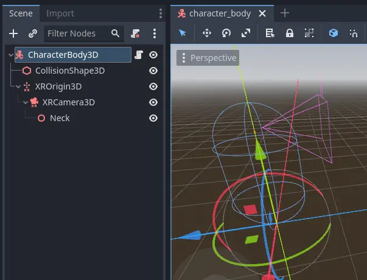
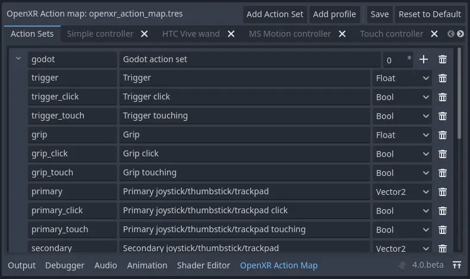
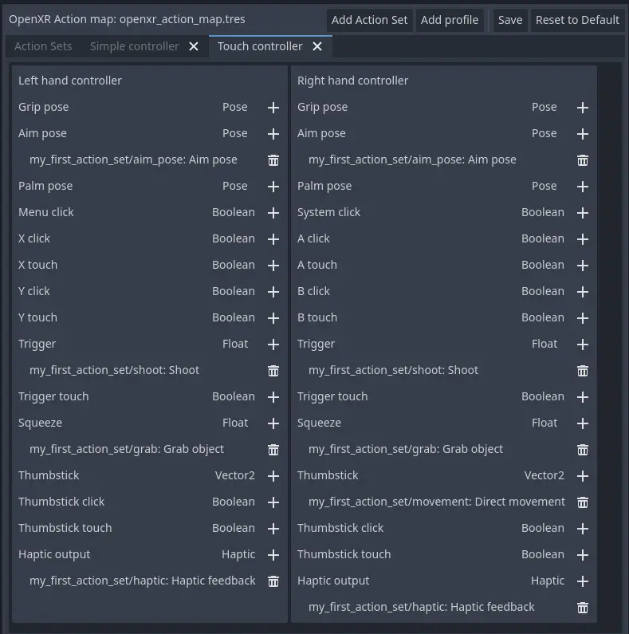
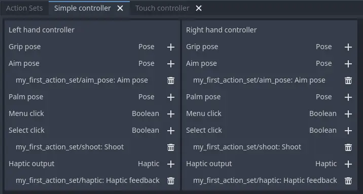

# Bewegen in VR

## Inleiding

In een klassiek firstpersongame is bewegen redelijk overzichtelijk. Je leest de toetsen of de controller uit, verplaatst het personage en laat de camera volgen. In VR komt daar iets bij: de speler kan ook gewoon een stap opzij zetten. Of zich omdraaien. Of bukken om onder een tafel te kijken. Die bewegingen gebeuren zonder dat er een knop wordt ingedrukt.

Dat lijkt misschien een klein verschil, maar het heeft grote gevolgen voor onze controller. We moeten rekening houden met een lichaam dat botst tegen de spelwereld en een hoofd dat door een echt persoon wordt bewogen. We kunnen dat echte hoofd niet tegenhouden wanneer het in de virtuele wereld een muur raakt.

We zullen daarom eerst uitzoeken wat Godot precies bijhoudt. Daarna laten we ons virtuele lichaam de fysieke speler volgen. Eens dat werkt, voegen we controllerbeweging, draaien en comfortinstellingen toe. Ten slotte bekijken we de hoogte van de speler, bukken en trappen.

Deze les werkt de drie video's van Bastiaan Olij uit: [fysieke beweging](https://youtu.be/v-jLvxlDSOY), [virtuele beweging](https://youtu.be/iz0tcT1cGBU) en [hoogtekalibratie en trappen](https://youtu.be/VfDuFoqTwkw). De verwijzingen naar tijdstippen volgen de hoofdstukken bij die video's. De API-uitleg en bijgevoegde voorbeelden richten zich op **Godot 4.5**. De videobroncode vermeldt Godot 4.4; de belangrijkste versiegevoelige shaderkeuze bespreken we verderop.

We gaan ervan uit dat je een werkende OpenXR-scène hebt: OpenXR is ingeschakeld, de interface is geïnitialiseerd en de viewport gebruikt XR. Dat opstartwerk behandelen we hier niet opnieuw. Raadpleeg indien nodig [Setting up XR](https://docs.godotengine.org/en/4.5/tutorials/xr/setting_up_xr.html). Voor de C#-voorbeelden heb je de .NET-uitgave van Godot nodig.

## Twee manieren om te bewegen

*Video 1, 0:00–1:55.*

Onze headset en controllers worden gevolgd door de XR-runtime. Godot verwerkt die informatie in een `XRCamera3D` en twee `XRController3D`-nodes. Deze nodes staan onder een `XROrigin3D`.

De origin stelt het referentiepunt van de trackingruimte voor. Dat is **niet noodzakelijk de plaats waar de speler staat**. Stel dat je bij het begin van de sessie in het midden van je kamer staat. Daarna zet je een meter naar rechts. De positie van de camera verandert ten opzichte van de origin, terwijl de origin zelf gewoon blijft staan.

Dat geeft ons twee verschillende opdrachten:

| Wat doet de speler? | Wat moet onze code doen? |
| --- | --- |
| Een echte stap zetten | Het botsende lichaam naar het hoofd laten volgen, zonder de trackingruimte extra te verplaatsen. |
| Fysiek ronddraaien | De horizontale oriëntatie van het lichaam aanpassen, zonder de trackingruimte mee te draaien. |
| De bewegingsstick gebruiken | Het lichaam én de trackingruimte verplaatsen. |
| De draaistick gebruiken | Het lichaam én de trackingruimte draaien rond de speler. |

Waarom is dat onderscheid nodig? Als we het lichaam een meter verplaatsen om de fysieke stap te volgen en daardoor ook de origin een meter opschuiven, krijgt de camera die beweging er nog eens bij. Je zet dan in werkelijkheid één stap, maar ziet twee stappen gebeuren. Dat voelt onmiddellijk verkeerd.

We moeten dus eerst bepalen **waar de beweging vandaan komt** en pas daarna de juiste nodes aanpassen.

## Onze scène voorbereiden

*Video 1, 1:55–3:25.*

Maak een `CharacterBody3D` voor het virtuele lichaam. Voeg een `CollisionShape3D` toe en gebruik voorlopig een `CapsuleShape3D`. Plaats de onderkant van de capsule op de vloer. Een capsule van 1,8 meter hoog staat bijvoorbeeld met haar middelpunt op `y = 0.9`.

Maak de `XROrigin3D` een kind van het lichaam. De camera en controllers blijven kinderen van de origin. Zo neemt controllerbeweging van het lichaam automatisch de volledige XR-opstelling mee.



*Screenshot uit de officiële Godot-documentatie. De extra `Neck`-node benadert het punt waar de nek aansluit op het lichaam. Ons vereenvoudigde voorbeeld gebruikt de horizontale positie van de camera zelf.*

Voor de uitgewerkte code bij deze les gebruiken we deze boom:

```text
Main (Node3D)
├── World (Node3D, met vloer en obstakels)
└── Player (CharacterBody3D)             ← VRPlayer-script
    ├── BodyCollisionShape (CollisionShape3D)
    ├── FloorRayCast (RayCast3D)         ← pas nodig bij trappen
    └── XROrigin3D
        ├── XRCamera3D
        │   ├── Fade (MeshInstance3D)
        │   └── Vignette (MeshInstance3D) ← RingMesh-script
        ├── LeftHand (XRController3D)
        └── RightHand (XRController3D)
```

Gebruik meters als eenheid en laat de schaal van het lichaam, de origin en hun bovenliggende nodes op `(1, 1, 1)` staan. Het lichaam blijft rechtop: we draaien het alleen rond de verticale as. De vloer en muren hebben echte physics-colliders nodig, bijvoorbeeld een `StaticBody3D` met een `CollisionShape3D`. Alleen een zichtbare mesh houdt de speler niet tegen.

Controleer ook de collision layers en masks. Het mask van het lichaam moet de laag van de vloer en de muren bevatten. Verderop gebruiken de hoofdquery en de vloerraycast hetzelfde mask.

Een transparante capsule kan handig zijn om te zien wat er gebeurt, maar is alleen een hulpmiddel voor de ontwikkelaar. Hetzelfde geldt voor de gekleurde assen in de video's. Die assenscène is terug te vinden als `objects/axis.tscn` in de [videobroncode](https://github.com/BastiaanOlij/godot4_tutorial/tree/first_person_controller_part3). Je hebt ze niet nodig om de controller te laten werken.

## Even stilstaan bij coördinaten

*Video 1, vanaf 3:25.*

We zullen veel posities en richtingen omrekenen. Voor we code schrijven, moeten we dus weten wat die waarden betekenen.

Een `Transform3D` bevat twee delen. De `origin` is de positie. De `basis` beschrijft de lokale assen, en daarmee de rotatie en eventuele schaal van een node. `transform` beschrijft dat alles ten opzichte van de parent. `global_transform` beschrijft het ten opzichte van de spelwereld.

Stel dat de origin drie meter rechts van het lichaam staat en de camera nog eens een halve meter rechts van de origin. In de ruimte van het lichaam staat de camera dan drieënhalve meter naar rechts. Bij rotaties kunnen we die posities niet zomaar optellen, maar de vermenigvuldiging van transforms rekent ook dat voor ons uit.

Als camera en origin rechtstreeks onder elkaar staan zoals in onze boom, krijgen we de cameratransform in de ruimte van het lichaam als volgt:

```gdscript
var camera_in_body: Transform3D = origin.transform * camera.transform
```

```csharp
Transform3D cameraInBody = Origin.Transform * Camera.Transform;
```

Lees die vermenigvuldiging van rechts naar links: eerst van camera naar origin, daarna van origin naar lichaam. Wil je alleen de positie, dan kan het ook met `to_local`:

```gdscript
var local_head: Vector3 = to_local(camera.global_position)
var world_head: Vector3 = to_global(local_head)
```

```csharp
Vector3 localHead = ToLocal(Camera.GlobalPosition);
Vector3 worldHead = ToGlobal(localHead);
```

Deze twee snippets horen in een script op het lichaam. Dat is belangrijk: `to_local` rekent om naar de ruimte van **de node waarop je de methode oproept**.

Een positie en een verplaatsingsvector zijn bovendien verschillende zaken. Een positie reken je om met een volledige transform. Een verplaatsingsvector heeft geen eigen vertrekpunt; daarvoor gebruik je alleen de basis. De inverse basis maakt de omgekeerde omzetting:

```gdscript
var movement_local: Vector3 = global_basis.inverse() * movement_world
```

```csharp
Vector3 movementLocal = GlobalBasis.Inverse() * movementWorld;
```

Dat beantwoordt meteen een vraag uit de bronnotities: `move_and_collide` verwacht een **verplaatsing in wereldcoördinaten**. `velocity` is ook een wereldvector, maar stelt een snelheid in meter per seconde voor. `move_and_slide()` gebruikt die snelheid en verwerkt de physics-tijdstap zelf. Vermenigvuldig `velocity` dus niet nog eens met `delta` wanneer je `move_and_slide()` oproept.

## Het lichaam laten volgen

*Video 1, 3:25–5:50.*

We weten nu waar het hoofd zich bevindt. Het lichaam hoort ongeveer onder dat hoofd te staan. Daarom nemen we de camerapositie in de lokale ruimte van het lichaam en zetten we de hoogte op nul. Daarna rekenen we die gewenste voetpositie om naar wereldcoördinaten.

We proberen het lichaam met `move_and_collide` naar dat punt te bewegen. We schrijven dus niet rechtstreeks de gewenste positie naar `global_position`, want dan zouden we botsingen overslaan.

```gdscript
# In een methode op CharacterBody3D; origin en camera verwijzen naar onze XR-nodes.
var local_head := to_local(camera.global_position)
local_head.y = 0.0
var target := to_global(local_head)
var original_position := global_position
move_and_collide(target - original_position)
var actual_movement := global_position - original_position
origin.global_position -= actual_movement
```

```csharp
// In een methode op CharacterBody3D.
Vector3 localHead = ToLocal(Camera.GlobalPosition);
localHead.Y = 0;
Vector3 target = ToGlobal(localHead);
Vector3 originalPosition = GlobalPosition;
MoveAndCollide(target - originalPosition);
Vector3 actualMovement = GlobalPosition - originalPosition;
Origin.GlobalPosition -= actualMovement;
```

De laatste regel is de kern van deze aanpak. Het lichaam verplaatst eerst zijn volledige onderliggende boom. Daarna bewegen we de origin in de tegengestelde richting terug. Zo blijft de trackingruimte op dezelfde wereldpositie staan.

Merk op dat we de **werkelijke** verplaatsing gebruiken. Stel dat het hoofd 30 centimeter verder staat, maar het lichaam na 10 centimeter een muur raakt. Dan bewegen we de origin 10 centimeter terug, geen 30. Het lichaam blijft bij de muur en er ontstaat een verschil tussen de positie van het lichaam en die van het hoofd. Dat verschil hebben we verderop nodig.

De video rekent de werkelijke verplaatsing eerst met `global_basis.inverse()` om naar lokale coördinaten en trekt die dan van `origin.position` af. Hier passen we de tegenbeweging rechtstreeks in wereldcoördinaten toe. Onder onze aannames leveren beide manieren hetzelfde resultaat. Meng de twee niet: een wereldvector aftrekken van een lokale positie gaat fout zodra de parent gedraaid is.

Probeer dit eerst uit zonder obstakels. Zet een kleine stap naar links en kijk via een spectatorcamera naar de capsule. Het lichaam moet je volgen, maar de spelwereld mag niet een tweede keer opschuiven. Zet daarna een muur in de scène en herhaal de proef. De capsule moet tegen de muur stoppen.

## Het lichaam dezelfde kant laten uitkijken

*Video 1, 5:50–7:05.*

Bij fysieke rotatie geldt hetzelfde principe. We willen dat het lichaam de horizontale kijkrichting volgt. We willen niet dat het kantelt wanneer je naar de grond kijkt of je hoofd schuin houdt.

Godots gebruikelijke voorwaartse richting is de negatieve Z-as. We halen daarom `-camera.global_basis.z` op en maken de Y-component nul. Zo projecteren we de kijkrichting op het horizontale vlak. Daarna bouwen we met `Basis.looking_at` een rechtopstaande oriëntatie.

```gdscript
var saved_origin := origin.global_transform
var forward := -camera.global_basis.z
forward.y = 0.0
if forward.length_squared() > 0.000001:
    global_basis = Basis.looking_at(forward.normalized(), Vector3.UP)
origin.global_transform = saved_origin
```

```csharp
Transform3D savedOrigin = Origin.GlobalTransform;
Vector3 forward = -Camera.GlobalBasis.Z;
forward.Y = 0;
if (forward.LengthSquared() > 0.000001f)
    GlobalBasis = Basis.LookingAt(forward.Normalized(), Vector3.Up);
Origin.GlobalTransform = savedOrigin;
```

Opnieuw maken we de invloed op de origin ongedaan. Nu bewaren we daarvoor de volledige wereldtransform. Dat is een handige manier om zowel positie als rotatie te behouden. In de volledige voorbeeldcode bewaren we die transform vóór het volgen van de fysieke beweging en herstellen we hem na het aanpassen van de lichaamrotatie. Neem dus de volledige methode over, in plaats van beide losse voorbeelden na elkaar te plakken.

Waarom staat er een controle op de lengte? Als je bijna recht omhoog of omlaag kijkt, wordt de horizontale projectie bijna nul. Uit zo'n vector kunnen we geen betrouwbare kijkrichting afleiden. We behouden dan de vorige lichaamsoriëntatie.

De video gebruikt de positieve Z-as met `looking_at(..., Vector3.UP, true)`. Die laatste `true` laat de positieve Z-as naar het doel wijzen. Ons voorbeeld gebruikt de negatieve Z-as met de standaardinstelling. Beide afspraken zijn bruikbaar, zolang je het teken en de parameter samen kiest.

## Configuratiefouten zichtbaar maken

*Video 1, vanaf 3:25.*

In de video staat de code voor fysieke beweging op de `XROrigin3D`. Die verwacht een `CharacterBody3D` als parent en een `XRCamera3D` als kind. Je kan zulke voorwaarden zichtbaar maken in de editor met een toolscript en configuratiewaarschuwingen.

Dit kleine voorbeeld hoort op een `XROrigin3D`, los van de volledige `VRPlayer`-implementatie:

```gdscript
@tool
extends XROrigin3D

func _get_configuration_warnings() -> PackedStringArray:
    var warnings := PackedStringArray()
    if not get_parent() is CharacterBody3D:
        warnings.append("Plaats deze origin onder een CharacterBody3D.")
    if not get_node_or_null("XRCamera3D") is XRCamera3D:
        warnings.append("Voeg een XRCamera3D met die naam toe als kind.")
    return warnings
```

```csharp
using Godot;
using System.Collections.Generic;

[Tool]
public partial class XRRigValidation : XROrigin3D
{
    public override string[] _GetConfigurationWarnings()
    {
        var warnings = new List<string>();
        if (GetParent() is not CharacterBody3D)
            warnings.Add("Plaats deze origin onder een CharacterBody3D.");
        if (GetNodeOrNull<XRCamera3D>("XRCamera3D") == null)
            warnings.Add("Voeg een XRCamera3D met die naam toe als kind.");
        return warnings.ToArray();
    }
}
```

`PackedStringArray` is een compact opgeslagen reeks strings. Godot verwacht hier één waarschuwing per element. In de C#-API is de overeenkomstige returnwaarde een `string[]`.

Een toolscript draait ook in de editor. Als je er physicscode aan toevoegt, moet je die daar tegenhouden met `if Engine.is_editor_hint(): return`, of `if (Engine.IsEditorHint()) return;` in C#. Waarschuwingen kan je opnieuw laten berekenen met `update_configuration_warnings()` / `UpdateConfigurationWarnings()` wanneer relevante instellingen wijzigen.

## Wat als de speler door een muur stapt?

*Video 1, 7:05–12:00.*

Ons lichaam botst nu correct, maar onze echte speler kan blijven wandelen. De runtime blijft de werkelijke hoofdpositie doorgeven. Daardoor kan de camera achter de virtuele muur belanden.

We zouden de camera kunnen terugduwen door de origin aan te passen. Maar dan klopt wat de speler ziet niet meer met de fysieke hoofdbeweging. Dat kan erg onaangenaam worden. Daarom laten we de tracking intact en maken we het beeld geleidelijk zwart wanneer hoofd en lichaam te ver uit elkaar raken.

Meet daarvoor de horizontale afstand tussen de gewenste voetpositie onder het hoofd en de werkelijke positie van het lichaam. We gebruiken twee afstanden: vanaf `fade_start` begint het beeld te verdwijnen; na nog eens `fade_distance` is het volledig zwart.

```gdscript
var fade := clampf((distance - fade_start) / fade_distance, 0.0, 1.0)
```

```csharp
float fade = Mathf.Clamp((distance - FadeStart) / FadeDistance, 0.0f, 1.0f);
```

Met `fade_start = 0.2` en `fade_distance = 0.2` is er bij 20 centimeter nog geen verduistering, bij 30 centimeter ongeveer de helft en bij 40 centimeter volledige verduistering. Dat zijn startwaarden voor een proef, geen universele comfortinstellingen. `fade_distance` moet positief zijn; de volledige code beveiligt de deler ook tegen nul.

### Een zwart vlak voor beide ogen

Maak onder de camera een `MeshInstance3D` met een `PlaneMesh`. Stel de afmetingen in op 2 bij 2 en kies **Face Z** voor de oriëntatie. Plaats de mesh bijvoorbeeld op `z = -0.5`. Geef hem een `ShaderMaterial` met deze spatial shader:

```glsl
shader_type spatial;
render_mode depth_test_disabled, unshaded, cull_disabled, fog_disabled;
uniform float alpha : hint_range(0.0, 1.0) = 0.0;

void vertex() {
    POSITION = vec4(VERTEX.xy, 1.0, 1.0);
}

void fragment() {
    ALBEDO = vec3(0.0);
    ALPHA = alpha;
}
```

Deze shader is dezelfde voor GDScript en C#. De programmeertaal van je gameplaycode verandert de shader niet.

`POSITION` bevat hier een positie in clipruimte. Onze hoekpunten lopen op X en Y van -1 tot 1 en bedekken daarmee het beeld. De W-component is 1, zodat de perspectiefdeling de X- en Y-waarden niet meer verandert. De Z-component is 1 omdat **Godot sinds 4.3 reverse Z gebruikt**: de nabije kant van de depthbuffer heeft waarde 1. Oude fullscreenshaders die gewoon `vec4(VERTEX, 1.0)` schrijven, moet je dus niet zomaar overnemen.

De render modes betekenen het volgende:

| Instelling | Waarom gebruiken we die? |
| --- | --- |
| `depth_test_disabled` | Een muur mag het verduisteringsvlak niet verbergen. |
| `unshaded` | De kleur wordt niet door lampen bepaald. |
| `cull_disabled` | De mesh verdwijnt niet door de richting van zijn driehoeken. |
| `fog_disabled` | Mist verandert ons zwart niet. |

In de video staat ook `skip_vertex_transform`. Dat slaat de automatische model/view-omrekening van `VERTEX` over. Omdat ons voorbeeld rechtstreeks `POSITION` schrijft, hebben we die automatische positieomrekening hier al omzeild.

Zet de **Render Priority** van het fademateriaal op 127, en die van de vignette die we later maken op 120. Zo wordt de fade na de vignette getekend. Markeer de materialen als **Local to Scene** of dupliceer ze per speler, anders kan het aanpassen van één material alle gebruikers van dezelfde resource veranderen. De bijgeleverde code dupliceert de materialen bij het opstarten.

CPU-culling houdt geen rekening met de verplaatsing in de vertexshader. Omdat de mesh onder de camera staat, blijft zijn gewone bounding box normaal in beeld. Vergroot indien nodig **Extra Cull Margin**. Controleer ook dat de camera de visual layer van de effecten rendert en dat een spectatorcamera ze eventueel uitsluit.

We stellen de alpha vanuit code in en verbergen de mesh volledig als de fade nul is:

```gdscript
fade_material.set_shader_parameter("alpha", fade)
fade_mesh.visible = fade > 0.0
```

```csharp
fadeMaterial.SetShaderParameter("alpha", fade);
FadeMesh.Visible = fade > 0.0f;
```

## Controllerinput via OpenXR

*Video 2, 1:10–4:05.*

Nu we fysieke beweging begrijpen, kunnen we de sticks gebruiken. Daarvoor werken we met de **OpenXR action map**. Die is een afspraak tussen onze applicatie en de runtime: welke acties hebben we nodig, en welk soort waarde levert elke actie op?

We vragen bijvoorbeeld geen "as 2 van controllermerk X" op. We vragen de actie `movement`, die een `Vector2` oplevert. In een interaction profile leggen we vast welke fysieke stick die actie aanstuurt.



*Het tabblad voor de action map. De actie bepaalt de betekenis en het datatype; een binding koppelt die aan een invoer op een bepaald controllertype. De officiële documentatie gebruikt hier een screenshot van een oudere editorversie; de vormgeving kan in 4.5 verschillen.*

Voor deze les gebruiken we een `Vector2`-actie met naam `movement`, beschikbaar voor beide handen. Bind die aan de thumbstick van elke ondersteunde controller. Stel de tracker van `LeftHand` in op `left_hand` en die van `RightHand` op `right_hand`. In ons voorbeeld gebruiken we rechts voor lopen en links voor draaien, zoals in de broncode van de video's. Je kan die keuze omwisselen door de geëxporteerde referenties te wijzigen.



*De officiële documentatie toont een voorbeeldbinding. Controleer voor onze cursus dat `movement` voor beide handen aan de gewenste stick is gekoppeld; neem deze screenshot niet over als volledige configuratie voor ons project.*

Er is ook een generiek **Simple Controller**-profiel. Dat is nuttig als terugval voor eenvoudige interacties, maar bevat geen thumbstick. Het kan dus niet zomaar onze stickbesturing vervangen.



*Een ondersteund profiel betekent niet dat alle acties beschikbaar zijn. Voor hardware zonder stick heb je een alternatief nodig, bijvoorbeeld teleporteren.*

De video raadt aan ondersteunde hardware echt te testen. Neem niet aan dat de runtime een onbekend profiel precies zal omzetten zoals jij verwacht. Action sets en bindings worden bij de sessieopbouw aangeboden. Voor instellingen zoals een andere bewegingshand kan je vervolgens in je eigen code kiezen welke controllerreferentie je gebruikt. Dat is iets anders dan tijdens een lopende sessie de hele action map heropbouwen.

## Virtueel lopen

*Video 2, 4:05–10:24.*

We kunnen de waarde nu ophalen via `get_vector2("movement")`. In C# heet dat `GetVector2("movement")`. Een stick naar voren heeft hier een positieve Y-waarde. Godots voorwaartse richting is negatieve Z. Daarom keren we die component om wanneer we er een bewegingsvector van maken.

Dit is de kern van de bewegingsmethode op ons lichaam. `max_speed.x` bepaalt de zijwaartse snelheid en `max_speed.y` de voorwaartse snelheid:

```gdscript
var stick := movement_controller.get_vector2("movement").limit_length()
var target := global_basis * Vector3(stick.x * max_speed.x, 0.0, -stick.y * max_speed.y)
var weight := 1.0 - exp(-acceleration * delta)
velocity.x = lerpf(velocity.x, target.x, weight)
velocity.z = lerpf(velocity.z, target.z, weight)
velocity += get_gravity() * delta
move_and_slide()
```

```csharp
Vector2 stick = MovementController.GetVector2("movement").LimitLength();
Vector3 target = GlobalBasis * new Vector3(stick.X * MaxSpeed.X, 0, -stick.Y * MaxSpeed.Y);
float weight = 1.0f - Mathf.Exp(-Acceleration * (float)delta);
Vector3 v = Velocity;
v.X = Mathf.Lerp(v.X, target.X, weight);
v.Z = Mathf.Lerp(v.Z, target.Z, weight);
Velocity = v + GetGravity() * (float)delta;
MoveAndSlide();
```

Gebruik deze snippets als uitleg van de berekening. In de volledige controller staan zwaartekracht en `move_and_slide()` op één centrale plaats; voeg ze daar dus niet nog een tweede keer toe.

`global_basis` draait de lokale bewegingsrichting naar wereldruimte. Aangezien het lichaam de horizontale kijkrichting volgt, lopen we vooruit in de richting waarin het hoofd kijkt. Naar beneden kijken laat ons niet de grond in bewegen, want het lichaam zelf heeft alleen een horizontale rotatie.

`limit_length()` voorkomt dat een te grote diagonale input extra snelheid oplevert. De interpolatie laat de horizontale snelheid geleidelijk naar het doel gaan. De factor `1 - exp(-acceleration * delta)` blijft tussen 0 en 1 voor een positieve versnelling. Dat vermijdt het doorschieten dat je bij een onbegrensde `delta * lerp_factor` kan krijgen. De verticale snelheid blijft behouden, zodat zwaartekracht kan blijven werken.

In de video wordt de snelheid eerst met `project()` opgesplitst in een voorwaarts, zijwaarts en verticaal deel. Dat zijn **nog steeds wereldvectoren**. De projectie berekent alleen welk deel van de wereldsnelheid langs een gekozen as ligt. Pas een vermenigvuldiging met de inverse basis zou de vector in lokale componenten uitdrukken.

### Waarom gebruikt de video aparte functies?

Vanaf 6:20 krijgt de controller een `DirectMovementFunction` onder de bewegingscontroller en een `TurnFunction` onder de draaicontroller. Beide zoeken via hun ancestors naar een `XRController3D` en een `CharacterBody3D`. Zo blijft de functie bruikbaar als er een extra hulpknoop tussen komt.

Dat is een nuttige opdeling wanneer je later teleportatie, klimmen of andere bewegingsvormen wil toevoegen. Je moet wel de uitvoervolgorde afspreken. Een functie die pas na `move_and_slide()` de snelheid instelt, beïnvloedt anders pas de volgende tick.

In de volledige cursusvoorbeelden gebruiken we daarom één physicslus op `VRPlayer`, met aparte methoden voor elk onderdeel. Dat is een didactische aanpassing van de video-opbouw. De volgorde staat zichtbaar op één plaats: vorm aanpassen, fysieke beweging volgen, botsingen controleren, controllerinput toepassen, zwaartekracht en vloerondersteuning berekenen, en ten slotte bewegen.

## Draaien met de stick

*Video 2, 10:24–14:50.*

Vloeiend draaien is op zich eenvoudig: neem de horizontale stickwaarde en vermenigvuldig die met een hoeksnelheid en `delta`. Godot verwacht hoeken in radialen.

```gdscript
var input := -turn_controller.get_vector2("movement").x
var angle := input * deg_to_rad(turn_speed_degrees) * delta
```

```csharp
float input = -TurnController.GetVector2("movement").X;
float angle = input * Mathf.DegToRad(TurnSpeedDegrees) * (float)delta;
```

Het minteken laat rechts op de stick overeenkomen met rechts draaien rond Godots Y-as. In de video gebruikt de Inspector de hint `radians_as_degrees`: de gebruiker ziet graden, terwijl de opgeslagen waarde radialen is. Onze voorbeelden houden de geëxporteerde waarde expliciet in graden en rekenen ze pas om bij gebruik.

Het draaipunt is belangrijk. Als het lichaam niet goed onder het hoofd staat, kan een rotatie rond de oorspronkelijke origin de speler in een cirkel door de wereld verplaatsen. Dat is precies een van de problemen die onze fysieke volglogica oplost. De volledige voorbeeldcode draait bovendien expliciet rond het punt onder het hoofd. Anders dan bij fysieke rotatie maken we deze draai **niet** ongedaan op de origin: de speler vraagt nu juist een virtuele rotatie aan.

### Snap turning

Vloeiende rotatie is niet voor iedereen aangenaam. Bij snap turning verandert de kijkrichting met kleine sprongen, bijvoorbeeld 30 graden. De fysieke rotatie van het hoofd blijft wel vloeiend gevolgd worden.

De video spaart kleine draaistappen op tot een ingestelde hoek is bereikt. Dan wordt de draai toegepast. Ons voorbeeld gebruikt datzelfde idee, maar bewaart het overschot en past een exact vaste stap toe:

```gdscript
turn_accumulator += angle
var step := deg_to_rad(snap_degrees)
if absf(turn_accumulator) >= step:
    var snap := signf(turn_accumulator) * step
    rotate_y(snap)
    turn_accumulator -= snap
```

```csharp
turnAccumulator += angle;
float step = Mathf.DegToRad(SnapDegrees);
if (Mathf.Abs(turnAccumulator) >= step)
{
    float snap = Mathf.Sign(turnAccumulator) * step;
    RotateY(snap);
    turnAccumulator -= snap;
}
```

Dit rekenvoorbeeld veronderstelt dat het lichaam al onder het hoofd staat; de volledige code gebruikt de expliciete draaipuntberekening. Voer deze snaplogica alleen uit als `snap_degrees > 0`. Bij nul gebruiken we vloeiend draaien. Bij een stickwaarde dicht bij nul resetten we de accumulator, zodat kleine restjes niet later onverwacht een draai opleveren.

Dit is een variant die blijft herhalen zolang je de stick vasthoudt. Een andere veelgebruikte variant doet precies één draai per stickuitslag en wacht dan tot de stick terug in de neutrale stand staat. Dat is een goede uitbreiding voor de labo-oefening.

## De blik beperken met een vignette

*Video 2, 14:50–22:55.*

Een tweede comfortoptie is een vignette: een donkere rand die het zicht tijdelijk smaller maakt tijdens virtuele beweging. Ze vervangt snap turning niet. Laat de speler zelf kiezen welke combinatie aangenaam is.

De video bouwt de vignette als een ring. Die ring heeft een binnenste en een buitenste reeks hoekpunten. Tussen telkens twee opeenvolgende paren tekenen we twee driehoeken. Met 32 segmenten levert dat 64 vertices en 192 indices op. Het laatste segment sluit met modulo terug aan op het eerste.

De volledige opbouw staat in [ring_mesh.gd](code/gdscript/ring_mesh.gd) en [RingMesh.cs](code/csharp/RingMesh.cs). Koppel één van die scripts aan de `Vignette`-mesh. De laatste stap in beide scripts is:

```gdscript
var arrays := []
arrays.resize(Mesh.ARRAY_MAX)
arrays[Mesh.ARRAY_VERTEX] = vertices
arrays[Mesh.ARRAY_INDEX] = indices
var ring := ArrayMesh.new()
ring.add_surface_from_arrays(Mesh.PRIMITIVE_TRIANGLES, arrays)
mesh = ring
```

```csharp
var arrays = new Godot.Collections.Array();
arrays.Resize((int)Godot.Mesh.ArrayType.Max);
arrays[(int)Godot.Mesh.ArrayType.Vertex] = vertices;
arrays[(int)Godot.Mesh.ArrayType.Index] = indices;
var ring = new ArrayMesh();
ring.AddSurfaceFromArrays(Godot.Mesh.PrimitiveType.Triangles, arrays);
Mesh = ring;
```

Waarom moet die array precies `ARRAY_MAX` groot zijn? Godot verwacht vaste plaatsen voor verschillende vertexgegevens: posities, normalen, UV-coördinaten, indices enzovoort. `ARRAY_MAX` is het aantal van die plaatsen. Het is dus niet het aantal vertices. We vullen alleen de plaatsen die onze ring nodig heeft; de andere blijven leeg.

### De ring voor elk oog projecteren

Geef de vignette een `ShaderMaterial` met [vignette.gdshader](code/shaders/vignette.gdshader). Plaats de mesh, net zoals de fade, op `z = -0.5` onder de camera.

De vertexshader herkent de binnenste vertices aan hun afstand tot het middelpunt. Hun oorspronkelijke afstand is 1; die van de buitenste is 2. Een grens van 1,5 maakt het onderscheid. We verschuiven de binnenrand volgens de gewenste radius en geven de afstand via een `varying` door aan de fragmentshader.

We mogen hierbij niet aannemen dat het midden van het linkeroog en het midden van het rechteroog exact dezelfde projectie hebben. De shader gebruikt daarom de `PROJECTION_MATRIX` van het oog dat op dat moment wordt gerenderd:

```glsl
vec4 eye = PROJECTION_MATRIX * vec4(0.0, 0.0, -100.0, 1.0);
v += eye.xy / eye.w;
```

We projecteren een punt ver vooruit op de kijkas. Na de perspectiefdeling krijgen we de verschuiving van het midden voor dat oog. In de volledige shader volgt daarna `POSITION = vec4(v, 1.0, 1.0)`, opnieuw voor de reverse-Z-conventie van Godot 4.5. Het is dus geen gewone ring die op een halve meter van je ogen in de wereld hangt: de shader plaatst hem rechtstreeks in clipruimte.

De fragmentshader laat de binnenrand transparant beginnen en maakt de ring naar buiten toe zwart:

```glsl
ALPHA = color.a * clamp((dist - radius) / max(fade, 0.001), 0.0, 1.0);
```

Deze `fade` bepaalt de breedte van de zachte rand, niet de verduistering bij een muur. Gebruik bijvoorbeeld 0,05 als startwaarde. Hoe groter de waarde, hoe breder de overgang.

Vanuit de controller sturen we de zichtbare opening aan:

```gdscript
var radius := 1.0 - absf(turn_input) * vignette_strength
vignette_material.set_shader_parameter("radius", radius * sqrt(2.0))
vignette_mesh.visible = radius < 1.0
```

```csharp
float radius = 1.0f - Mathf.Abs(turnInput) * VignetteStrength;
vignetteMaterial.SetShaderParameter("radius", radius * Mathf.Sqrt(2.0f));
VignetteMesh.Visible = radius < 1.0f;
```

Waar komt die `sqrt(2)` vandaan? In het clipvierkant ligt een hoek op `(1, 1)`. De afstand van die hoek tot het midden is volgens Pythagoras `sqrt(1² + 1²)`. Een cirkel met die straal omvat dus het hele vierkant. Dat verklaart de schaalfactor in de video. De extra verschuiving per oog en lensvervorming maken dit geen universele geometrische garantie voor elke headset. Daarom verbergen we de mesh expliciet wanneer de ingestelde radius 1 is en testen we de rand op de doelhardware.

Wil je de vignette tijdens het bewerken al zien veranderen, dan kan je geëxporteerde properties met setters gebruiken. Laat een setter alleen de mesh opvragen als die bestaat of de node klaar is. De volledige ringgenerator is al een toolscript; de runtimecontroller zelf hoeft dat niet te zijn.

## Het hoofd afzonderlijk controleren

*Video 2, 22:55–25:30.*

De afstand tussen lichaam en hoofd vertelt ons niet alles. Je kan boven een tafel leunen zonder dat het lichaam beweegt. Je kan ook je hoofd door een dunne muur steken terwijl de capsule nog op een geldige plaats staat.

De video lost dit op met een bol ter grootte van het hoofd en een physicsquery. Een `PhysicsShapeQueryParameters3D` beschrijft de vorm, haar transform, haar beweging en de collision-instellingen. We maken die query één keer aan en passen de waarden aan wanneer we haar gebruiken.

```gdscript
var sphere := SphereShape3D.new()
sphere.radius = 0.15
var query := PhysicsShapeQueryParameters3D.new()
query.shape = sphere
query.collision_mask = collision_mask
query.exclude = [get_rid()]
```

```csharp
var query = new PhysicsShapeQueryParameters3D
{
    Shape = new SphereShape3D { Radius = 0.15f },
    CollisionMask = CollisionMask,
    Exclude = new Godot.Collections.Array<Rid> { GetRid() }
};
```

Een `RID` is een interne resource-identificatie voor Godots servers. Met het RID van het lichaam sluiten we onszelf uit. Zonder die uitsluiting zou onze hoofdbol waarschijnlijk het eigen lichaam als obstakel vinden.

Een query op alleen de eindpositie is niet voldoende. Stel dat het hoofd volledig door een dunne muur heen gaat en aan de andere kant weer vrij staat. Op de eindpositie is er dan geen overlap meer. Daarom gebruikt de video `cast_motion`: die test het hele pad van de bol vanaf een verwachte hoofdpositie boven het lichaam tot aan de echte camera.

```gdscript
var state := get_world_3d().direct_space_state
query.transform = Transform3D(Basis.IDENTITY, start)
query.motion = camera.global_position - start
var fractions := state.cast_motion(query)
var blocked := not fractions.is_empty() and fractions[0] < 1.0
```

```csharp
var state = GetWorld3D().DirectSpaceState;
query.Transform = new Transform3D(Basis.Identity, start);
query.Motion = Camera.GlobalPosition - start;
float[] fractions = state.CastMotion(query);
bool blocked = fractions.Length > 0 && fractions[0] < 1.0f;
```

Deze query hoort in de physicslus. De eerste fractie is het veilige deel van de gewenste verplaatsing. Een waarde onder 1 betekent dat de volledige verplaatsing niet vrij is. In onze volledige code ligt `start` recht boven het lichaam, op dezelfde hoogte als de camera. De video gebruikt daarvoor een ingestelde hoofdhoogte.

De API vermeldt ook een belangrijk detail: `cast_motion` negeert vormen waarmee de queryvorm aan het begin al overlapt. Daarom controleert de volledige cursuscode met `intersect_shape` ook het begin- en eindpunt. Zodra het hoofd geblokkeerd is, zetten we de fade volledig op zwart en onderbreken we controllerbeweging. Zwaartekracht blijft wel actief.

Is een extra `CollisionShape3D` op het lichaam dan een eenvoudiger oplossing? Die kan helpen om een lichaamsmodel nauwkeuriger te maken, maar houdt de door tracking gestuurde camera niet vanzelf tegen. Een `Area3D` kan overlaps signaleren, maar test ook niet automatisch het volledige pad door een dunne muur. We hebben dus nog steeds detectie en een bewuste visuele reactie nodig. We laten de camera de fysieke beweging volgen.

## De lengte kalibreren

*Video 3, 0:35–5:23.*

Tot nu toe gingen we ervan uit dat de gemeten hoofdhoogte ook de gewenste hoogte in de spelwereld is. Voor een staande speler kan dat prima zijn. Maar als je zittend speelt, kan je personage veel kleiner lijken dan bedoeld.

Kalibreren betekent hier dat we een **vaste verticale offset** kiezen. Stel dat de runtime een hoofdhoogte van 1,15 meter meet en we in de game 1,60 meter willen. Dan plaatsen we de origin 45 centimeter hoger.

```gdscript
height_offset = target_head_height - tracked_head_height
origin.position.y = height_offset
```

```csharp
float heightOffset = TargetHeadHeight - trackedHeadHeight;
Origin.Position = Origin.Position with { Y = heightOffset };
```

Gebruik een trackingruimte waarvan je de hoogteconventie kent, bijvoorbeeld een floor-relative referentieruimte. Een hoogte gemeten vanaf een onbekend referentiepunt is geen betrouwbare vloerhoogte. We verschalen de wereld hier niet: de afstand tussen de handen en het hoofd blijft dezelfde.

Kalibreer bovendien niet door elke tick de actuele hoogte naar 1,60 meter te corrigeren. Als de speler daarna bukt, zou die correctie het bukken meteen ongedaan maken. We meten één keer wanneer de speler klaar is en behouden daarna de offset.

De volledige voorbeelden halen de pose op bij de `head`-tracker, controleren `has_tracking_data` en gebruiken `get_adjusted_transform()`. Zo meten we de trackinghoogte zonder onze eigen origin-offset opnieuw mee te tellen. Herhaald kalibreren mag de speler immers niet elke keer wat hoger of lager zetten.

### Wanneer is de speler klaar?

`_ready()` betekent dat onze nodes klaar zijn, niet dat de speler de headset al goed draagt. De video probeert daarom ook te kalibreren bij `OpenXRInterface.session_visible` en nog eens bij `pose_recentered`.

`session_visible` betekent dat de applicatie zichtbaar is, maar nog niet noodzakelijk XR-input ontvangt. `session_focussed` geeft aan dat ook die interactie beschikbaar is. Geen van beide signalen bewijst dat de speler rechtop of in de gewenste zithouding klaarzit.

Een bruikbare oplossing is daarom een ruime startomgeving met een knop "Ik ben klaar". Laat die knop de kalibratiemethode oproepen. In onze voorbeelden heet die `calibrate_height()` / `CalibrateHeight()`. Geeft ze `false` terug, dan is er nog geen bruikbare hoofdpose en laat je de speler later opnieuw proberen. De voorbeelden koppelen ook `pose_recentered` aan een uitgestelde herkalibratie. Geef de speler daarnaast een handmatige mogelijkheid om opnieuw te kalibreren.

```gdscript
var xr := XRServer.find_interface("OpenXR") as OpenXRInterface
if xr:
    xr.pose_recentered.connect(_on_pose_recentered)

# Elders in hetzelfde script:
func _on_pose_recentered() -> void:
    call_deferred("calibrate_height")
```

```csharp
// Bijvoorbeeld in _Ready():
if (XRServer.FindInterface("OpenXR") is OpenXRInterface xr)
    xr.PoseRecentered += OnPoseRecentered;

// Methode op dezelfde klasse:
private void OnPoseRecentered() => Callable.From(() => { CalibrateHeight(); }).CallDeferred();
```

De snippets tonen alleen de koppeling. In de volledige C#-klasse wordt het signaal ook weer losgekoppeld bij het verlaten van de scene tree. Wil je fysieke lengte behouden in plaats van een vaste avatarhoogte op te leggen, dan schakel je deze correctie uit. Dat is een productkeuze die je aan de speler kan aanbieden.

## Bukken en de collision shape

*Video 3, 5:23–7:22.*

Als de camera omlaag gaat, moet de collider mee veranderen. Anders kan de speler wel onder een tafel kijken, maar niet onder die tafel doorlopen.

Neem de camerahoogte in de lokale ruimte van het lichaam en tel er een kleine marge boven het oogpunt bij. Dat is de gewenste bovenkant van onze capsule. Voor de eerste versie loopt de capsule van de voeten tot die bovenkant:

```gdscript
var top := maxf(to_local(camera.global_position).y + head_margin, 2.0 * body_radius)
capsule.height = top
body_collision.position.y = top * 0.5
```

```csharp
float top = Mathf.Max(ToLocal(Camera.GlobalPosition).Y + HeadMargin, 2.0f * BodyRadius);
capsule.Height = top;
BodyCollision.Position = BodyCollision.Position with { Y = top * 0.5f };
```

Een capsule kan niet lager zijn dan twee keer haar radius. Daarom staat er een ondergrens op de hoogte. Dupliceer ook de `CapsuleShape3D` per speler: shapes zijn resources en kunnen gedeeld worden. Anders kan het bukken van één personage alle instanties van dezelfde shape veranderen.

Fysiek rechtstaan onder een laag plafond blijft een bijzonder geval. De camera wordt door tracking omhoog gebracht, ook wanneer de collider daar eigenlijk niet past. Onze hoofdquery en fade blijven daarom nodig. Voor een uitgebreider personagesysteem kan je eerst testen hoeveel ruimte er is om de capsule te laten groeien; de hoofdtracking zelf blijf je respecteren.

## Waarom lopen we nog niet goed een trap op?

*Video 3, 7:22–12:59.*

Dit was het ontbrekende stuk in de aangeleverde notities. Een `CharacterBody3D` met een capsule over de volledige lichaamslengte botst tegen de voorkant van een trede. `move_and_slide()` schuift langs botsingsvlakken, maar is geen automatische stap-op-de-trapfunctie. Ook `floor_snap_length` is vooral bedoeld om contact met de vloer te behouden; het tilt ons niet vanzelf over elke verticale rand.

De video verandert daarom de voorstelling van het lichaam. De capsule stelt voortaan alleen het **bovenlichaam** voor. Voor de benen en de ondersteuning op de vloer gebruiken we een raycast.

### Een kortere capsule

*Video 3, 7:48–9:15.*

Kies bijvoorbeeld een bovenlichaamshoogte van 1 meter en een radius van 30 centimeter. We blijven de bovenkant aan het hoofd koppelen, maar de onderkant ligt nu hoger dan de voeten:

```gdscript
body_collision.position.y = top - upper_body_height * 0.5
capsule.height = upper_body_height
```

```csharp
BodyCollision.Position = BodyCollision.Position with { Y = top - UpperBodyHeight * 0.5f };
capsule.Height = UpperBodyHeight;
```

De volledige code bewaakt ook hier de minimumhoogte van de capsule. Bij normale hoofdhoogte heeft de collider nu ruimte boven een lage trede. Wanneer de speler bukt, zakt de bovenlichaamscapsule mee. Heel laag bukken en tegelijk trappen lopen vraagt verdere afstemming van de lichaamsvorm; deze eenvoudige benadering heeft geen echt benenmodel.

### Een raycast naar de vloer

*Video 3, 9:15–9:48.*

Zet een `RayCast3D` onder het lichaam. Het beginpunt ligt bij de onderkant van de bovenlichaamscapsule. Richt de straal neerwaarts tot aan de verwachte voetpositie. In het cursusvoorbeeld laten we hem nog 10 centimeter verder reiken, zodat we ook een klein hoogteverschil omlaag kunnen detecteren.

Sluit het eigen lichaam uit en gebruik hetzelfde collision mask als het lichaam. Een gevonden botsingspunt staat in wereldcoördinaten; met `to_local` rekenen we de hoogte om naar de ruimte van het lichaam.

Denk even na over het teken. Als het raakpunt lokaal op `y = 0.15` ligt, staat de gevonden vloer 15 centimeter boven onze huidige voetpositie. We moeten het lichaam omhoog helpen. Ligt het raakpunt onder nul, dan moeten we zakken. Bij een afgrond zonder raakpunt laten we de ondersteuning los en blijft de zwaartekracht over.

### De hoogte rustig bijregelen met PID

*Video 3, 9:48–12:30.*

We zouden het lichaam onmiddellijk op het raakpunt kunnen zetten, maar dan springt de wereld plots omhoog bij elke trede. De video gebruikt daarom een PID-regelaar om een correctie op de verticale snelheid te berekenen.

Die naam klinkt ingewikkelder dan het basisidee. We bekijken drie zaken: hoe groot de fout nu is, hoe lang er al een fout bestaat en hoe snel de gemeten waarde verandert.

| Term | Berekening in deze les | Wat draagt die bij? |
| --- | --- | --- |
| P, proportioneel | `kp * error` | Een grotere hoogtefout geeft een grotere onmiddellijke correctie. |
| I, integraal | `ki * som(error * delta)` | Een aanhoudende fout bouwt extra correctie op, bijvoorbeeld om zwaartekracht tegen te werken. |
| D, afgeleide | `kd * (value - last_value) / delta` | Verwerkt hoe snel de gemeten vloerhoogte verandert en kan de regeling dempen. |

In deze formulering is `error = floor_y - 0`. De richting is bewust zo gekozen: een positieve vloerhoogte moet een positieve verticale correctie geven. Dat is dezelfde tekenkeuze als in de videobroncode. Kopieer dus geen PID-formule met de omgekeerde foutdefinitie zonder ook de richting van de correctie te controleren.

De kern van onze implementatie:

```gdscript
var error := floor_y
integral = clampf(integral + error * delta, -integral_limit, integral_limit)
var derivative := (floor_y - last_value) / delta if has_last_value else 0.0
last_value = floor_y
has_last_value = true
velocity += global_basis.y * (kp * error + ki * integral + kd * derivative)
```

```csharp
float error = floorY;
integral = Mathf.Clamp(integral + error * dt, -IntegralLimit, IntegralLimit);
float derivative = hasLastValue ? (floorY - lastValue) / dt : 0;
lastValue = floorY;
hasLastValue = true;
Velocity += GlobalBasis.Y * (Kp * error + Ki * integral + Kd * derivative);
```

De integrale term krijgt een grens om onbeperkt oplopen te vermijden. Voor de eerste meting gebruiken we geen afgeleide, want er is nog geen vorige waarde. Verliezen we de vloer, dan resetten we de opgebouwde toestand. De volledige code controleert bovendien de vloernormaal: een te steile wand mag geen ondersteuning worden.

In de tutorial wordt de uitkomst als **snelheidsaanpassing per physics-tick** toegevoegd. De gains horen bij die discretisatie; het is geen universele krachtberekening die je ongewijzigd op elke physicsfrequentie kan toepassen. Verander je de timestep of kies je een regelaar die versnelling oplevert, dan moet je de eenheden, `delta` en de afstelling opnieuw bekijken.

Gebruik de waarden uit de code alleen als startpunt. Test eerst met een lage trede en dezelfde physicsfrequentie. Een te sterke correctie laat de speler veren, een te zwakke correctie laat het lichaam doorzakken. Fysiek comfort moet je in de headset beoordelen, niet alleen in het spectatorbeeld.

Deze oplossing is bewust eenvoudig. Eén raycast stelt geen twee voeten voor en kan smalle oppervlakken missen. Heel hoge treden, snelle afdalingen, bewegende platforms en scherpe randen vragen bijkomende logica. Voor een uitgebreid spel kan je meerdere steunpunten of een andere step-up-oplossing onderzoeken. De methode uit deze video is vooral een begrijpelijk vertrekpunt.

## De volledige voorbeelden gebruiken

De losse snippets leggen telkens één stap uit. Om alle onderdelen in een vaste volgorde te bekijken, staan er ook twee volledige alternatieve scripts klaar:

- [vr_player.gd](code/gdscript/vr_player.gd) voor GDScript;
- [VRPlayer.cs](code/csharp/VRPlayer.cs) voor C#;
- [ring_mesh.gd](code/gdscript/ring_mesh.gd) of [RingMesh.cs](code/csharp/RingMesh.cs) voor de vignettering;
- [fade.gdshader](code/shaders/fade.gdshader) en [vignette.gdshader](code/shaders/vignette.gdshader), gedeeld door beide taalversies.

Koppel precies één `VRPlayer`-script aan het lichaam. Koppel in de Inspector `Origin`, `Camera`, `Body Collision`, de twee controllers en de effectmeshes. De exacte schrijfwijze verschilt tussen de taalversies, maar de velden hebben dezelfde betekenis. De camera moet rechtstreeks onder de origin staan, en de origin rechtstreeks onder het lichaam, zoals in de scèneboom.

Maak voor `Fade` de plane en het shadermateriaal zoals eerder beschreven. Laat de mesh voor `Vignette` door het ringgenerator-script opbouwen en geef die het vignette-shadermateriaal. De effecten gebruiken `material_override` / `MaterialOverride`. Stel de renderprioriteiten in op 127 voor fade en 120 voor vignette. Wil je beide effecten eerst overslaan, laat die twee referenties dan leeg.

Begin met `use_stair_support = false`. De capsule loopt dan tot de voeten en je kan de basisbeweging controleren. Voor het trapgedeelte koppel je ook de `FloorRayCast` en zet je `use_stair_support` aan. De capsule wordt dan automatisch als bovenlichaam geplaatst.

Roep na bevestiging op je startscherm de kalibratiemethode op als je een vaste avatarhoogte wil. De scripts initialiseren OpenXR niet opnieuw en maken geen startscherm aan; ze sluiten aan op de reeds werkende XR-basis van deze les.

De code is een cursusvoorbeeld dat de videotechnieken samenbrengt, met enkele genoemde aanpassingen: één physicslus, begrensde interpolatie, controles van de begin- en eindoverlap van het hoofd en een expliciet draaipunt. Het is geen vervanging voor testen op je doelheadset. De voorbeelden zijn hier niet uitgevoerd in Godot of met XR-hardware; de controle van deze uitwerking is beschreven in [broncontrole.md](broncontrole.md).

## Zelf uitproberen

Bouw één kleine testruimte met een vloer, een muur, een lage tafel en enkele lage treden. Test niet alles tegelijk. Werk in deze volgorde en probeer bij elke stap uit te leggen welke node verandert.

1. Zet fysiek een stap opzij. De capsule volgt; de wereld mag niet dubbel bewegen.
2. Draai je hoofd en kijk daarna bijna recht omhoog. Het lichaam volgt alleen de horizontale kijkrichting en blijft rechtop.
3. Loop met de stick tegen een muur. Het lichaam stopt. Laat de stick los: de horizontale snelheid neemt af.
4. Leun met je hoofd door de muur, ook helemaal tot aan de andere kant van een dunne wand. Het beeld moet zwart worden. Trek je hoofd terug: de wereld moet opnieuw zichtbaar worden.
5. Probeer vloeiend draaien, snap turning en verschillende vignette-instellingen. Test ook wanneer je naast het oorspronkelijke midden van de trackingruimte staat.
6. Kalibreer zittend, buk daarna en kalibreer nog eens. Bukken moet zichtbaar blijven en herhaald kalibreren mag de offset niet blijven opstapelen.
7. Zet de trapondersteuning aan. Loop langzaam een lage trap op en af en daarna van een rand. Controleer dat de regelaar stopt wanneer er geen vloer wordt gevonden.

Als uitbreiding kan je een VR-instellingenmenu maken. Laat de speler de bewegingshand, snelheid, draaiwijze, snaphoek, vignette en hoogtecorrectie kiezen. Een tweede goede oefening is snap turning aanpassen naar één sprong per stickuitslag. Leg bij elke instelling uit welk concreet effect ze heeft, zodat de speler gericht kan uitproberen wat aangenaam is.

## Bronnen

De oorspronkelijke werknotities blijven bewaard in [samenvatting.md](notities.md), de videolinks in [links.md](links.md). Voor deze tekst zijn de videohoofdstukken en de bijbehorende broncode geraadpleegd; de API's en versieverschillen zijn vergeleken met de officiële documentatie.

| Bron | Waarvoor gebruikt? |
| --- | --- |
| [Bastiaan Olij — deel 1](https://youtu.be/v-jLvxlDSOY) en [code](https://github.com/BastiaanOlij/godot4_tutorial/tree/first_person_controller_part1) | Lichaamsopbouw, fysieke beweging, rotatie en fade. |
| [Bastiaan Olij — deel 2](https://youtu.be/iz0tcT1cGBU) en [code](https://github.com/BastiaanOlij/godot4_tutorial/tree/first_person_controller_part2) | Action map, lopen, draaien, vignette en hoofdquery. |
| [Bastiaan Olij — deel 3](https://youtu.be/VfDuFoqTwkw) en [code](https://github.com/BastiaanOlij/godot4_tutorial/tree/first_person_controller_part3) | Kalibratie, bovenlichaamscapsule, raycast en PID-ondersteuning. |
| [Room scale in XR](https://docs.godotengine.org/en/4.5/tutorials/xr/xr_room_scale.html) | Verschil tussen trackingruimte en lichaam, tegenbeweging en omgaan met muren. |
| [XR action map](https://docs.godotengine.org/en/4.5/tutorials/xr/xr_action_map.html) | Acties, datatypes, profielen en beperkingen van Simple Controller. |
| [CharacterBody3D](https://docs.godotengine.org/en/4.5/classes/class_characterbody3d.html) en [PhysicsBody3D](https://docs.godotengine.org/en/4.5/classes/class_physicsbody3d.html) | Snelheid, beweging, botsingen en floor snapping. |
| [PhysicsDirectSpaceState3D](https://docs.godotengine.org/en/4.5/classes/class_physicsdirectspacestate3d.html) | `cast_motion`, veilige fracties en al overlappende shapes. |
| [OpenXRInterface](https://docs.godotengine.org/en/4.5/classes/class_openxrinterface.html) en [XRPose](https://docs.godotengine.org/en/4.5/classes/class_xrpose.html) | Sessiesignalen, recentering en geldige trackingdata. |
| [Advanced post-processing](https://docs.godotengine.org/en/4.5/tutorials/shaders/advanced_postprocessing.html) en [Spatial shaders](https://docs.godotengine.org/en/4.5/tutorials/shaders/shader_reference/spatial_shader.html) | Clipruimte, reverse Z, projectie en render modes. |

De screenshots zijn afkomstig uit de officiële documentatie, onder CC BY 3.0. Zie [de afbeeldingsbronnen](afbeeldingen/BRONNEN.md). De meegeleverde code is een bewerking en C#-vertaling van technieken uit Bastiaan Olijs MIT-gelicentieerde tutorialproject; de [oorspronkelijke licentie](code/LICENSE-Bastiaan-Olij.txt) is bijgevoegd.
