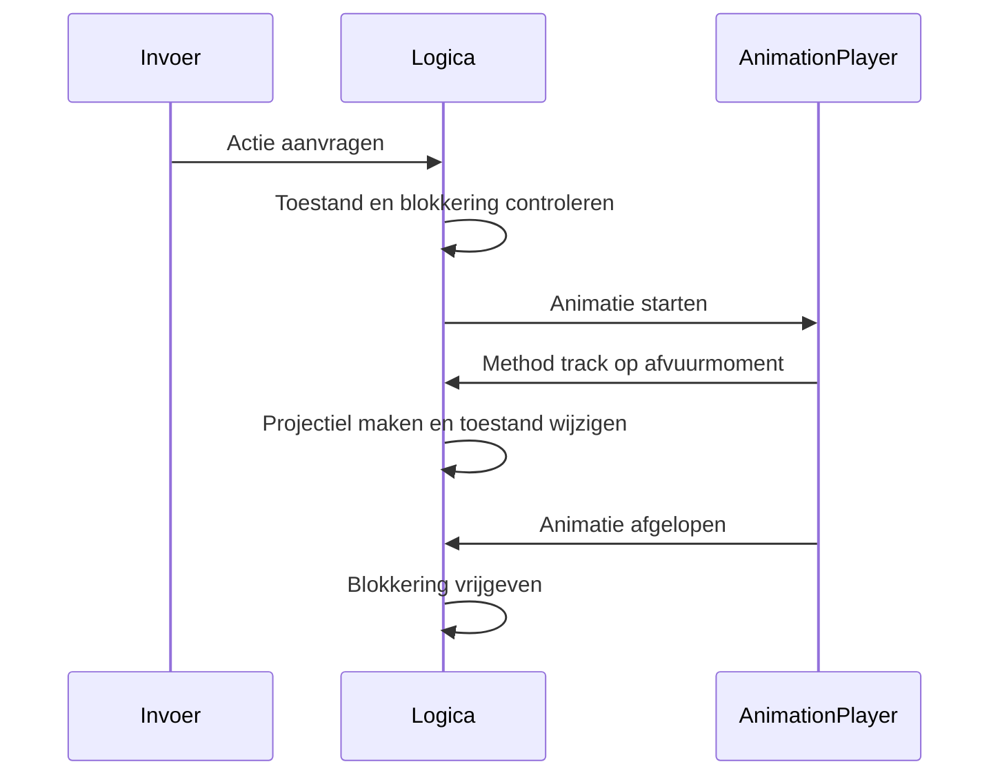

# Animatiegebeurtenissen en spelgedrag

Voor **Godot 4.5 en XR Tools 4.5.1**. Dit begrip ondersteunt de [les objectmanipulatie](../objectmanipulatie/cursus.md).

Een animatie toont een handeling in de tijd. Een spelregel bepaalt of die handeling mag plaatsvinden. Houd die beslissingen samenhangend zonder ze onbedoeld tweemaal uit te voeren.

## Eén moment dat de toestand verandert

Je kan een projectiel onmiddellijk in de actiehandler maken, zoals in onze minimale code. Je kan ook een animatie starten en een method call track de afvuurmethode laten oproepen. Gebruik voor hetzelfde projectiel één van die momenten. Anders krijg je een projectiel bij de knopdruk én een tweede bij het animatieframe.

De methode op het afvuurframe controleert de toestand opnieuw. Tijdens een vertraagde animatie kan immers een ander onderdeel veranderd zijn. Voor fysieke wijzigingen is de standaard uitgestelde verwerking van method call tracks vaak passend; onderzoek de callbackinstellingen voordat je nodes tijdens animatieverwerking verwijdert.

## Wie schrijft een transform?

Als een sledescript elke physicsstap `position` schrijft en een animatietrack hetzelfde doet, overschrijven ze elkaar. Kies per fase één bestuurder of animeer een aparte visuele kindnode. Een animatie die de flits zichtbaar maakt, hoeft de kamertoestand niet zelf te beheren.

Een eenvoudige blokkering voorkomt een tweede actie tijdens een lopende mechanische animatie. Denk ook aan onderbreken: bij stoppen of wisselen eindigt een animatie niet noodzakelijk via het gewone verwachte pad. Herstel de blokkering ook bij die overgangen.

In C# moeten methodetracks de namen van jouw C#-methoden gebruiken, zoals `Cycle`. Addon-methoden aangeroepen via `Call` blijven hun GDScriptnamen gebruiken. Kies in de editor de werkelijk beschikbare methode op de doelnode.

**Denkvraag:** een flits speelt af maar er verschijnt geen projectiel. Welke toestand en callback zou je eerst loggen, en waarom bewijst de animatie alleen nog niets?

Bronnen: [AnimationPlayer](https://docs.godotengine.org/en/4.5/classes/class_animationplayer.html), [animatietracks](https://docs.godotengine.org/en/4.5/tutorials/animation/animation_track_types.html), [tutorial Part 4](https://www.youtube.com/watch?v=mSBFU-gq0MY).
