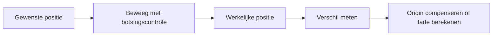

# Beweging, snelheid en physics

Een gewenste positie, een verplaatsing en `velocity` zijn drie verschillende grootheden. De eenheden helpen om fouten te herkennen.

## Meter of meter per seconde?

| Grootheid | Voorbeeld | Eenheid |
| --- | --- | --- |
| Positie | Het lichaam staat op X = 2. | meter |
| Verplaatsing | Het moet 0,03 opschuiven. | meter |
| Snelheid | Het beweegt met 3. | meter/seconde |
| Versnelling | De snelheid verandert met 9,8 per seconde. | meter/seconde² |

Bij een tijdstap van 0,01 seconde geeft een constante snelheid van 3 m/s een verplaatsing van 0,03 meter. Met `delta` rekenen we dus tussen snelheid en verplaatsing om.

## Twee bewegingsmethoden

`move_and_collide(motion)` krijgt een **wereldverplaatsing**. Je geeft aan hoeveel het lichaam deze oproep moet opschuiven. De engine zoekt botsingen langs dat pad. De methode biedt niet automatisch de volledige glijlogica van een gewone charactercontroller.

`move_and_slide()` gebruikt `CharacterBody3D.velocity`, een **wereldsnelheid**. De methode verwerkt de physics-tijdstap intern en behandelt glijden en de classificatie van vloeren, muren en plafonds. Ze kan `velocity` bij een botsing aanpassen.

```gdscript
# Twee alternatieven, niet samen uitvoeren voor dezelfde beweging:
move_and_collide(velocity * delta)
# Of:
move_and_slide()
```

```csharp
MoveAndCollide(Velocity * (float)delta);
// Of:
MoveAndSlide();
```

Zet dus niet eerst `velocity *= delta` voor een oproep aan `move_and_slide`. Dan behandel je een verplaatsing alsof ze een snelheid was.

## Gewenst en werkelijk



Een muur kan de werkelijke verplaatsing kleiner maken dan de gewenste. Meet daarom de oude en nieuwe lichaamspositie. De [XR-tegenbeweging](xr-tracking-en-tegenbeweging.md) moet alleen de werkelijk uitgevoerde fysieke volgbeweging compenseren.

Rechtstreeks `global_position` wijzigen is geen vervanging voor deze bewegingsmethoden. Je voert daarmee geen equivalente sweep langs het hele pad uit.

## Een afgesproken uitvoervolgorde

Physicscode hoort doorgaans in `_physics_process(delta)` / `_PhysicsProcess(double delta)`. De physicsfrequentie staat los van de getekende framerate. Als meerdere scripts snelheid instellen en bewegen, moet hun volgorde vaststaan. Eén centrale lus met aparte methoden maakt die afspraak zichtbaar.

Zwaartekracht is een versnelling: `velocity += get_gravity() * delta`, of `Velocity += GetGravity() * (float)delta`. Daarna volgt de bewegingsoproep. Ook wanneer stickinput tijdelijk wordt genegeerd omdat het hoofd door een muur zit, kan zwaartekracht nog nodig zijn.

Bron: Godot 4.5, [CharacterBody3D](https://docs.godotengine.org/en/4.5/classes/class_characterbody3d.html) en [PhysicsBody3D](https://docs.godotengine.org/en/4.5/classes/class_physicsbody3d.html).
