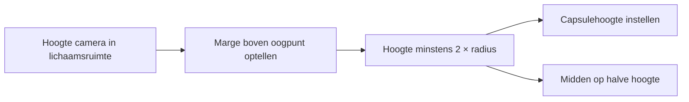

# Capsules en bukken

De camera kan door tracking omlaag bewegen, terwijl een vaste lichaamscollider even hoog blijft. Dan zie je onder een tafel, maar kan het lichaam er niet onderdoor. We moeten de fysieke vorm dus bewust aan de hoofdhoogte koppelen.

## Hoogte is niet het midden

Een `CapsuleShape3D` heeft een totale hoogte, inclusief de afgeronde uiteinden. De `CollisionShape3D` plaatst het midden van die vorm. Voor een capsule vanaf de voeten tot hoogte `h` horen daarom deze waarden samen:

```text
shape.height = h
collision_shape.position.y = h / 2
```

Alleen de hoogte kleiner maken houdt het midden op dezelfde plek en laat de onderkant omhoog komen. Alleen het midden verplaatsen verandert de lengte niet.



Gebruik de camerahoogte in lichaamsruimte. De globale Y-positie bevat ook de hoogte van het lichaam in het level. Een trap oplopen mag een staande speler niet steeds een langere capsule geven.

## Radius, hoofd en marge

Een capsule kan niet lager zijn dan twee keer haar radius. Als `r = 0.3`, ligt de minimumhoogte dus op 0,6 meter. De marge boven het oogpunt is een benadering van hoofdvolume; ze is niet automatisch gelijk aan de hoofdradius. Het oogpunt, het midden van een querybol en de bovenkant van een capsule kunnen andere referentiepunten zijn.

Dupliceer de shape per speler voordat je haar hoogte aanpast, want shapes zijn [gedeelde resources](resources-en-local-to-scene.md).

## Rechtstaan onder een plafond

Een collider vergroten kan haar in een plafond laten overlappen. Een compleet systeem moet controleren of er ruimte is om te groeien en hoe de lichaamsvorm daarop reageert. De echte hoofdtracking blijft doorgaan: een virtueel plafond houdt je fysieke hoofd niet tegen. De [hoofdquery en fade](physicsqueries-en-rids.md) blijven dus nodig.

## Alleen een bovenlichaam modelleren

Bij de trapoplossing krijgt de capsule een vaste kortere hoogte. Haar bovenkant volgt het hoofd, haar midden staat op `top - upper_body_height / 2`. De onderkant hangt dan boven de voeten. Een raycast en regelaar nemen de vloerondersteuning over.

Dat is een ander model dan de capsule tot op de vloer. Bij zeer laag bukken kan de vaste bovenlichaamscapsule zelfs onder het voetpunt komen; je moet de gekozen hoogte dan verder aanpassen. Zie [vloerondersteuning en PID](vloerondersteuning-en-pid.md) voor de bedoeling en beperkingen.

Bron: Godot 4.5, [CapsuleShape3D](https://docs.godotengine.org/en/4.5/classes/class_capsuleshape3d.html) en [Room scale in XR](https://docs.godotengine.org/en/4.5/tutorials/xr/xr_room_scale.html).
