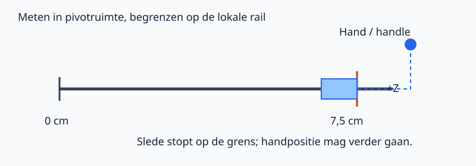

# Eén as, begrenzing en drempels

Voor **Godot 4.5 en XR Tools 4.5.1**. Dit begrip ondersteunt de [les objectmanipulatie](../objectmanipulatie/cursus.md).

Een lade of slede beweegt langs een rail, terwijl de hand alle kanten op kan. We zetten de gemeten wereldpositie daarom eerst om naar de lokale ruimte van de rail. Daarna behouden we alleen de verplaatsing langs de gewenste as.

## Meten in de juiste ruimte

Voor een rail langs lokale +Z:

```gdscript
var current := pivot.to_local(handle.global_position)
var pull := clampf(current.z - rest_in_pivot.z, 0.0, travel)
```

```csharp
var current = pivot.ToLocal(handle.GlobalPosition);
float pull = Mathf.Clamp(current.Z - restInPivot.Z, 0.0f, travel);
```

`rest_in_pivot` is de rustpositie uitgedrukt in dezelfde pivotruimte. Zonder die aftrekking meet je een absolute coördinaat in plaats van de afgelegde afstand. Bij een geschaalde pivot zijn lokale eenheden niet vanzelf meters; onze oefening gebruikt daarom een neutrale schaal.



Alleen de zichtbare slede wordt op de begrensde positie getekend. De grijpbare handle kan verder bewegen als meetpunt. Dat is een eenvoudige interactieconstructie; het simuleert geen fysieke railkracht op de hand.

## Een toestand is nog geen gebeurtenis

`pull >= threshold` kan zestig physicsstappen na elkaar waar blijven. Als elke stap een patroon laadt, is één beweging plots zestig gebeurtenissen. Bewaar daarom of de drempel voor deze greep al is afgehandeld. In de les wordt die vlag bij loslaten hersteld.

Wil je opnieuw activeren zonder los te laten, gebruik dan twee drempels. Bijvoorbeeld: activeer boven 7,1 cm en maak pas opnieuw gereed onder 1 cm. Dat verschil heet **hysterese**. Het voorkomt dat kleine trackingvariaties rond één grens voortdurend activeren en resetten. Een tijdvertraging alleen lost dat ruimtelijke probleem niet op.

**Probeer zelf:** draai de pivot 90 graden en trek opnieuw. Als je nog steeds wereld-Z gebruikt, beweegt de rail verkeerd mee. Met lokale coördinaten blijft dezelfde code geldig.

Bronnen: [Node3D.to_local](https://docs.godotengine.org/en/4.5/classes/class_node3d.html#class-node3d-method-to-local), [Vectoren en projecties](vectoren-en-projecties.md).
