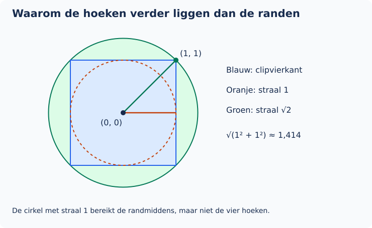

# Fade, vignette en de straal sqrt(2)

Fade en vignette kunnen allebei zwart toevoegen aan het beeld, maar beantwoorden een andere vraag. De fade reageert op een ongeldige hoofdpositie; de vignette beperkt het zicht tijdens virtuele beweging.

## Een afstand naar 0 tot 1 omzetten

Noem de horizontale afwijking tussen hoofd en lichaam `d`, de beginafstand `s` en de overgangsafstand `f`. Dan berekenen we:

```text
alpha = clamp((d - s) / f, 0, 1), met f > 0
```

Bij `s = 0.2` en `f = 0.2` geeft dat:

| Afwijking | Uitkomst |
| --- | --- |
| 0,10 m | 0: nog zichtbaar. |
| 0,20 m | 0: begin van de overgang. |
| 0,30 m | 0,5: halve verduistering. |
| 0,40 m of meer | 1: volledig zwart. |

`clamp` begrenst de uitkomst. Het voorkomt niet dat je eerst door nul deelt; de overgangsafstand moet dus positief zijn. Vergelijk ook horizontale voetposities, niet rechtstreeks de afstand van voeten tot ogen. Anders zou de gewone lichaamslengte al een grote afwijking opleveren.

Een aparte hoofd-sweep kan volledige verduistering eisen, zelfs als de horizontale afstand klein is. Zie [physicsqueries](physicsqueries-en-rids.md).

## Een ring met een opening

Een vignette gebruikt een transparante binnenkant en een donkere buitenrand. De ingestelde straal bepaalt hoeveel zicht overblijft. De zachte randbreedte van de vignette is een andere parameter dan de fadeafstand bij een muur.



Het clipvierkant loopt op X en Y van -1 tot 1. Het midden van een rand ligt op afstand 1 van het centrum, maar een hoek op `(1, 1)` ligt verder:

```text
hoekafstand = sqrt(1² + 1²) = sqrt(2) ≈ 1,414
```

Daarom vermenigvuldigt de video de genormaliseerde radius met `sqrt(2)`. Een waarde 1 kan zo een opening geven die het hele gecentreerde clipvierkant omvat. Een cirkel met straal 1 zou de hoeken nog verduisteren.

De cirkel is hier getekend in genormaliseerde beeldcoördinaten. Een andere aspectratio, de verschuiving per oog en de headsetoptiek maken dit geen universele garantie voor een exacte fysieke kijkhoek. De cursus verbergt de vignette daarom expliciet wanneer de ingestelde radius 1 is en controleert de uitlijning met de juiste [oogprojectie](projectie-en-perspectiefdeling.md).

De basisafspraak voor beide comforteffecten blijft dezelfde: laat de fysieke hoofdpose betrouwbaar volgen en verander het beeld bewust. Zet de virtuele camera niet willekeurig stil wanneer de echte speler beweegt. Bied voor stickbeweging en -rotatie instellingen aan die de speler kan uitproberen.

Bron: Godot 4.5, [Room scale in XR](https://docs.godotengine.org/en/4.5/tutorials/xr/xr_room_scale.html) en [XR full screen effects](https://docs.godotengine.org/en/4.5/tutorials/xr/xr_full_screen_effects.html).
