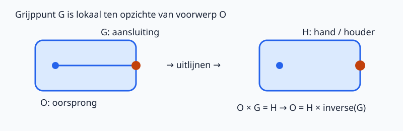

# Grijppunten en uitlijning

Voor **Godot 4.5 en XR Tools 4.5.1**. Dit begrip ondersteunt de [les objectmanipulatie](../objectmanipulatie/cursus.md).

Een grijppunt is een lokale afspraak op het voorwerp: hier moet de hand of houder aansluiten, in deze oriëntatie. Het is geen nieuwe wereldpositie van de controller.

## Een lokale aansluiting omrekenen

Noem de wereldtransform van het voorwerp `O`, de lokale transform van het grijppunt `G` en de gewenste wereldtransform van de aansluiting `H`. Dan willen we:

```text
O × G = H
O = H × inverse(G)
```

De vermenigvuldigingsvolgorde telt. Eerst de hand verplaatsen en daarna een offset langs haar gedraaide assen toepassen is iets anders dan dezelfde offset langs de wereldassen nemen. Zie ook [transforms](transforms-en-samenstelling.md) en [inverse transformaties](inverse-transformaties.md).



De addon berekent die aansluiting voor je en kan bijkomende instellingen zoals handpose, schaal en tweehandsgewichten verwerken. De formule is een vereenvoudigd model om te begrijpen waarom een verkeerd gedraaid grijppunt het hele voorwerp anders laat aansluiten; ze vervangt de grab driver niet.

## Handpunt en snappunt

Een handgrijppunt hoort bij links of rechts en kan een pose en handle-identiteit bevatten. Een snapgrijppunt beschrijft de aansluiting met een houder. Een beker kan daarom bij het oor worden vastgehouden en met de onderkant op een standaard aansluiten. Daarvoor hoeven die markers niet op dezelfde plaats te staan.

Plaats de grijppunten rechtstreeks onder de pickable-root, waar 4.5.1 ze verzamelt. Onderzoek een afwijkende boom eerst in de broncode in plaats van te veronderstellen dat iedere geneste marker automatisch wordt gevonden.

**Probeer zelf:** draai alleen het snapgrijppunt een kwartslag. Voorspel hoe de beker in dezelfde onveranderde zone zal aansluiten.

Bronnen: [XR Tools grab points](https://godotvr.github.io/godot-xr-tools/docs/grab_point/), [Node3D](https://docs.godotengine.org/en/4.5/classes/class_node3d.html), [Transform3D](https://docs.godotengine.org/en/4.5/classes/class_transform3d.html).
