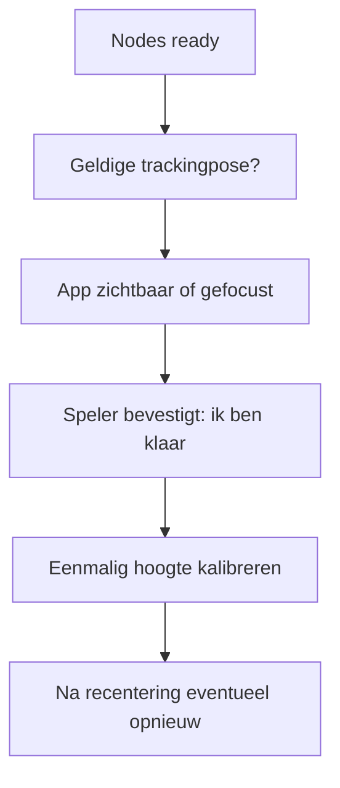

# Hoogtekalibratie en XR-sessies

Een `ready`-node betekent nog geen betrouwbare hoofdmeting. De headset kan op een tafel liggen of de speler kan hem nog aan het opzetten zijn. Daarom vraagt hoogtekalibratie zowel een coördinatenafspraak als een goed gekozen moment.

## Een offset, geen continue correctie

Als de tracking een hoofdhoogte van 1,15 meter boven de referentievloer meet en we 1,60 meter willen, kiezen we een origin-offset van 0,45 meter:

```text
hoogteoffset = gewenste hoofdhoogte - gemeten trackinghoogte
```

Die offset bewaren we. Elke frame opnieuw corrigeren zou de fysieke beweging bij bukken ongedaan maken.

Meet in de trackingruimte, zonder je eigen eerdere origin-offset opnieuw mee te rekenen. Anders kan herhaald kalibreren de speler blijven verplaatsen. In de tutorial wordt daarvoor de aangepaste pose van de head-tracker gebruikt, niet simpelweg de al verplaatste globale camerapositie.

## Welke referentiehoogte?

Een floor-relative referentieruimte maakt een hoogte tegenover de vloer interpreteerbaar. In een andere trackingruimte hoeft de oorsprong niet op de fysieke vloer te liggen. `world_scale`, een verticale offset en een echte gebruikerslengte zijn ook verschillende grootheden. Deze kalibratie verschuift de avatarhoogte; ze maakt de handen niet verder uit elkaar en schaalt de wereld niet.

## Zichtbaar is niet noodzakelijk klaar



Dit is een praktische volgorde, geen volledige OpenXR-statemachine. `session_visible` meldt een zichtbare sessietoestand, maar niet noodzakelijk beschikbare XR-input. `session_focussed` hoort bij de toestand waarin de applicatie ook XR-input ontvangt. Bij focusverlies kan de sessie naar zichtbaar teruggaan; dat is geen bewijs dat de gebruiker opnieuw klaarstaat.

`pose_recentered` meldt dat de runtime de pose heeft gerecentreerd. Herkalibratie kan dan nodig zijn, maar controleer opnieuw of de pose geldig is. Uitgesteld oproepen geeft de runtime gelegenheid de update door te geven; één uitgestelde call is geen garantie dat trackingdata meteen beschikbaar zijn.

Een ruime startomgeving met een bevestigingsknop is daarom een betere gebruikersafspraak dan blind kalibreren in `_ready`. Bij ontbrekende trackingdata wacht je op een volgende geschikte poging.

**Probeer zelf:** kalibreer zittend, buk en kalibreer opnieuw in dezelfde zithouding. De vaste offset mag niet bij elke poging verder oplopen. Bied ook een keuze om de echte gebruikershoogte te behouden.

Bron: Godot 4.5, [OpenXRInterface](https://docs.godotengine.org/en/4.5/classes/class_openxrinterface.html), [XRPose](https://docs.godotengine.org/en/4.5/classes/class_xrpose.html) en [Room scale in XR](https://docs.godotengine.org/en/4.5/tutorials/xr/xr_room_scale.html).
