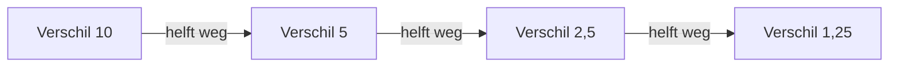

# Interpolatie en delta

De bewegingsfunctie laat snelheid geleidelijk veranderen. De spectatorcamera doet iets vergelijkbaars met positie en rotatie. "Lerpen" zegt echter pas iets als je ook weet hoe de factor in de tijd verandert.

## Wat betekent lerp?

Lineaire interpolatie berekent een tussenwaarde:

```text
lerp(a, b, t) = a + (b - a) × t
```

Voor `t = 0` krijg je `a`, voor `t = 1` krijg je `b`. Met `a = 0`, `b = 10` en `t = 0.25` is het resultaat 2,5. Buiten het bereik 0 tot 1 wordt het extrapolatie; de waarde kan dan voorbij het doel liggen.

Herhaald de huidige waarde naar een vast doel lerpen is niet hetzelfde als één lineaire beweging met vaste snelheid. Bij elke stap blijft een kleiner verschil over. Het resultaat nadert het doel geleidelijk.

## Waarom delta gebruiken?

`delta` is de duur van de vorige processtap, in seconden. Zonder tijdsafhankelijke factor zou 120 updates per seconde veel sneller naar het doel gaan dan 30 updates per seconde.

De video gebruikt een factor zoals `delta * lerp_factor`. Bij grote `delta` kan die boven 1 komen. Een begrenzing vermijdt overshoot, maar een exponentiële factor geeft voor een vast doel een beter tijdsconsistent resultaat:

```gdscript
var weight := 1.0 - exp(-rate * delta)
var next_speed := lerpf(current_speed, target_speed, weight)
```

```csharp
float weight = 1.0f - Mathf.Exp(-rate * (float)delta);
float nextSpeed = Mathf.Lerp(currentSpeed, targetSpeed, weight);
```

Hier zijn `rate > 0` en `delta >= 0` verondersteld. Bij een camera kan je `rate = 1 / delay` gebruiken. `delay` is dan een tijdconstante: na die tijd is bij een plots vast doel ongeveer 63 procent van het verschil weggewerkt, geen exacte aankomsttijd.



## Positie is geen rotatie

Voor vectoren kan je `lerp` gebruiken. Voor een rotatiebasis gebruik je `slerp`, dat rotaties over een bolvormige interpolatie behandelt. Zorg dat de bases echte rotaties voorstellen: schaal of scheefstand vraagt een andere behandeling. Rechtstreeks Eulerhoeken interpoleren kan rond de overgang van 359 naar 0 graden onbedoeld de lange weg kiezen.

Wil je een exact begrensde versnelling, dan is `move_toward(current, target, acceleration * delta)` een andere keuze. Dat beweegt met een maximale hoeveelheid per stap. Een lerpfactor is dus niet zonder meer een versnelling in m/s².

Verder: [basis](basis-en-assen.md), [snelheid en physics](beweging-en-physics.md).

Bron: Godot 4.5, [Interpolation](https://docs.godotengine.org/en/4.5/tutorials/math/interpolation.html), [Basis](https://docs.godotengine.org/en/4.5/classes/class_basis.html).
