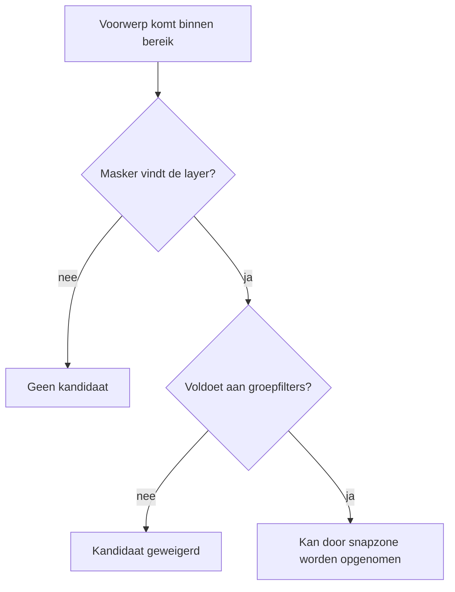

# Lagen, maskers en groepen

Voor **Godot 4.5 en XR Tools 4.5.1**. Dit begrip ondersteunt de [les objectmanipulatie](../objectmanipulatie/cursus.md).

Een physicslaag en een groep lossen verschillende problemen op. Een detectiegebied moet een voorwerp eerst fysisch kunnen vinden. Daarna kan een groepfilter beslissen of dat voorwerp inhoudelijk past.

## Eerst detectie, daarna betekenis

Op laag 3 staan in de les de losse pickables. Tijdens vasthouden gebruikt het voorwerp laag 17. De snapzone moet dus beide lagen in haar detectiemasker hebben. Haar eigen laag moet ook vindbaar zijn voor de pickupfunctie, anders kan de speler het aangesloten voorwerp niet uitnemen.

Een layernummer is een nummer van een bit. Laag 3 is `1 << 2`, dus 4. Laag 17 is `1 << 16`, dus 65536. Beide samen zijn 65540. Gebruik de selectievakjes om deze vergissing te vermijden. Voor een `Area3D` gaat detectie uit van het masker van de area en de laag van het lichaam. Een body-body-botsing heeft andere deelnamevoorwaarden; denk niet dat het leegmaken van één willekeurig masker alle botsingen uitschakelt.

## Drie filters uit elkaar houden

`Snap Require = magazine` controleert de groep op het binnenkomende pickable voorwerp. `Grab Require` controleert de grijpende node die iets uit de zone wil nemen. `Require Group` op een snapgrijppunt controleert de groep van de zone waarvoor dat grijppunt bedoeld is. Het zijn drie verschillende richtingen van dezelfde vraag: wie mag met wie samenwerken?

Voeg groepen via de Node-tab aan de juiste root toe. Een groep op alleen de mesh is niet automatisch een groep op de root. Geef bijvoorbeeld de magazijnroot groep `magazine`, de zoneroot groep `magazine_well`, en laat het snapgrijppunt die laatste groep vereisen.

**Probeer zelf:** verwijder eerst de groep `magazine` en daarna, in een aparte proef, laag 17 uit het zonemasker. Het eindresultaat kan hetzelfde lijken, maar de weigering gebeurt op een ander moment.

Bronnen: [XR Tools physicslagen](https://godotvr.github.io/godot-xr-tools/docs/physics_layers/), [snapzones](https://godotvr.github.io/godot-xr-tools/docs/snap_zone/), [Area3D](https://docs.godotengine.org/en/4.5/classes/class_area3d.html), [groepen](https://docs.godotengine.org/en/4.5/tutorials/scripting/groups.html).
