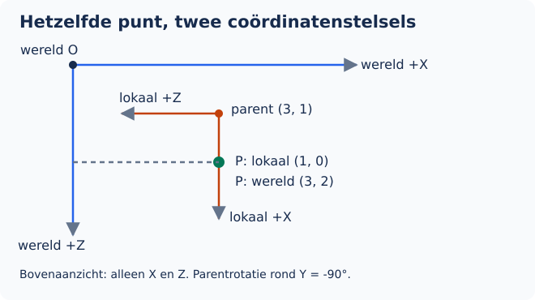

# Lokale en globale ruimte

In de bewegingscode beschrijven we dezelfde camerapositie soms in de ruimte van de origin, soms in die van het lichaam en soms in wereldruimte. Dat zijn geen verschillende camera's: het zijn verschillende beschrijvingen van hetzelfde punt.

## Ten opzichte van wat?

Een lokale positie is uitgedrukt ten opzichte van de parent. Een globale positie is uitgedrukt ten opzichte van de wereld. Een vector `(1, 0, 0)` betekent dus pas iets als je ook weet welke assen en welke oorsprong je gebruikt.

Staat de parent gedraaid, dan kan zijn lokale rechterkant in de wereld naar voren wijzen. Staat de parent verplaatst, dan ligt lokaal `(0, 0, 0)` niet meer op de wereldoorsprong.



In deze tekening kijken we van bovenaf. De wereldpositie van de parent is `(3, 0, 1)`. Zijn lokale X-as wijst naar wereld-positieve Z. Het punt op lokaal `(1, 0, 0)` ligt daarom op wereldpositie `(3, 0, 2)`. De parent staat rond Y op -90 graden.

## Omrekenen in Godot

Deze snippets horen in een methode op de node waarvan je de lokale ruimte bedoelt. `camera` is een referentie naar de XR-camera:

```gdscript
var local_head: Vector3 = to_local(camera.global_position)
var world_head: Vector3 = to_global(local_head)
```

```csharp
Vector3 localHead = ToLocal(Camera.GlobalPosition);
Vector3 worldHead = ToGlobal(localHead);
```

Op een `CharacterBody3D` betekent `to_local` dus "naar de ruimte van dit lichaam", niet automatisch "naar de trackingruimte". Op de origin betekent dezelfde methode iets anders.

`position` en `global_position` zijn vergelijkbaar: de eerste hoort bij de parentruimte, de tweede bij wereldruimte. Met `transform` en `global_transform` krijgen we daarnaast ook de oriëntatie en schaal.

## Punten en verplaatsingen niet mengen

Een punt heeft een positie ten opzichte van een oorsprong. Een verplaatsing zegt hoeveel je opschuift. De omzetting van een punt bevat daarom ook translatie; die van een verplaatsing niet. `to_local` is een omzetting voor punten. Een wereldverplaatsing reken je om met de inverse basis, zoals uitgelegd bij [inverse transformaties](inverse-transformaties.md).

Vraag bij een berekening altijd: in welke ruimte staan de invoerwaarden en in welke ruimte moet het resultaat staan? Een lokale camerapositie rechtstreeks aftrekken van een globale lichaamspositie is meestal een fout, ook als het toevallig werkt zolang alle parents op nul staan.

**Probeer zelf:** draai de parent 90 graden en laat de camera lokaal één meter langs X bewegen. Voorspel eerst langs welke wereldas de beweging zal verlopen.

Verder: [transforms samenstellen](transforms-en-samenstelling.md), [basis en assen](basis-en-assen.md).

Bron: Godot 4.5, [Node3D](https://docs.godotengine.org/en/4.5/classes/class_node3d.html) en [Matrices and transforms](https://docs.godotengine.org/en/4.5/tutorials/math/matrices_and_transforms.html).
