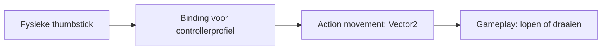

# OpenXR-actions en controllerprofielen

In de notities is de action map een "contract" met OpenXR. Dat is een bruikbaar beeld: de applicatie benoemt welke betekenisvolle invoer ze nodig heeft, zonder rechtstreeks aan één controllermerk vast te hangen.

## Van apparaat naar bedoeling



Een action heeft een naam en datatype, bijvoorbeeld boolean, float, vector2 of pose. Een action set groepeert acties. Via subaction paths kan een actie bijvoorbeeld voor links en rechts beschikbaar zijn. Een interaction profile beschrijft vervolgens hoe de actie aan de invoer van een bepaald type hardware gekoppeld wordt.

`movement` is geen ingebouwde garantie dat elk apparaat een stick heeft. Het is een afgesproken actienaam uit ons project. De naam in de code moet overeenkomen met die in de action map.

```gdscript
var input: Vector2 = controller.get_vector2("movement")
```

```csharp
Vector2 input = Controller.GetVector2("movement");
```

De controllertracker bepaalt van welke hand we de waarde opvragen. Voor onze locomotie vertalen we stick-Y naar Godots voorwaartse -Z-richting. Dat teken hoort bij de gekozen binding en bewegingsafspraak, niet bij een universele regel voor elke `Vector2` in Godot.

## Een fallback heeft beperkingen

Het Simple Controller-profiel is een minimale terugval, maar heeft geen thumbstick. Het kan dus niet al onze bewegingsacties ondersteunen. Voor hardware zonder geschikte invoer heb je een andere interactie nodig, bijvoorbeeld teleportatie of een bevestigingsknop.

De runtime kan beschikbare of door de gebruiker aangepaste bindings kiezen, maar je kan niet op een willekeurige profielnabootsing vertrouwen. Test de apparaten waarvoor je ondersteuning belooft. Het advies uit de notities om alleen op een ander profiel te vertrouwen is geen vervanging voor dat testen.

## Acties versus instellingen

De XR-action map is niet hetzelfde als de gewone Godot Input Map. De koppelingen worden rond het opbouwen van de XR-sessie aangeboden. Een instelling zoals "links lopen, rechts draaien" kan je in gameplaycode regelen door te kiezen welke hand je voor welke functie gebruikt. Daarvoor hoef je niet tijdens het spelen de hele action map opnieuw op te bouwen.

De persoonlijke mening uit de video dat remapping weinig nodig zou zijn, is geen technische beperking. Handvoorkeur, toegankelijkheid en comfort kunnen goede redenen zijn om invoerkeuzes aan te bieden.

Bron: Godot 4.5, [XR action map](https://docs.godotengine.org/en/4.5/tutorials/xr/xr_action_map.html) en [XRController3D](https://docs.godotengine.org/en/4.5/classes/class_xrcontroller3d.html).
