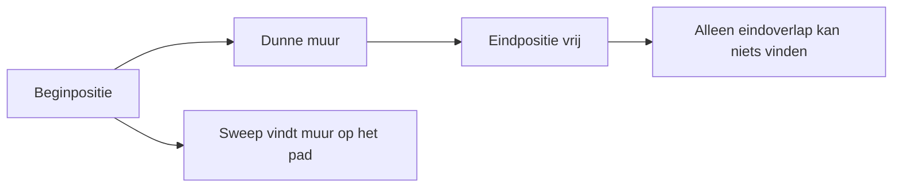

# Physicsqueries, collision masks en RIDs

Een collider geeft niet automatisch controle over een door tracking bewogen camera. De hoofdcontrole stelt daarom de vraag: "Zou een bol langs dit pad een obstakel raken?" Een physicsquery kan die vraag beantwoorden zonder een nieuw fysiek hoofd te simuleren.

## Beschrijf eerst de vraag

Een `PhysicsShapeQueryParameters3D` bevat onder meer een shape, een wereldtransform, een gewenste beweging, een collision mask en een lijst uitgesloten RIDs. Een `SphereShape3D` benadert het volume van het hoofd.

Collision layers vertellen bij welke groepen een object hoort. Een collision mask vertelt op welke groepen een beweging of query let. Dat zijn physicsinstellingen, geen [renderlagen](renderinstellingen-en-culling.md).

## Wat is een RID?

Een `RID` is een interne identificatie waarmee een Godot-server een resource of object herkent. Het is geen NodePath, geen node en geen geheugenadres dat je zelf moet derefereren. Met `body.get_rid()` / `Body.GetRid()` verkrijg je het physics-RID van het lichaam.

Dat RID gebruiken we om de eigen collider uit te sluiten:

```gdscript
query.exclude = [body.get_rid()]
```

```csharp
query.Exclude = new Godot.Collections.Array<Rid> { Body.GetRid() };
```

De node beheert het bijbehorende serverobject. Het opvragen van haar RID betekent niet dat je die serverresource zelf moet vrijgeven.

## Overlap of een pad testen?

| Query | Betekenis |
| --- | --- |
| `intersect_shape` | Welke objecten overlappen de vorm op deze positie? |
| `cast_motion` | Hoe ver kan de vorm langs de opgegeven beweging zonder botsing? |



Het eindpunt kan vrij zijn terwijl het hoofd onderweg door een muur is gegaan. Een sweep is daarom belangrijk. `cast_motion` geeft een veilige en onveilige fractie van het pad terug; de veilige fractie onder 1 betekent dat de volledige beweging niet vrij is.

De API negeert bij `cast_motion` shapes waarmee de query aan het begin al overlapt. Controleer waar nodig ook de begin- en eindoverlap. Voer de queries in de physicsfase uit via de juiste `World3D.direct_space_state`.

## Waarom geen gewone extra collider?

Een collider op het lichaam kan lichaamsbotsingen verbeteren. Hij stopt niet vanzelf de echte hoofdbeweging die de XR-runtime doorgeeft. Een `Area3D` kan overlap melden, maar is niet hetzelfde als een sweep door een dunne muur. We moeten nog steeds beslissen hoe we reageren, bijvoorbeeld met [fade](fade-en-vignette.md), terwijl de tracking blijft kloppen.

Bron: Godot 4.5, [PhysicsDirectSpaceState3D](https://docs.godotengine.org/en/4.5/classes/class_physicsdirectspacestate3d.html), [PhysicsShapeQueryParameters3D](https://docs.godotengine.org/en/4.5/classes/class_physicsshapequeryparameters3d.html) en [RID](https://docs.godotengine.org/en/4.5/classes/class_rid.html).
