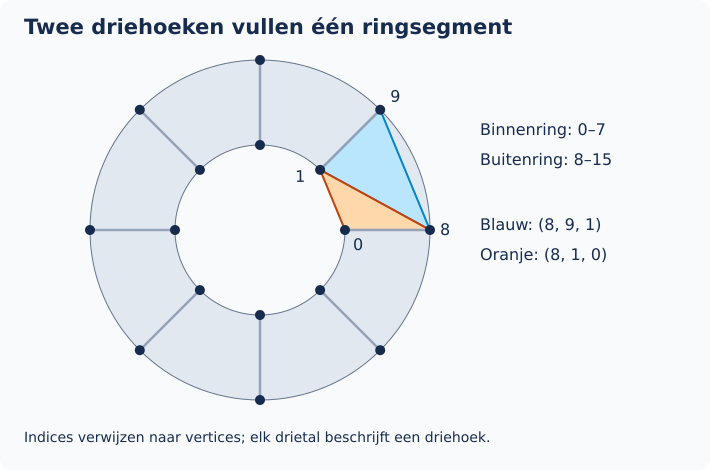

# Procedurele meshes: vertices, indices en kanalen

De vignette uit de notities is een ring die in code wordt opgebouwd. Een mesh is daarbij niet alleen een lijst punten. Je moet ook beschrijven welke punten samen driehoeken vormen.

## Punten hergebruiken met indices

Een vertex heeft een positie en kan bijkomende gegevens hebben, zoals UV-coördinaten of een normaal. Een index verwijst naar de plaats van zo'n vertex in de vertexlijst. Met drie indices beschrijf je één driehoek.

Voor een ring met `n` segmenten maken we twee cirkels van elk `n` vertices: binnenste indices `0..n-1`, buitenste indices `n..2n-1`.



De tekening gebruikt 8 segmenten. Het eerste ringstuk heeft binnenste vertices 0 en 1 en buitenste vertices 8 en 9. De twee driehoeken zijn `(8, 9, 1)` en `(8, 1, 0)`. Samen vullen ze het vierhoekige ringstuk.

Per segment hebben we twee driehoeken nodig, dus zes indexplaatsen. In totaal zijn dat `2 * n` vertices en `6 * n` indices. Bij 32 segmenten worden dat 64 vertices en 192 indices, geen 192 verschillende punten.

Met `next = (i + 1) % n` sluit het laatste segment terug aan op het eerste. Zonder modulo zou de laatste verwijzing buiten de bedoelde cirkelreeks vallen.

## ARRAY_MAX telt geen vertices

Godot verwacht voor `add_surface_from_arrays` een buitenste array met vaste plaatsen voor gegevenskanalen:

```text
buitenste Array, grootte Mesh.ARRAY_MAX
├── ARRAY_VERTEX → PackedVector3Array met alle posities
├── ARRAY_NORMAL → eventueel normalen
├── ARRAY_TEX_UV → eventueel UV-coördinaten
└── ARRAY_INDEX → PackedInt32Array met verwijzingen
```

De niet gebruikte kanalen mogen voor dit voorbeeld leeg blijven. `ARRAY_MAX` is het aantal kanaalplaatsen, niet het aantal segmenten of vertices.

```gdscript
var arrays := []
arrays.resize(Mesh.ARRAY_MAX)
arrays[Mesh.ARRAY_VERTEX] = vertices
arrays[Mesh.ARRAY_INDEX] = indices
var mesh := ArrayMesh.new()
mesh.add_surface_from_arrays(Mesh.PRIMITIVE_TRIANGLES, arrays)
```

```csharp
var arrays = new Godot.Collections.Array();
arrays.Resize((int)Godot.Mesh.ArrayType.Max);
arrays[(int)Godot.Mesh.ArrayType.Vertex] = vertices;
arrays[(int)Godot.Mesh.ArrayType.Index] = indices;
var mesh = new ArrayMesh();
mesh.AddSurfaceFromArrays(Godot.Mesh.PrimitiveType.Triangles, arrays);
```

Deze snippets veronderstellen reeds ingevulde vertex- en indexarrays. De complete ringgenerator staat bij [beweging](../beweging/cursus.md).

## Voor- en achterkant

De volgorde van de drie indices bepaalt de oriëntatie van de driehoek. Godot gebruikt bij driehoekprimitives een klokwijzerzin voor de voorzijde. `cull_disabled` maakt een materiaal tweezijdig zichtbaar, maar herstelt geen verkeerde indices of ontbrekende oppervlakken.

Voor onze onbelichte schermring hebben we geen normalen nodig. Voor een belichte 3D-mesh meestal wel. De ring toont dus een minimaal passend meshformaat, geen universeel recept voor elke mesh.

Bron: Godot 4.5, [Using the ArrayMesh](https://docs.godotengine.org/en/4.5/tutorials/3d/procedural_geometry/arraymesh.html) en [ArrayMesh](https://docs.godotengine.org/en/4.5/classes/class_arraymesh.html).
