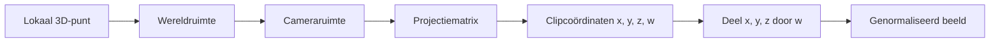

# Projectie, clipruimte en perspectiefdeling

Waarom heeft `POSITION` vier componenten, terwijl ons punt maar drie ruimtelijke coördinaten heeft? En waarom deelt de vignettecode door `w`? De ontbrekende stap is de projectie van 3D naar een beeld.

## Van punt naar beeld



De projectiematrix gebruikt homogene coördinaten. De vierde component `w` is geen extra ruimte-as of tijdwaarde. Ze maakt onder meer de perspectiefdeling mogelijk. Bij een gebruikelijke perspectiefprojectie hangt ze samen met de diepte tegenover de camera.

Na de projectie wordt `(x, y, z)` door `w` gedeeld. Zo wordt eenzelfde voorwerp kleiner naarmate het verder weg ligt. Staat een clip-X bijvoorbeeld op 2 en clip-W op 4, dan is de genormaliseerde X-positie 0,5.

De zichtbare X- en Y-grenzen liggen na die deling op -1 en 1. De precieze Z-conventie hangt van de renderer af; zie [reverse Z](reverse-z.md).

## Een fullscreenvlak

Een `PlaneMesh` ligt standaard in het XZ-vlak. Kies voor ons fullscreenvlak **Face Z**, zodat het vlak in XY ligt. Bij afmetingen 2 bij 2 hebben de hoekpunten dan X/Y = -1 en 1. Een `QuadMesh` van 2 bij 2 is ook geschikt. We kunnen vervolgens rechtstreeks schrijven:

```glsl
POSITION = vec4(VERTEX.xy, 1.0, 1.0);
```

Omdat W hier 1 is, blijven X en Y na perspectiefdeling gelijk. De Z-waarde 1 kiest in Godot 4.5 de nabije clipkant. We omzeilen daarmee de gewone omzetting van deze vertex naar een wereld- en cameropositie.

Dat maakt het vlak schermvullend in de shader. De CPU kan de mesh nog steeds op basis van haar gewone bounding box wegfilteren. Bekijk dus ook [frustum culling](renderinstellingen-en-culling.md).

## Waarom twee oogprojecties?

Een headset heeft per oog een eigen, vaak asymmetrische projectie. Het midden van de rendertexture hoeft niet overeen te komen met de recht-vooruit-richting door de lens. Een vignette die voor beide ogen blind hetzelfde rendertexturemidden gebruikt, kan daardoor scheef aanvoelen.

De code projecteert een punt ver vooruit op de camerakijkas:

```glsl
vec4 center = PROJECTION_MATRIX * vec4(0.0, 0.0, -100.0, 1.0);
vec2 offset = center.xy / center.w;
```

`PROJECTION_MATRIX` hoort bij het oog dat op dat moment wordt verwerkt. De deling zet de clipuitkomst om naar de genormaliseerde beeldverschuiving. Deze offset kan de binnenrand van de vignette richten. De buitenrand moet intussen het hele beeld blijven afdekken.

Dit betekent niet dat je in gameplaycode tweemaal dezelfde shader moet aanroepen. De XR-rendering voert de benodigde oogverwerking uit, eventueel met multiview. Een gewone spectatorcamera gebruikt een andere projectie en bewijst dus niet dat de vignette goed in de headset is uitgelijnd.

Bron: Godot 4.5, [XR full screen effects](https://docs.godotengine.org/en/4.5/tutorials/xr/xr_full_screen_effects.html), [Advanced post-processing](https://docs.godotengine.org/en/4.5/tutorials/shaders/advanced_postprocessing.html).
