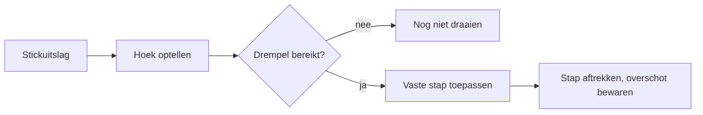

# Radialen, snap turning en draaipunten

In de Inspector lezen we graag graden, terwijl Godots rotatiemethoden radialen verwachten. Daarnaast betekent "een stukje draaien" in VR niet alleen een hoek kiezen: ook het draaipunt doet ertoe.

## Van graden naar radialen

Een volledige omwenteling is 360 graden of `2 × PI` radialen. Een halve draai is `PI`, een kwartdraai `PI / 2`.

```gdscript
var angle := deg_to_rad(30.0)
```

```csharp
float angle = Mathf.DegToRad(30.0f);
```

De GDScript-exporthint `radians_as_degrees` laat de editor graden tonen voor een waarde die intern in radialen staat. Dat is een andere afspraak dan een property met naam `turn_speed_degrees` opslaan en bij gebruik omrekenen. Doe niet beide omrekeningen na elkaar.

Een hoeksnelheid van 45 graden per seconde levert bij een tijdstap van 0,02 seconde een hoek van 0,9 graden. Je vermenigvuldigt een hoeksnelheid dus met `delta`, net zoals een gewone snelheid.

## Een accumulator voor snap turning

Bij de tutorialvariant spaar je zulke kleine hoekjes op. Wanneer de som een drempel bereikt, voer je een zichtbare sprong uit. Een vaste stap van 30 graden kan je toepassen door precies die stap van de accumulator af te trekken en het overschot te bewaren.



Dit blijft herhalen zolang je de stick vasthoudt. Eén sprong per stickuitslag is een andere variant: na een sprong wacht je tot de stick opnieuw neutraal staat. Gebruik een deadzone en een duidelijke resetafspraak, zodat kleine stickruis niet later onverwacht een draai veroorzaakt.

## Rond het hoofd draaien

Een rotatie rond de origin verplaatst een hoofd dat naast de origin staat langs een cirkel. Dat is ongewenst wanneer de speler alleen vraagt om op zijn plaats te draaien.

Voor een wereldpunt `p`, draaipunt `c` en rotatiebasis `R` geldt:

```text
nieuw_punt = c + R × (p - c)
```

Eerst schuif je het draaipunt naar nul, daarna draai je, ten slotte schuif je terug. De volledige transformketen is `T(c) × R × T(-c)`. Voor een lichaam dat precies onder het hoofd staat is draaien rond de lichaamsoorsprong equivalent. Bij een afwijking is de expliciete berekening duidelijker.

Fysiek draaien van het hoofd blijft vloeiend gevolgd worden. Snap turning is alleen een keuze voor de virtuele rotatie door input. Maak de echte hoofdtracking niet stapsgewijs.

Bron: Godot 4.5, [Basis](https://docs.godotengine.org/en/4.5/classes/class_basis.html), [GDScript exports](https://docs.godotengine.org/en/4.5/tutorials/scripting/gdscript/gdscript_exports.html) en [Room scale in XR](https://docs.godotengine.org/en/4.5/tutorials/xr/xr_room_scale.html).
