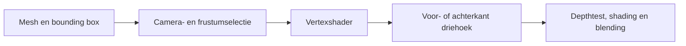

# Renderinstellingen, tekenvolgorde en culling

Een mesh die niet verschijnt is niet noodzakelijk fout gekleurd. Ze kan buiten de camera zijn weggefilterd, met haar achterkant naar de camera staan of achter een ander oppervlak verdwijnen. Dat zijn verschillende stappen.

## Niet alle culling is hetzelfde

Dit schema toont de relevante afhankelijkheden; de engine kan werk intern anders ordenen of combineren. Vooral belangrijk: shaderverplaatsing wordt niet automatisch meegenomen in de oorspronkelijke CPU-bounding box.

**Frustum culling** verwijdert objecten buiten het zichtvolume. Een fullscreenmesh die pas in de vertexshader schermvullend wordt, kan op basis van haar gewone positie toch buiten beeld lijken. Plaats haar logisch onder de camera en vergroot zo nodig `Extra Cull Margin` of gebruik een passende bounding box.

**Backface culling** laat de achterkant van driehoeken weg. Dat hangt samen met de vertexvolgorde. `cull_disabled` schakelt dit uit; het voorkomt geen frustum culling.

## Wat betekenen de render modes?

| Spatial render mode | Betekenis voor fade of vignette |
| --- | --- |
| `unshaded` | Verlichting bepaalt de materiaalkleur niet. |
| `depth_test_disabled` | Andere geometrie mag het vlak niet via de depthtest verbergen. |
| `cull_disabled` | Ook de achterzijde van driehoeken kan zichtbaar zijn. |
| `skip_vertex_transform` | Slaat de gewone model/view-omzetting van `VERTEX` over; projectie is een aparte stap. |
| `fog_disabled` | Mist verandert de effectkleur niet. |

De correcte naam is `cull_disabled`, niet `culling_disabled`. Schrijf je rechtstreeks naar `POSITION`, dan neem je de uiteindelijke clippositie zelf over. Voor dat patroon is `skip_vertex_transform` niet nog eens nodig om dezelfde positieomrekening te vermijden.

Depthtest en depth schrijven zijn verschillende begrippen. Ook `ALPHA = 0` betekent niet dat er geen werk wordt uitgevoerd. Een volledig uitgeschakelde effectmesh verbergen kan duidelijker zijn.

## Prioriteit is geen universele laatste laag

Voor transparante 3D-effecten gebruiken we een hoge `render_priority`, bijvoorbeeld 120 voor vignette en 127 voor fade. Binnen de relevante 3D-sortering komt de hogere prioriteit voor de lagere te liggen. De toegelaten waarden lopen van -128 tot 127.

Dat is geen garantie dat dit materiaal na elke mogelijke UI-laag, compositorstap of andere renderpass verschijnt. Depthinstellingen, renderpass en transparantiesortering blijven verschillende zaken. Twee effecten alleen een hoge waarde geven vertelt ook nog niet welke van de twee bovenaan hoort: kies hun onderlinge volgorde expliciet.

## Selecteren per camera

Visual layers en het `Camera3D.cull_mask` bepalen welke meshes een camera bekijkt. Dat voorkomt bijvoorbeeld dat een fullscreenfade ook het buitenaanzicht bedekt. Physics collision masks zijn een ander systeem. De [spectatorles](../debugging/cursus.md) werkt die laagindeling concreet uit.

Bron: Godot 4.5, [Spatial shaders](https://docs.godotengine.org/en/4.5/tutorials/shaders/shader_reference/spatial_shader.html), [Material](https://docs.godotengine.org/en/4.5/classes/class_material.html) en [GeometryInstance3D](https://docs.godotengine.org/en/4.5/classes/class_geometryinstance3d.html).
