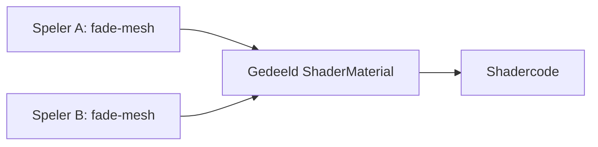
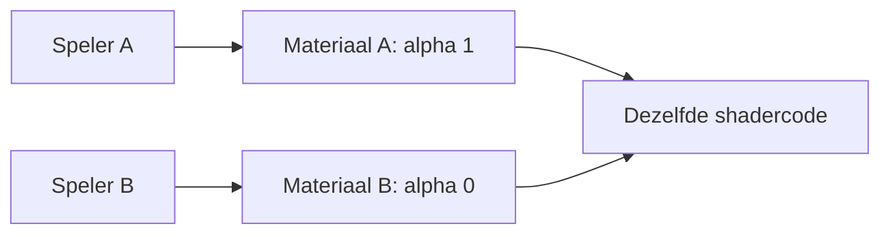

# Gedeelde resources en Local to Scene

Een scene instance is niet automatisch een volledig onafhankelijke kopie van elk materiaal en elke shape. Veel van die gegevens zijn resources, en resources kunnen gedeeld zijn.

## Eén materiaal, twee gebruikers



Verander je op dat materiaal de uniform `alpha`, dan gebruiken beide meshes die nieuwe waarde. Dat kan gewenst zijn voor een gemeenschappelijk wereldmateriaal, maar is fout als alleen het beeld van speler A moet verduisteren.

Maak je het materiaal onafhankelijk, dan mogen beide materialen nog altijd dezelfde shadercode gebruiken:



## Twee manieren om te scheiden

Met **Local to Scene** (`resource_local_to_scene`) laat je Godot de resource bij het instantiëren van de scène per instance dupliceren. De wijzigingen blijven dan bij die instance. De eigenschap pas achteraf aanzetten maakt reeds gebruikte resources niet alsnog automatisch onafhankelijk.

Je kan ook bij de voorbereiding expliciet dupliceren:

```gdscript
var own_material := mesh.material_override.duplicate() as ShaderMaterial
mesh.material_override = own_material
```

```csharp
var ownMaterial = (ShaderMaterial)MeshNode.MaterialOverride.Duplicate();
MeshNode.MaterialOverride = ownMaterial;
```

Deze snippets veronderstellen dat `material_override` een geldig `ShaderMaterial` bevat. Controleer dat wanneer de referentie uit de Inspector komt. Een duplicatie hoeft niet elke onderliggende resource diep te kopiëren. Voor een onafhankelijk uniform op het nieuwe shadermateriaal is het normaal juist prima dat de shadercode gedeeld blijft.

## Hetzelfde probleem bij collision shapes

Een `CapsuleShape3D` is ook een resource. Delen twee spelers dezelfde shape en verander je haar hoogte, dan veranderen beide colliders. Dupliceer daarom de shape voordat je per speler de hoogte aanpast.

Een `MeshInstance3D` is daarentegen een node die naar mesh- en materiaalresources verwijst. Het node-object, de meshdata, het materiaal en de shader zijn verschillende lagen. Een nieuwe node maken betekent niet dat je alle achterliggende resources ook hebt gekopieerd.

Verder: [capsules en bukken](capsules-en-bukken.md), [shaderuniforms](shaderfasen-uniforms-varyings.md).

Bron: Godot 4.5, [Resource](https://docs.godotengine.org/en/4.5/classes/class_resource.html).
