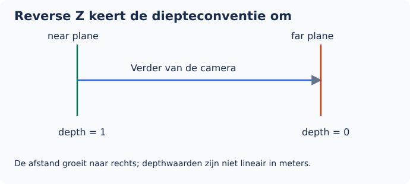

# Reverse Z

Een fullscreenvertexshader schrijft een specifieke Z-waarde om het effect op de juiste diepte te tekenen. Dat is versiegevoelig: Godot veranderde deze conventie in versie 4.3.

## Wat houdt een depthbuffer bij?

De depthbuffer helpt bepalen welk oppervlak voor een ander oppervlak ligt. De opgeslagen diepte is bij een perspectiefcamera niet gewoon de afstand in meters. Ze volgt uit de projectie en is niet lineair verdeeld over de zichtbare afstand.

Bij reverse Z loopt de opgeslagen diepte omgekeerd: de nabije kant krijgt waarde 1 en de verre kant nadert 0. Die afspraak kan met een geschikte floating-point depthbuffer de precisieverdeling verbeteren.



Een dieptewaarde 0,5 betekent dus niet dat een oppervlak halverwege de near en far plane in meters ligt.

## De regel voor onze fullscreenshader

Voor de op Godot 4.5 gerichte fullscreenmesh schrijven we:

```glsl
POSITION = vec4(VERTEX.xy, 1.0, 1.0);
```

De eerste 1 is clip-Z, de tweede clip-W. Met W = 1 blijft de genormaliseerde Z ook 1. Oude voorbeelden die `vec4(VERTEX, 1.0)` schrijven op een vlak met `VERTEX.z = 0` kunnen vanaf Godot 4.3 fout zijn. Kopieer dus niet alleen de geometrie uit een oudere tutorial.

`depth_test_disabled` is een afzonderlijke instelling. Ze zegt dat de depthtest het vlak niet moet verbergen. De Z-keuze blijft relevant voor een geldige clippositie; die render mode verandert de projectieconventie niet.

## NDC en opgeslagen diepte zijn niet hetzelfde

De Forward+- en Mobile-renderer gebruiken een NDC-Z-bereik van 0 tot 1. De Compatibility-renderer gebruikt voor die genormaliseerde clipcoördinaat -1 tot 1. De depthtexture zelf wordt als 0 tot 1 gelezen. Bij depthreconstructie moet je daarom de juiste rendererconversie en inverse projectiematrix gebruiken.

Voor deze cursus hebben we geen eigen depthreconstructie nodig. Het belangrijke onderscheid is: "reverse Z" beschrijft de richting van de diepteafbeelding; het is niet hetzelfde als "iedere renderer heeft exact hetzelfde NDC-bereik".

Probeer een oude shader daarom niet universeel te repareren door willekeurig een teken in de projectiematrix te testen. Volg de conventie van de gekozen Godot-versie en renderer. Zie ook [projectie en W](projectie-en-perspectiefdeling.md).

Bron: Godot 4.5, [Advanced post-processing](https://docs.godotengine.org/en/4.5/tutorials/shaders/advanced_postprocessing.html).
