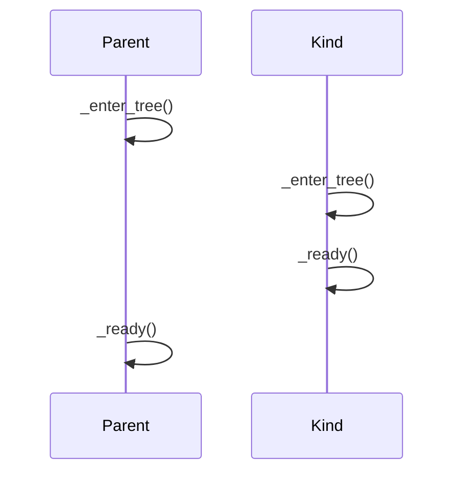

# Scenelevenscyclus, tools en configuratiewaarschuwingen

Een bewegingscomponent moet haar controller en lichaam vinden. Een toolscript moet bovendien in de editor kunnen draaien zonder daar het personage te laten wandelen. Dat zijn vragen over de levenscyclus van nodes.

## Wanneer zijn nodes beschikbaar?

Bij het toevoegen van een boom loopt `_enter_tree` van parent naar kinderen. De `_ready`-oproepen komen daarna van kinderen terug naar parent. Een parent is bij zijn `_ready` dus normaal klaar om zijn geïnitialiseerde kinderen te gebruiken.



Bij een bewegingsfunctie onder een controller kan je ancestors doorlopen om de dichtstbijzijnde geschikte `XRController3D` en `CharacterBody3D` te vinden. Een extra hulpknoop tussen component en controller breekt dat zoeken niet. Bewaar geen oude referenties als de component later een andere parent krijgt: `_enter_tree` kan opnieuw optreden, terwijl `_ready` niet standaard bij elke herintrede opnieuw wordt uitgevoerd.

Een geëxporteerde referentie is een andere geldige aanpak. Dan wijst de ontwerper de nodes in de Inspector toe. Welke aanpak je ook kiest: controleer het type en behandel ontbrekende koppelingen expliciet.

## Toolscript betekent editoruitvoering

Met `@tool` in GDScript of `[Tool]` in C# mag een script ook in de editor draaien. Dat is nuttig voor een meshgenerator of waarschuwing, maar geen opdracht om alle runtimephysics ook daar uit te voeren.

```gdscript
func _physics_process(_delta: float) -> void:
    if Engine.is_editor_hint():
        return
    # Runtimephysics komt hier.
```

```csharp
public override void _PhysicsProcess(double delta)
{
    if (Engine.IsEditorHint()) return;
    // Runtimephysics komt hier.
}
```

De C#-klasse moet daarnaast correct gebouwd zijn voordat de editor de gewijzigde code kan gebruiken.

## Waarschuwingen en typen

`_get_configuration_warnings()` geeft een `PackedStringArray` terug met één boodschap per probleem. In C# is de override `_GetConfigurationWarnings()` met returntype `string[]`. Gebruik `update_configuration_warnings()` wanneer een relevante editorinstelling verandert.

Een `class_name` registreert een GDScript-type. Zo kan je bijvoorbeeld `@export var fade_effect: FadeEffect` gebruiken en in de Inspector de juiste node koppelen. In C# declareer je de klasse met dat type; met `[GlobalClass]` kan je een geschikte Godot-klasse ook als globaal script-type voor de editor registreren.

Een geëxporteerde property met setter kan het previewbeeld bijwerken. Controleer dan of de benodigde kindnode al beschikbaar is. `is_inside_tree()` betekent dat de node in de boom staat; dat is niet hetzelfde als "alle kinderen zijn ready". Een setter kan vroeg lopen. Gebruik waar nodig `is_node_ready()`, een geldige nodereferentie en een extra update vanuit `_ready`.

Bron: Godot 4.5, [Node](https://docs.godotengine.org/en/4.5/classes/class_node.html), [Running code in the editor](https://docs.godotengine.org/en/4.5/tutorials/plugins/running_code_in_the_editor.html) en [GDScript exports](https://docs.godotengine.org/en/4.5/tutorials/scripting/gdscript/gdscript_exports.html).
