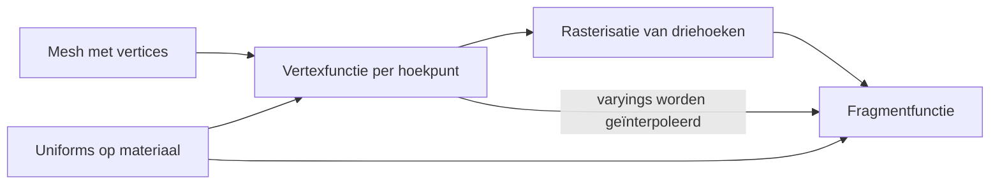

# Shaderfasen, uniforms en varyings

Voor de vignette gebruiken we vertexcode, fragmentcode, uniforms en een `varying dist`. Die namen beschrijven verschillende plaatsen en manieren waarop gegevens in de renderpipeline bewegen.

## Eerst geometrie, dan fragmenten



De vertexfunctie bepaalt waar hoekpunten worden getekend. De rasterisatie bepaalt welke fragmenten door de driehoeken worden bedekt. De fragmentfunctie berekent vervolgens de kleur en andere uitvoer voor die fragmenten.

Een fragment is niet gegarandeerd één uiteindelijke schermpixel: overdraw, multisampling en blending kunnen ertussen zitten. De vertexfunctie draait evenmin één keer per pixel.

## Drie soorten waarden

| Soort | Waar komt de waarde vandaan? | Voorbeeld |
| --- | --- | --- |
| Built-in | Godot levert haar aan of verwacht er uitvoer in. | `VERTEX`, `UV`, `POSITION`. |
| Uniform | Instelling op een materiaal of andere uniformbron. | Radius of fade. |
| Varying | De vertexfase schrijft waarden; de fragmentfase krijgt de geïnterpoleerde resultaten. | Afstand tot de ringrand. |

Een uniform is binnen de bedoelde draw-instelling gelijk voor de shaderaanroepen. Je gebruikt het niet als een persistent tellertje dat elke pixel verhoogt. In de fragmentfase heeft een varying juist vaak een andere waarde per fragment.

## Een kleine verbinding tussen de fasen

Dit is een illustratief fragment van een **spatial** shader, geen volledig vignette-effect:

```glsl
shader_type spatial;
render_mode unshaded;
uniform float strength : hint_range(0.0, 1.0) = 0.5;
varying float local_x;

void vertex() {
    local_x = VERTEX.x;
}

void fragment() {
    ALBEDO = vec3(clamp(local_x * strength, 0.0, 1.0));
}
```

Elke vertex geeft zijn lokale X-waarde door. Binnen een driehoek ontstaat via interpolatie een verloop. In de vignette doet `dist` iets vergelijkbaars met de waarden op de binnen- en buitenring. Het is dan een interpolatie van vertexwaarden, niet noodzakelijk de exact opnieuw berekende geometrische afstand van elk fragment.

Bij `canvas_item`-shaders uit de [2D-inleiding](../shaders/cursus.md) schrijf je de uiteindelijke kleur naar `COLOR`. In een spatial shader schrijf je bijvoorbeeld naar `ALBEDO` en `ALPHA`. Die uitvoervariabelen zijn dus niet onderling uitwisselbaar.

De shadercode blijft dezelfde in GDScript- en C#-projecten. Alleen het instellen van parameters op het materiaal verschilt: `set_shader_parameter` versus `SetShaderParameter`.

Bron: Godot 4.5, [Shading language](https://docs.godotengine.org/en/4.5/tutorials/shaders/shader_reference/shading_language.html) en [Spatial shaders](https://docs.godotengine.org/en/4.5/tutorials/shaders/shader_reference/spatial_shader.html).
