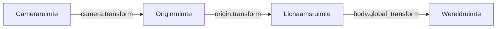

# Transforms samenstellen

Een transform beschrijft hoe je van de ene ruimte naar een andere gaat. In onze XR-boom moeten we soms door meerdere ruimtes heen: camera → origin → lichaam → wereld.

## Basis en oorsprong samen

Een `Transform3D` bestaat uit een basis `B` en een oorsprong `o`. Voor een lokaal punt `p` geldt:

```text
punt in parentruimte = B × p + o
```

De basis draait of schaalt het punt; de oorsprong verplaatst het daarna. Voor een verplaatsingsvector `d` geldt alleen `B × d`. Een verplaatsing heeft immers geen oorsprong die we moeten opschuiven.

## Van camera naar lichaam

Het bewegingshoofdstuk gebruikt deze scèneboom:



De transform die rechtstreeks van camera naar lichaam gaat, is:

```gdscript
var camera_in_body := origin.transform * camera.transform
```

```csharp
Transform3D cameraInBody = Origin.Transform * Camera.Transform;
```

Lees de toepassing op een punt van rechts naar links. Eerst verwerkt de cameratransform het punt, daarna de origintransform. De samengestelde transform is dus niet zomaar de som van twee posities.

Een rekenvoorbeeld maakt dat zichtbaar. De parent staat op `(3, 0, 1)` en is -90 graden rond Y gedraaid. Een kind staat lokaal op `(1, 0, 0)`. Zijn wereldpositie is `(3, 0, 2)`: de lokale meter langs X wordt eerst een wereldmeter langs Z en wordt daarna bij de parentpositie opgeteld.

Als je alleen posities optelt, zou je `(4, 0, 1)` krijgen. Dat lijkt bij een ongedraaide parent te werken, maar is hier verkeerd.

## De volgorde doet ertoe

`A * B` is meestal niet hetzelfde als `B * A`. Neem een punt op de oorsprong. Eerst één meter naar rechts verschuiven en daarna rond de oorsprong draaien geeft een ander eindpunt dan eerst draaien en daarna naar rechts verschuiven.

Voor de camera in wereldruimte krijgen we:

```text
camera.global_transform
  = body.global_transform × origin.transform × camera.transform
```

Dit geldt voor de getoonde directe parentrelaties. Staat er een extra `Node3D` tussen twee nodes, dan moet haar transform ook in de keten staan. Met `camera.global_transform` verwerkt Godot die volledige keten voor ons.

**Probeer zelf:** reken met een ongedraaide parent op `(5, 0, 0)` en een kind op `(2, 0, 0)`. Draai daarna de parent -90 graden rond Y en verklaar waarom het kind niet meer op wereld-X = 7 staat.

Verder: [de inverse keten](inverse-transformaties.md).

Bron: Godot 4.5, [Transform3D](https://docs.godotengine.org/en/4.5/classes/class_transform3d.html).
