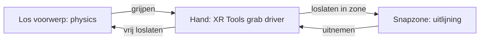

# Vasthouden en physics

Voor **Godot 4.5 en XR Tools 4.5.1**. Dit begrip ondersteunt de [les objectmanipulatie](../objectmanipulatie/cursus.md).

Een los voorwerp wordt door de physicsimulatie bewogen. Bij vastnemen neemt XR Tools de posebesturing over. De `RigidBody3D` blijft bestaan, maar de bibliotheek beheert de overgang tussen vrij bewegen en vasthouden. Dat is de reden waarom we niet tegelijk een eigen script elke frame de positie laten bepalen.

## Wie bestuurt de pose?

De hand en de zone zijn twee mogelijke houders. `is_picked_up()` betekent daarom dat er een houder is, niet noodzakelijk dat een controller het voorwerp bezit. Vraag alleen controllerinvoer op als `get_picked_up_by_controller()` werkelijk een controller teruggeeft.

Bij loslaten bepaalt `Release Mode` of de body zijn oorspronkelijke freeze-toestand herneemt, ontdooit of bevroren blijft. Een dynamisch blok en een hulpgrijppunt voor een schuif hebben dus niet dezelfde instelling nodig. In de les herneemt het blok zijn oorspronkelijke dynamische toestand; de schuifhandle blijft bevroren.

## Waarom geen tweede werpimpuls?

De pickupfunctie schat lineaire en hoeksnelheid uit opeenvolgende handposes. Daarmee kan het losgelaten voorwerp verder bewegen. Voeg je daar nog een eigen identieke werpimpuls aan toe, dan tel je dezelfde bedoeling tweemaal. Pas eerst de instellingen van die snelheidsmeting aan en vergelijk rustig loslaten met een worp.

Een botsing met het spelerslichaam kan tijdens vasthouden terugkoppeling veroorzaken. Gebruik de aparte held-layer en controleer beide botsingsmaskers. Dat probleem los je niet op door de massa willekeurig te verlagen.

**Denkvraag:** een beker staat in een snapzone en `is_picked_up()` is waar. Waarom bewijst dat niet dat de speler de grip ingedrukt houdt?

Bronnen: [XR Tools pickable](https://godotvr.github.io/godot-xr-tools/docs/pickable/), [pickup](https://godotvr.github.io/godot-xr-tools/docs/pickup/), [RigidBody3D](https://docs.godotengine.org/en/4.5/classes/class_rigidbody3d.html).
