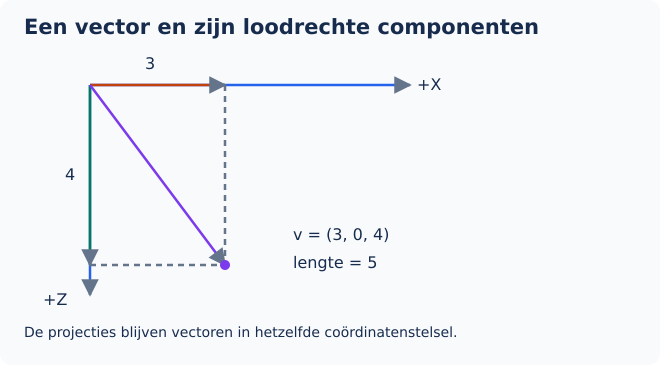

# Vectoren en projecties

De notities vragen of `project()` de snelheid omzet naar lokale ruimte. Dat doet de methode niet. Om dat te begrijpen moeten we een vector onderscheiden van de component die langs een gekozen as ligt.

## Richting en lengte

Een `Vector3` bevat drie componenten. Dezelfde datatype kan een punt, verplaatsing, richting of snelheid voorstellen; de betekenis komt uit de berekening. Een snelheid `(3, 0, 4)` heeft bijvoorbeeld lengte 5 meter per seconde.

Een genormaliseerde vector heeft lengte 1. Je behoudt daarmee alleen de richting. Dat is nuttig voor een kijkrichting, maar bij een snelheid zou je de grootte verliezen. Een nulvector heeft geen richting: controleer de lengte voor je er een oriëntatie uit probeert te maken.

## Het deel langs een as

De projectie van vector **v** op een niet-nulle as **a** is:

```text
projectie(v op a) = a × (v · a) / (a · a)
```

De punt betekent het scalair product, of dot product. De vermenigvuldiging met de breuk is hier gewone vermenigvuldiging van een vector met een getal, geen kruisproduct. Is `a` een eenheidsvector, dan wordt de noemer 1.



Een wereldsnelheid `(3, 0, 4)` projecteert op wereld-X tot `(3, 0, 0)` en op wereld-Z tot `(0, 0, 4)`. Die twee wereldvectoren tellen samen weer op tot de oorspronkelijke horizontale snelheid.

```gdscript
var v := Vector3(3.0, 0.0, 4.0)
var sideways := v.project(Vector3.RIGHT)
var along_z := v.project(Vector3.BACK)
```

```csharp
var v = new Vector3(3, 0, 4);
Vector3 sideways = v.Project(Vector3.Right);
Vector3 alongZ = v.Project(Vector3.Back);
```

In de video zijn de gekozen assen bijvoorbeeld `character_body.global_basis.x` en `.z`. De snelheid en de assen staan allebei in wereldruimte. Ook de uitkomsten staan in wereldruimte. Je splitst de snelheid volgens lichaamsrichtingen, maar zet haar niet om naar lokale getalcomponenten.

## Hoogte negeren is ook een projectie

Met `Vector3(v.x, 0, v.z)` projecteer je op het horizontale XZ-vlak. Dat is iets anders dan projecteren op één as. De lengte wordt meestal kleiner. Maak een afgevlakte kijkrichting daarom daarna opnieuw een eenheidsvector als je er een oriëntatie of vaste bewegingssnelheid uit opbouwt.

Een dot product tussen twee eenheidsvectoren geeft ook de cosinus van de hoek. Het is 1 voor dezelfde richting, 0 voor loodrechte richtingen en -1 voor tegengestelde richtingen. Zo kan je bijvoorbeeld meten of een vloernormaal voldoende omhoog wijst om als vloer te tellen.

**Controleer jezelf:** verandert het coördinatenstelsel als je een wereldvector op een wereldas projecteert? Nee. Voor een echte ruimteomzetting heb je een [basis of inverse basis](inverse-transformaties.md) nodig.

Bron: Godot 4.5, [Vector math](https://docs.godotengine.org/en/4.5/tutorials/math/vector_math.html) en [Vector3](https://docs.godotengine.org/en/4.5/classes/class_vector3.html).
