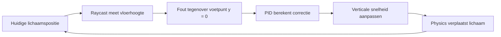

# Vloerondersteuning en een PID-regelaar

Om trappen te kunnen oplopen gebruikt de tutorialbroncode een bovenlichaamscapsule, een neerwaartse raycast en een regelaar voor de verticale ondersteuning.

## Waarom geen gewone volledige capsule?

Een capsule tot op de vloer botst tegen de verticale voorkant van een trede. `move_and_slide()` is geen automatische step-up-functie. De video laat de benen daarom vrij en bewaart alleen een [bovenlichaamscapsule](capsules-en-bukken.md).

De raycast start bij de onderkant van dat bovenlichaam en zoekt de vloer onder de speler. Zijn raakpunt staat in wereldruimte. Omgerekend naar lichaamsruimte zegt de Y-waarde hoeveel de gevonden vloer boven of onder de verwachte voetpositie ligt.

Een raakpunt op lokaal Y = 0,15 betekent: de vloer ligt 15 centimeter boven het huidige voetpunt. Het lichaam moet omhoog. Zonder raakpunt is er geen vloerondersteuning en blijft zwaartekracht werken. Controleer ook de vloernormaal; een wand is geen geschikte vloer.

## Een terugkoppellus

Een PID-regelaar combineert drie bijdragen:

| Term | Berekening | Idee |
| --- | --- | --- |
| P | `kp * error` | Reageer op de huidige fout. |
| I | `ki * integral` | Bouw correctie op voor aanhoudende fout. |
| D | `kd * derivative` | Reageer op de verandering van de meting. |

Hier kiezen we `error = gemeten_vloer_y - 0`. Positief betekent dus omhoog corrigeren. Veel andere PID-uitleg kiest `target - current`; dan moet je de richting en de rest van de regelketen mee controleren. Alleen een formule kopiëren is niet genoeg.

De integraal telt `error * delta` op. Begrens hem om onbeperkt oplopen te vermijden en reset opgebouwde toestand als de ondersteuning verdwijnt. De afgeleide gebruikt `(meting - vorige_meting) / delta`; bij de eerste meting bestaat er nog geen vorige waarde, dus slaan we die bijdrage dan over.

## Eenheden en afstelling

In deze tutorial levert de som een **snelheidsaanpassing per physics-tick** die bij de verticale snelheid wordt opgeteld. Dat is geen generieke kracht of versnelling. Verander je de physicsfrequentie, dan kan de regeling anders reageren en moet je de gains opnieuw bekijken. Een tijdsgebaseerde regelaar met versnellingsuitvoer zou de tijdstap elders verwerken.

De correctie moet ook de zwaartekracht kunnen compenseren. Zonder voldoende regeling kan het voetpunt wat onder de gevonden vloer blijven liggen. Met te sterke gains kan het lichaam veren of trillen. De integrale begrenzing beperkt ophoping, maar is geen volledige anti-windupstrategie voor elke actuatorbeperking.

Eén raycast is geen benenmodel. Smalle randen, hoge treden, bewegende platforms en zeer laag bukken vragen verdere logica. Het voordeel is dat deze eenvoudige lus goed zichtbaar maakt hoe meten, corrigeren en opnieuw meten samenhangen.

Bron: [Tutorialbroncode van deel 3](https://raw.githubusercontent.com/BastiaanOlij/godot4_tutorial/first_person_controller_part3/player/character_body_3d.gd), Godot 4.5 [RayCast3D](https://docs.godotengine.org/en/4.5/classes/class_raycast3d.html) en [CharacterBody3D](https://docs.godotengine.org/en/4.5/classes/class_characterbody3d.html). De regelaar is de tutorialaanpak, geen ingebouwde PID-API van Godot.
