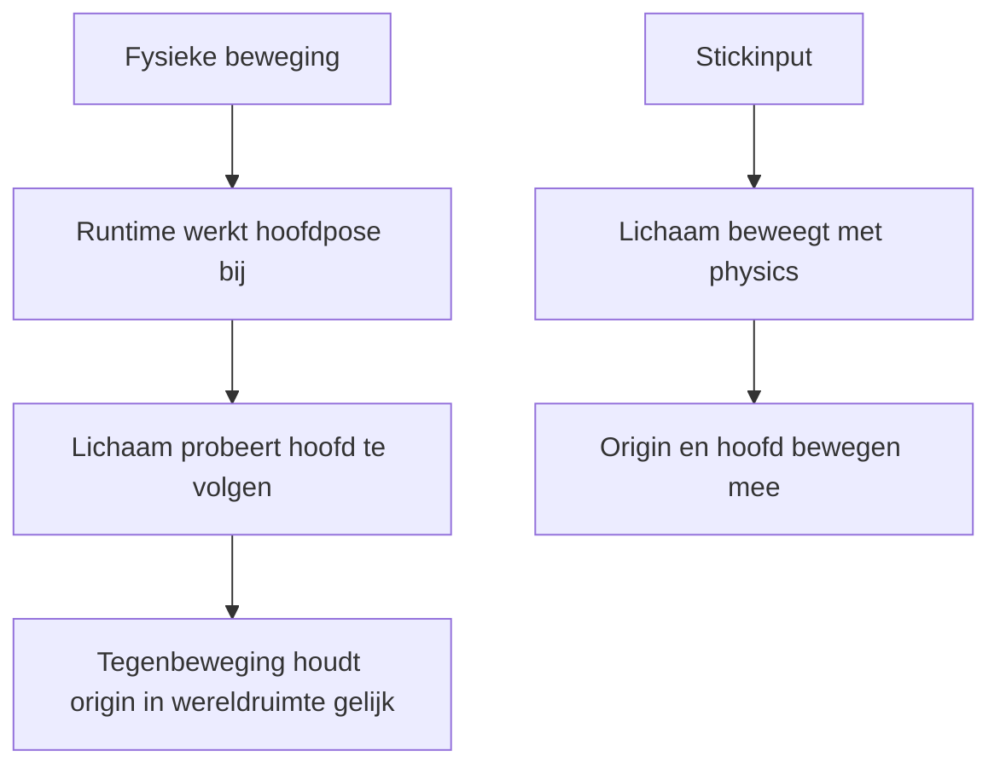

# XR-tracking en tegenbeweging

De origin is niet de speler. Ze beschrijft waar de trackingruimte in de spelwereld ligt. Het hoofd en de handen krijgen daarbinnen hun gevolgde pose.

## Wie bestuurt welke beweging?

De XR-runtime werkt de pose van `XRCamera3D` en `XRController3D` bij. Zelf die lokale transforms overschrijven is geen betrouwbare manier om de speler te verplaatsen: tracking kan ze opnieuw invullen. Voor virtuele verplaatsing bewegen we de origin of haar parent.



De notitie "fysieke beweging mag origin niet verplaatsen" bedoelt hier **de wereldtransform** van de origin. Haar lokale transform moet juist veranderen om de beweging van het lichaam te compenseren.

## Een stap in getallen

We bekijken alleen de X-as. Begin met lichaam en origin op nul. De speler zet fysiek 30 centimeter naar rechts. De camera staat nu lokaal tegenover de origin op 0,30.

| Toestand | Lichaam wereld-X | Origin lokaal-X onder lichaam | Origin wereld-X | Camera wereld-X |
| --- | --- | --- | --- | --- |
| Na de fysieke stap, voor het volgen | 0,00 | 0,00 | 0,00 | 0,30 |
| Lichaam volgt, nog geen correctie | 0,30 | 0,00 | 0,30 | 0,60 |
| Tegenbeweging toegepast | 0,30 | -0,30 | 0,00 | 0,30 |

Zonder correctie zouden we de echte beweging dubbel zien. De tegenbeweging verwijdert alleen de extra verplaatsing die door de parentrelatie ontstond.

Botst het lichaam na 10 centimeter tegen een muur, dan compenseren we ook maar 10 centimeter. Het lichaam eindigt op 0,10, de origin lokaal op -0,10 en het hoofd nog steeds op wereld-X = 0,30. De resterende afstand van 20 centimeter is relevant voor de [fade](fade-en-vignette.md).

## Ook rotatie compenseren

Fysiek draaien vraagt dezelfde afspraak: het lichaam mag de horizontale hoofdrichting volgen, maar de trackingruimte mag daardoor niet opnieuw draaien. Een leesbare aanpak is de wereldtransform van de origin te bewaren voor je het lichaam aanpast, en die daarna te herstellen.

```gdscript
var saved_origin := origin.global_transform
# Verplaats en draai hier het lichaam op basis van de fysieke hoofdpose.
origin.global_transform = saved_origin
```

```csharp
Transform3D savedOrigin = Origin.GlobalTransform;
// Pas hier het lichaam aan op basis van de fysieke hoofdpose.
Origin.GlobalTransform = savedOrigin;
```

Dit is een patroon, geen complete bewegingsmethode. Het hoort alleen rond het volgen van fysieke beweging. Rond stickbeweging zou het juist de gewenste virtuele beweging ongedaan maken.

Bron: Godot 4.5, [Room scale in XR](https://docs.godotengine.org/en/4.5/tutorials/xr/xr_room_scale.html).
