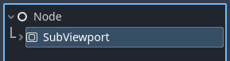
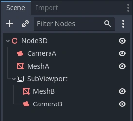
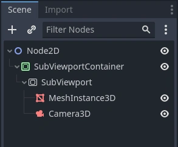

# Zien wat er in VR gebeurt

## Inleiding

Wanneer je een gewoon spel debugt, kan je naar het scherm kijken terwijl je de besturing gebruikt. Bij VR is dat minder vanzelfsprekend. De speler heeft een headset op en ziet iets anders dan de mensen rond de computer. Bovendien toont een gewoon spiegelbeeld van de headset niet hoe het virtuele lichaam ten opzichte van het hoofd beweegt.

Dat maakt een eenvoudige fout soms verrassend moeilijk te onderzoeken. De speler zegt bijvoorbeeld dat hij niet verder kan wandelen. Botst de capsule tegen een muur? Staat het lichaam nog wel onder het hoofd? Is de camera al voorbij het obstakel geraakt? Vanuit het headsetbeeld alleen kan je dat niet altijd onderscheiden.

In deze les bouwen we daarom een **spectator view**: een bureaubladvenster waarmee je de speler van buitenaf volgt. In een kleine first-person preview tonen we ook een rustiger firstpersonbeeld. Zo kan iemand in VR testen, terwijl iemand anders kijkt naar wat de verschillende onderdelen doen.

We volgen de video [Godot XR Spectator View](https://www.youtube.com/watch?v=VvTLP3neEbg) van Bastiaan Olij. De eigenlijke uitleg begint rond 0:53; de korte aankondigingen ervoor zijn geen onderdeel van deze les. Er waren voor dit hoofdstuk geen voorafgaande notities. De uitwerking steunt op de hoofdstukbeschrijvingen en de [bijbehorende broncode](https://github.com/BastiaanOlij/godot4_tutorial/tree/spectator_view), aangevuld met de officiële documentatie.

Net als bij het [hoofdstuk beweging](../beweging/cursus.md) gebruiken we **Godot 4.5** als referentie. De tutorialbroncode vermeldt Godot 4.4. Voor C# heb je de .NET-uitgave van Godot nodig. Je vertrekt van een werkende XR-hoofdscène; deze les vervangt haar OpenXR-opstartcode en bewegingscontroller niet.

## Wat willen we kunnen zien?

*Video, 0:53–1:45.*

We willen drie beelden van dezelfde wereld:

| Beeld | Voor wie? | Camera |
| --- | --- | --- |
| Het headsetbeeld | De speler | `XRCamera3D`, met de projectie van de XR-runtime. |
| Een groot buitenaanzicht | De persoon die observeert | Een gewone `Camera3D` die naar de speler kijkt. |
| Een kleine first-person preview | De persoon die observeert | Een gewone `Camera3D` die de hoofdpose afgevlakt volgt. |

Het buitenaanzicht laat zien waar hoofd, handen en lichaamscollider zich bevinden. De first-person preview helpt om dat te koppelen aan de richting waarin de speler kijkt. Het is geen exacte kopie van één oog: onze gewone camera heeft haar eigen projectie, beeldverhouding en instellingen.

We veranderen hiervoor niets aan de fysieke hoofdtracking. De echte `XRCamera3D` moet de speler rechtstreeks blijven volgen. Alleen het beeld voor de toeschouwer maken we rustiger.

## Eén wereld, verschillende viewports

*Video, 2:34–4:15.*

Een `Viewport` is het onderdeel dat een beeld laat renderen. Het hoofdvenster van Godot heeft er al één. Met een `SubViewport` kunnen we extra beelden laten maken zonder er telkens een nieuw besturingssysteemvenster voor te openen.



*Screenshot uit de officiële documentatie: een `SubViewport` is een node in onze scène. Zijn beeld moet nog een bestemming krijgen, bijvoorbeeld een headset of een `SubViewportContainer`.*

Een camera behoort tot de dichtstbijzijnde viewport boven haar in de scèneboom. Dat is belangrijk: als je twee gewone camera's in dezelfde viewport zet en telkens `make_current()` oproept, maak je daar niet twee gelijktijdige beelden mee. De laatst gekozen camera wordt de actieve camera van die viewport.



*De twee camera's horen bij verschillende viewports. Die scheiding gebruiken we ook voor de buitencamera en de first-person preview.*

De zichtbare objecten hoeven we daarvoor niet te kopiëren. Viewports gebruiken een `World3D`: de gedeelde 3D-wereld waarin objecten worden geregistreerd. Een nieuwe subviewport gebruikt standaard de wereld van de bovenliggende viewport, zolang je geen eigen wereld opgeeft.

Dat is precies wat we nodig hebben. **We maken de spelwereld en de speler maar één keer aan.** De verschillende camera's bekijken diezelfde toestand. Als je de hoofdscène drie keer instantieert, krijg je drie spelers, drie werelden of overlappende kopieën, niet drie betrouwbare beelden van dezelfde simulatie.

## Een spectator-scène rond het spel bouwen

*Video, 1:45–4:15.*

Bewaar je bestaande XR-hoofdscène, bijvoorbeeld `main.tscn`. Maak daarnaast een nieuwe scène met een `Control` als root en noem die `SpectatorView`. Maak de Control schermvullend met de layoutinstelling **Full Rect**.

Voeg een `SubViewport` met naam `HMD` toe en instantieer de bestaande hoofdscène daaronder. De buitencamera komt rechtstreeks onder `SpectatorView`. Voor de first-person preview gebruiken we een tweede subviewport, deze keer onder een `SubViewportContainer`.

```text
SpectatorView (Control)                       ← SpectatorView-script
├── ThirdPersonCamera (Camera3D)               ← ThirdPersonCamera-script
├── Frame (ColorRect)
│   └── FirstPersonContainer (SubViewportContainer)
│       └── FirstPersonViewport (SubViewport)
│           └── StabilizedCamera (Camera3D)    ← StabilizedCamera-script
├── FOVSlider (HSlider)
└── HMD (SubViewport)
    └── Main (instantie van je bestaande XR-scène)
        ├── World
        └── Player (CharacterBody3D)
            ├── BodyCollisionShape
            └── XROrigin3D
                ├── XRCamera3D
                │   └── HeadVisual (optionele mesh)
                ├── LeftHand
                └── RightHand
```

De namen onder `Main` zijn een voorbeeld en sluiten aan op het bewegingshoofdstuk. Je hoeft je bestaande speler niet te hernoemen. We koppelen de belangrijke nodes via geëxporteerde referenties in de Inspector, zodat de scripts niet afhangen van een lang, letterlijk uitgeschreven pad.

Laat bij beide subviewports **Own World 3D** uitgeschakeld. Een aparte `World3D` zou onze camera's immers van de bestaande wereld scheiden. De volledige voorbeelden koppelen bovendien beide subviewports expliciet aan de wereld van het bureaubladvenster. Dat is niet nodig bij de standaardovererving, maar maakt zichtbaar dat we één wereld bedoelen.

### Alleen de juiste viewport krijgt XR-output

Dit is de belangrijkste wijziging aan de bestaande XR-opstartcode. Gebruik in het script op `Main` de viewport waarin die scène **nu** staat:

```gdscript
# In je bestaande Main-script, nadat OpenXR succesvol geïnitialiseerd is:
var xr_viewport := get_viewport()
xr_viewport.use_xr = true
```

```csharp
// In je bestaande Main-script, nadat OpenXR succesvol geïnitialiseerd is:
Viewport xrViewport = GetViewport();
xrViewport.UseXR = true;
```

Vroeger was dat misschien het hoofdvenster. Na het inpakken van de scène is het `HMD`. Dezelfde regel blijft dus bruikbaar wanneer je `Main` rechtstreeks start of wanneer je de spectator-scène start.

Gebruik hier niet zonder nadenken `get_tree().root` / `GetTree().Root`. Dan zou je opnieuw XR-output op het bureaubladvenster inschakelen, terwijl we dat venster net voor het spectatorbeeld willen behouden. Eventuele andere XR-specifieke viewportinstellingen, zoals VRS, horen eveneens op de HMD-viewport.

Voor de hoofdviewport en de first-person preview blijft `use_xr` uit. `HMD` heeft geen `SubViewportContainer` nodig: zijn uitvoer gaat via de XR-interface naar de headset. Geef deze viewport ook niet zomaar de afmetingen van onze kleine first-person preview; de XR-runtime bepaalt de benodigde headsetresolutie.

### Welke scène start het project?

Stel voor desktopgebruik de spectator-scène in als **Main Scene**. `Main` zit daar al één keer in als kind van `HMD`.

De video gebruikt daarnaast een `mobile`-override voor `application/run/main_scene`, zodat op de bedoelde standalone mobiele headset rechtstreeks `main.tscn` start. Dat voorkomt dat daar ook de desktopcamera's en de slider worden aangemaakt.

De featuretag `mobile` betekent niet automatisch "elke headset". Een desktopheadset gebruikt nog steeds een desktopplatform. Kies de override dus volgens de platformen waarop je echt exporteert. Je kan deze werkwijze controleren in de [projectinstellingen van de video](https://raw.githubusercontent.com/BastiaanOlij/godot4_tutorial/spectator_view/project.godot).

## De speler van buitenaf bekijken

*Video, 4:15–5:00 en 7:10–7:50.*

Plaats `ThirdPersonCamera` op een vaste plek in de testruimte, bijvoorbeeld op `(0, 2, -3)`. Koppel haar `target` aan de XR-camera of aan een hulpknoop bij het hoofd. Maak de camera actief voor het hoofdvenster.

We laten deze camera elke frame naar het doel kijken:

```gdscript
# Op een Camera3D; target is een geëxporteerde Node3D-referentie.
func _process(_delta: float) -> void:
    if is_instance_valid(target):
        look_at(target.global_position, Vector3.UP)
```

```csharp
// Op een Camera3D; Target is een geëxporteerde Node3D-referentie.
public override void _Process(double delta)
{
    if (GodotObject.IsInstanceValid(Target))
        LookAt(Target.GlobalPosition, Vector3.Up);
}
```

Dat verandert de richting, niet de positie van de camera. De camera blijft dus op haar statief staan en draait mee om de speler in beeld te houden. Dat is voldoende voor een kleine testruimte. In een groter level zal je ook de positie moeten aanpassen of verschillende camerastandpunten voorzien.

De volledige scripts [third_person_camera.gd](code/gdscript/third_person_camera.gd) en [ThirdPersonCamera.cs](code/csharp/ThirdPersonCamera.cs) controleren ook of doel en camera bijna samenvallen. Verder kiezen ze een andere opwaartse referentie wanneer het doel bijna recht boven of onder de camera staat. `look_at` kan uit een nulrichting of uit twee parallelle richtingassen immers geen bruikbare oriëntatie opbouwen.

## Zichtbaarheid regelen met renderlagen

*Video, 5:00–7:10.*

Van buitenaf willen we zaken kunnen zien die voor de speler storend zijn: een model van de headset, de lichaamscapsule of de gekleurde assen uit de tutorial. Omgekeerd willen we niet dat een full-screen effect zoals een zwart fadevlak de volledige buitenwereld afdekt.

Daarvoor gebruiken we **3D-renderlagen** en het **Cull Mask** van elke camera. Een `MeshInstance3D` kan op verschillende visual layers staan. Een camera tekent die mesh wanneer minstens één van die lagen in haar mask ingeschakeld is.

Geef onder **Project Settings → Layer Names → 3D Render** de eerste vier lagen duidelijke namen. We volgen de indeling uit de video:

| Laag | Naam | Voorbeelden |
| --- | --- | --- |
| 1 | World | Vloer, muren en andere gewone spelobjecten. |
| 2 | HMD only | Objecten of effecten die alleen de speler moet zien. |
| 3 | Spectator only | Headsetmodel, zichtbare capsule en debugassen. |
| 4 | First person view only | Effecten die ook in de first-person preview mogen verschijnen. |

Vervolgens kiezen we deze cameramasks:

| Camera | Actieve lagen | Numerieke waarde |
| --- | --- | --- |
| `XRCamera3D` | 1 en 2 | `1 + 2 = 3` |
| `ThirdPersonCamera` | 1 en 3 | `1 + 4 = 5` |
| `StabilizedCamera` | 1 en 4 | `1 + 8 = 9` |

De binaire waarden zijn vooral belangrijk wanneer je zichtbaarheid in code wil instellen.

Let op: renderlagen zijn iets anders dan **physics collision layers en masks**. Als je een capsulemesh onzichtbaar maakt voor de headset, blijft de bijbehorende collision shape gewoon botsen. Dat is precies de bedoeling.

### Een zichtbaar hoofd en een schaduw

Een headsetmodel onder de XR-camera kan nuttig zijn voor de toeschouwer. Zet de `MeshInstance3D`-nodes van dat model op laag 3 en haal laag 1 weg. Alleen laag 3 toevoegen is niet voldoende wanneer het model ook op een laag blijft staan die de headsetcamera tekent.

In de videobroncode staat ook een afzonderlijke mesh die alleen een schaduw werpt. Daarvoor bestaat de instelling **Cast Shadow → Shadows Only**. Zo kan je een hoofdschaduw behouden zonder de eigen hoofdmesh in het headsetbeeld te tekenen. Schaduwen, lichtlagen en indirecte belichting hebben wel eigen regels: een camera-cullmask is geen algemene knop om alle invloed van een object op belichting uit te schakelen. Test het uiteindelijke resultaat met je renderer en lampen.

## Een kleine first-person preview maken

*Video, 7:50–9:00.*

Voeg een `ColorRect` toe als omlijsting. Plaats daarin een `SubViewportContainer`, met daaronder een `SubViewport` en een gewone `Camera3D`.



*De container toont de texture van zijn subviewport. Het voorbeeld uit de documentatie heeft ook een mesh in de subviewport; in onze opstelling gebruiken we de al bestaande gedeelde wereld.*

Kies bijvoorbeeld deze afmetingen:

- een frame van 310 bij 310 pixels, op 10 pixels van de linkerbovenhoek;
- een container van 300 bij 300 pixels, met 5 pixels marge binnen het frame;
- een subviewport met `size = (300, 300)`.

Laat **Stretch** op de container voor deze vaste opstelling uit. Staat Stretch aan, dan beheert de container de viewportgrootte en kan je die niet meer onafhankelijk instellen. Dat is ook een geldige aanpak, maar kies één systeem. Een subviewport moet in beide dimensies minstens 2 pixels groot zijn om iets weer te geven.

Zet **Render Target → Update Mode** voor de first-person preview op **Always** en maak `StabilizedCamera` actief. Zowel de bureaubladcamera als deze camera kan tegelijk actief zijn, omdat ze tot verschillende viewports behoren.

Plaats onder het frame een `HSlider`; die gebruiken we straks voor de kijkhoek. De insetcamera heeft geen eigen speler, eigen collision logic of tweede kopie van `Main` nodig. Ze bekijkt dezelfde `World3D` als de andere camera's.

## Het firstpersonbeeld stabiliseren

*Video, 9:00–10:40.*

Als we de hoofdtransform rechtstreeks kopiëren, krijgt de toeschouwer elke kleine hoofdbeweging te zien. Dat kan onrustig zijn. We maken daarom alleen deze extra camera wat trager en houden haar horizon recht.

Het woord "stabiliseren" betekent hier twee dingen: roll verwijderen en veranderingen geleidelijk volgen. We behandelen die apart.

### De horizon recht houden

Neem de lokale transform van de XR-camera. De voorwaartse richting halen we uit de negatieve Z-as van haar basis. Met `Basis.looking_at` bouwen we daar een nieuwe oriëntatie bij, met de wereldwijde Y-richting als opwaartse referentie:

```gdscript
var adjusted := xr_camera.transform
var forward := -adjusted.basis.z.normalized()
if absf(forward.dot(Vector3.UP)) < 0.999:
    adjusted.basis = Basis.looking_at(forward, Vector3.UP)
```

```csharp
Transform3D adjusted = XrCamera.Transform;
Vector3 forward = -adjusted.Basis.Z.Normalized();
if (Mathf.Abs(forward.Dot(Vector3.Up)) < 0.999f)
    adjusted.Basis = Basis.LookingAt(forward, Vector3.Up);
```

Hier behouden we zowel links/rechts kijken als omhoog/omlaag kijken. Wat verdwijnt, is **roll**: het schuin houden van het hoofd alsof je je oor naar je schouder brengt. In de oorspronkelijke code staat bij deze bewerking de commentaar "Remove pitch", maar de berekening verwijdert pitch niet. Ze maakt de horizon recht bij dezelfde kijkrichting.

Dat verschilt van de rotatiecode uit het bewegingshoofdstuk. Daar zetten we de Y-component van de kijkrichting op nul om het lichaam rechtop te laten staan. Hier doen we dat niet: de toeschouwer moet wel kunnen zien dat de speler naar een voorwerp op de grond kijkt.

Dicht bij recht omhoog of omlaag is een horizon niet eenduidig af te leiden. De volledige voorbeelden behouden in dat geval de gemeten oriëntatie, na orthonormaliseren. Dat vermijdt een ongeldige `looking_at`, maar is geen volwaardig systeem voor een camera die voortdurend over die verticale grens heen draait.

### Beweging en rotatie afvlakken

Voor de positie gebruiken we `lerp`; voor de basis gebruiken we `slerp`. Die laatste volgt een geleidelijke rotatie tussen de twee oriëntaties. We gaan uit van ongeschaalde cameratransforms, zoals in onze XR-opstelling.

```gdscript
var weight := 1.0 - exp(-delta / maxf(smooth_delay, 0.001))
previous.origin = previous.origin.lerp(adjusted.origin, weight)
previous.basis = previous.basis.slerp(adjusted.basis, weight)
```

```csharp
float weight = 1.0f - Mathf.Exp(-(float)delta / Mathf.Max(SmoothDelay, 0.001f));
previous.Origin = previous.Origin.Lerp(adjusted.Origin, weight);
previous.Basis = previous.Basis.Slerp(adjusted.Basis, weight);
```

`smooth_delay` is hier een tijdconstante. Een grotere waarde geeft een trager beeld dat verder achterloopt. Na ongeveer één tijdconstante is circa 63 procent van een plots verschil weggewerkt; het is dus geen vaste vertraging waarna de camera ineens aankomt.

De videocode gebruikt `delta / smooth_delay` als interpolatiefactor. Onze voorbeelden gebruiken de exponentiële vorm. Die blijft voor een positieve tijdstap tussen 0 en 1 en schiet bij een traag frame niet voorbij het doel.

### Terug naar wereldcoördinaten

Onze tussenwaarde staat nog in de lokale ruimte van de XR-origin. De first-person previewcamera heeft een andere parent. We mogen de tussenwaarde dus niet zomaar naar haar lokale `transform` kopiëren.

```gdscript
var origin := xr_camera.get_parent() as Node3D
global_transform = origin.global_transform * previous
```

```csharp
var origin = (Node3D)XrCamera.GetParent();
GlobalTransform = origin.GlobalTransform * previous;
```

Zo krijgen we de afgevlakte hoofdpose op de juiste plaats in de wereld. Veranderingen aan de origin worden rechtstreeks meegenomen; de filtering gebeurt in trackingruimte. Als je in plaats daarvan de volledige wereldtransform afvlakt, vertraag je ook originbewegingen en virtuele rotaties. Dat kan een gewenst filmeffect zijn, maar is een andere keuze dan in deze video.

Initialiseer `previous` met de actuele pose, niet met een willekeurig punt in de wereld. Anders vliegt de camera bij het opstarten eerst naar de speler toe. In de volledige scripts kan je met `reset_smoothing()` / `ResetSmoothing()` opnieuw beginnen vanaf de huidige pose, bijvoorbeeld na recentering of wanneer je van gevolgde speler verandert.

Nog eens: schrijf deze afgevlakte transform alleen naar de gewone insetcamera. Pas haar nooit toe op de echte `XRCamera3D`. De speler hoort geen extra cameravertraging van onze spectatorfunctie te krijgen.

## De kijkhoek instelbaar maken

*Video, 10:40–11:45.*

Een headset heeft een breed beeld, maar onze first-person preview is een klein vierkant. Wat daarin prettig leesbaar is, hangt af van wat je onderzoekt. Daarom voegt de video een slider toe voor het field of view, kortweg FOV.

Gebruik een `HSlider` met minimum 60, maximum 120 en bijvoorbeeld stapgrootte 1. Initialiseer de slider met de huidige `fov` van de insetcamera en koppel `value_changed` aan een methode:

```gdscript
# In het Control-script van SpectatorView:
func _on_fov_changed(value: float) -> void:
    inset_camera.fov = value
```

```csharp
// In het Control-script van SpectatorView:
private void OnFovChanged(double value)
{
    InsetCamera.Fov = (float)value;
}
```

Een grotere kijkhoek toont meer van de omgeving, maar maakt objecten kleiner. Een kleinere kijkhoek toont minder, met grotere details. De betekenis als horizontale of verticale hoek hangt ook samen met `Camera3D.keep_aspect`; laat voor deze oefening de standaardinstelling staan en houd de first-person preview vierkant.

De slider verandert alleen onze gewone insetcamera. De headset gebruikt een door de runtime bepaalde projectie. Dit is dus geen instelling om het optische zichtveld van de headset aan te passen.

In de volledige code gebeurt het instellen van de beginwaarde met `set_value_no_signal` / `SetValueNoSignal`. Zo zetten we de slider op de camerawaarde zonder tijdens de initialisatie al een wijzigingssignaal af te handelen. Verbind het signaal niet nog eens via de editor wanneer je het meegeleverde script gebruikt; dat script regelt de koppeling zelf.

## Met deze opstelling fouten onderzoeken

Het doel is niet alleen een mooi beeld te maken. We willen hypotheses kunnen controleren. Stel dat de speler door een muur kan kijken. Bekijk dan tegelijk de hoofdmesh, de lichaamscapsule en de first-person preview.

Blijft de capsule bij de muur terwijl het hoofd verdergaat, dan werkt de lichaamsbotsing waarschijnlijk wel. Je moet dan de hoofdquery en fade onderzoeken. Gaat ook de capsule door de muur, controleer dan eerst de physics-collider en collision masks. Dat zijn twee verschillende problemen, ook al omschrijft de speler beide als "ik ga door de muur".

Je kan een zichtbare capsulemesh op laag 3 gebruiken. Wil je de echte physicsvormen controleren, dan kan je in de editor ook **Debug → Visible Collision Shapes** inschakelen. Die ingebouwde debugweergave is een aparte voorziening; verwacht niet dat haar weergave zich precies volgens de eigen laag-3-afspraak gedraagt. Test daarvoor in een debugrun.

Bekijk tijdens het draaien ook de **Remote** scèneboom en Inspector. Daar zie je de runtime-instanties, in plaats van alleen de opgeslagen editorwaarden. Controleer bijvoorbeeld welke viewport `use_xr` heeft, welke camera actief is en of de origin beweegt wanneer je dat verwacht.

Gebruik de profiler en monitors om de belasting te vergelijken met en zonder spectatorbeelden. Dezelfde wereld delen betekent dat je de simulatie niet driemaal uitvoert, maar de extra camera's moeten wel opnieuw renderen. Stereo-XR heeft bovendien al twee oogaanzichten. Multiview en andere rendereroptimalisaties maken de kost geen eenvoudige vaste vermenigvuldiging, maar extra beelden zijn niet gratis.

Begin daarom met een kleine first-person preview van 300 bij 300 pixels. Onderzoek afzonderlijk wat het uitschakelen van de first-person preview, lagere spectatorresolutie of eenvoudigere schaduwen doet. Vermijd dat een debugfunctie de headsetframerate zo sterk verlaagt dat ze het onderzochte probleem zelf veroorzaakt.

## Als er iets niet zichtbaar is

| Wat zie je? | Wat controleer je eerst? |
| --- | --- |
| De headset werkt, maar het desktopbeeld is verkeerd of verdwenen. | Staat XR alleen aan op `HMD`, en blijft het rootvenster een gewone viewport? |
| De first-person preview blijft zwart of leeg. | Grootte minstens 2 × 2, update mode, actieve camera, gedeelde `World3D` en zichtbare wereldlagen. |
| De first-person preview toont een andere speler of een dubbele wereld. | Is `Main` maar één keer geïnstantieerd? Staat `Own World 3D` uit? |
| De capsule is zichtbaar in de headset. | Staat de capsulemesh uitsluitend op laag 3, en bevat het headsetmask die laag niet? |
| De buitencamera wordt plots helemaal zwart. | Renderen fade of vignette ook op een laag die de buitencamera tekent? |
| De first-person preview kijkt vanaf de verkeerde plek. | Is de lokale hoofdpose met de wereldtransform van de origin gecombineerd? |
| De horizon blijft schuin. | Wordt de gewone insetcamera bijgewerkt, en is de hoofdpose niet bijna verticaal? |
| De slider verandert niets. | Stuurt hij de gewone insetcamera aan, en is het signaal precies één keer gekoppeld? |
| De speler ervaart vertraagde hoofdtracking. | Is stabilisatie per ongeluk op de XR-camera toegepast? Verwijder die ingreep daar. |

Een breakpoint kan de simulatie volledig stilleggen. Doe zo'n proef met de speler in een rustige, afgesproken houding. Voor het volgen van doorlopende beweging zijn een buitenaanzicht, runtimewaarden en de profiler vaak handiger dan voortdurend pauzeren.

## Zelf uitproberen

1. Start met één vloer en één speler. Controleer dat de headset, de buitencamera en de first-person preview dezelfde objecten tonen.
2. Zet de debugcapsule en het hoofdmodel op laag 3. Controleer dat ze alleen in het buitenaanzicht zichtbaar zijn.
3. Laat de speler fysiek stappen en daarna met de stick bewegen. Leg uit welke verplaatsing van lichaam en origin je verwacht en vergelijk dat met het beeld.
4. Kantel je hoofd naar je schouder en kijk daarna omhoog. De first-person preview moet de horizon grotendeels recht houden, maar omhoog kijken wel behouden.
5. Vergelijk `smooth_delay = 0.05` met `0.3`. Let zowel op de rust van het beeld als op het achterlopen.
6. Verander de FOV van de first-person preview. Controleer dat de echte headsetprojectie en het buitenaanzicht daardoor niet veranderen.
7. Test fade bij een muur. Laat het effect eerst in headset en first-person preview verschijnen en daarna alleen in de headset. Controleer dat het buitenaanzicht in beide gevallen bruikbaar blijft.
8. Vergelijk de gemeten frametijd met en zonder first-person preview. Noteer welke configuratie je gebruikte, zodat de metingen vergelijkbaar blijven.

Als uitbreiding kan je tussen meerdere vaste buitencamera's schakelen. Een andere oefening is een klein paneel met de afstand tussen hoofd en lichaam, de actieve comfortinstellingen en de actuele snelheid. Laat die waarden uit de bestaande speler komen; maak voor je debugpaneel geen tweede simulatie van de beweging.

## Bronnen

| Bron | Gebruikt voor |
| --- | --- |
| [Godot XR Spectator View](https://www.youtube.com/watch?v=VvTLP3neEbg) | Onderwerpen, volgorde en tijdstippen van de les. |
| [Tutorialbranch spectator_view](https://github.com/BastiaanOlij/godot4_tutorial/tree/spectator_view) | Scèneboom, projectinstellingen, camerafuncties en renderlagen. |
| [Viewports](https://docs.godotengine.org/en/4.5/tutorials/rendering/viewports.html) | Actieve camera per viewport, gedeelde wereld en het tonen van subviewportbeelden. |
| [Setting up XR](https://docs.godotengine.org/en/4.5/tutorials/xr/setting_up_xr.html) | Apart XR-outputpad en de viewport waarop `use_xr` wordt ingesteld. |
| [Viewport](https://docs.godotengine.org/en/4.5/classes/class_viewport.html) en [SubViewport](https://docs.godotengine.org/en/4.5/classes/class_subviewport.html) | `World3D`, XR, update mode en viewportgrootte. |
| [Camera3D](https://docs.godotengine.org/en/4.5/classes/class_camera3d.html) en [XRCamera3D](https://docs.godotengine.org/en/4.5/classes/class_xrcamera3d.html) | Cullmasks, FOV, actieve camera's en XR-projectie. |
| [Node3D](https://docs.godotengine.org/en/4.5/classes/class_node3d.html) en [Basis](https://docs.godotengine.org/en/4.5/classes/class_basis.html) | `look_at`, transforms en rotatie-interpolatie. |
| [VisualInstance3D](https://docs.godotengine.org/en/4.5/classes/class_visualinstance3d.html) en [GeometryInstance3D](https://docs.godotengine.org/en/4.5/classes/class_geometryinstance3d.html) | Visual layers en alleen een schaduw tekenen. |
| [XR full screen effects](https://docs.godotengine.org/en/4.5/tutorials/xr/xr_full_screen_effects.html) | Verschil tussen gewone en asymmetrische XR-projectie. |
| [Overview of debugging tools](https://docs.godotengine.org/en/4.5/tutorials/scripting/debug/overview_of_debugging_tools.html) | Remote Inspector, collisionweergave, profiler en monitors. |

De oorspronkelijke videolink blijft bewaard in [links.md](links.md). De drie screenshots komen uit de officiële Godot-documentatie onder CC BY 3.0; zie [afbeeldingen/BRONNEN.md](afbeeldingen/BRONNEN.md). De code is een bewerking en C#-vertaling van de MIT-gelicentieerde tutorial; de [oorspronkelijke licentie](code/LICENSE-Bastiaan-Olij.txt) is bijgevoegd.

De voorbeelden zijn niet uitgevoerd in Godot of met een headset. Welke bronnen en controles wel zijn gebruikt, staat in [broncontrole.md](broncontrole.md).
