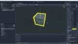
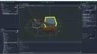
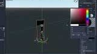
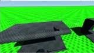
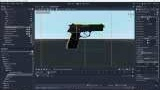

# Objectmanipulatie met Godot XR Tools

Bastiaan Olij bouwt de interactie in twee stappen op. In deel 2 neemt hij kubussen van een tafel. Hij voegt een gele omtrek toe en bepaalt hoe elke hand een kubus vasthoudt. In deel 3 hangt hij een bijl aan een gereedschapsbord. Daarna toont hij twee snapzones op de speler en een snapzone die tijdens een animatie beweegt. De editorbeelden komen uit de Godot-versie van de video's. [Bekijk de twee bronvideo's](links.md).

## Een kubus vastnemen

Maak een overgeërfde scène op basis van `addons/godot-xr-tools/objects/pickable.tscn`. Voeg een mesh voor de kubus toe en geef de bestaande collision node een passende boxvorm. Sla de scène op en plaats enkele instanties op de tafel. Voeg in de hoofdscène aan zowel de linker- als de rechtercontroller de pickupfunctie toe. Met de gripknop neem je een kubus vast. Bij deze eerste proef behoudt de kubus tijdens het grijpen zijn positie en oriëntatie ten opzichte van de hand zoals die waren op het moment van grijpen. [Deel 2, 1:21–3:48](https://www.youtube.com/watch?v=u66RwHdpeuQ&t=81s).

## HighlightVisible en de gele omtrek

Voeg met **Node toevoegen** een `HighlightVisible`-node toe onder de pickable. Geef die een eigen mesh als kind. De pickupfunctie duidt een voorwerp aan dat je kan grijpen. `HighlightVisible` toont op dat moment de extra mesh. Zo zie je vóór het indrukken van de gripknop welke kubus je zal vastnemen. De gewone mesh blijft de kubus zelf tekenen. [Deel 2, 3:51–4:37 en 6:05](https://www.youtube.com/watch?v=u66RwHdpeuQ&t=231s).

In deel 2 is de highlightmesh een iets grotere kubus met omgekeerde vlakken en een geel **Unshaded**-materiaal. In deel 3 kopieert Olij de mesh van de bijl naar de highlight en geeft hij die dezelfde positie als de originele mesh. Hij maakt de omtrek daar met drie materiaalinstellingen en slaat het materiaal op om het opnieuw te gebruiken. [Deel 3, 2:53–3:50](https://www.youtube.com/watch?v=UUwpEY_S9os&t=173s).

| Materiaalinstelling | Effect |
| --- | --- |
| **Unshaded** en geel | De gele kleur blijft zichtbaar zonder invloed van de verlichting. |
| **Cull Mode → Front** | Godot tekent de voorkanten van de highlightmesh niet. De gewone mesh bedekt het overlappende deel van de getekende achterkant. |
| **Grow → 0.002** | Het materiaal schuift de vertices langs hun normalen naar buiten. De vergrote achterkanten steken langs het silhouet uit en vormen de gele rand. |

De instellingen sturen de shader van het standaard 3D-materiaal aan. In de video stelt Olij die in via de Inspector. `HighlightVisible` regelt wanneer je het effect ziet, terwijl het materiaal bepaalt hoe de omtrek eruitziet.

*Deel 2, [4:35](https://www.youtube.com/watch?v=u66RwHdpeuQ&t=275s). De grotere highlightmesh tekent de gele omtrek van de kubus.*

## GrabPointHand en GrabPointSnap

Plaats onder de kubus een `GrabPointHand` voor de linkerhand en één voor de rechterhand. Zet de preview aan terwijl je de hand uitlijnt. Voor de linkerhand maakt Olij bij **Hand Pose** een `XRToolsHandPoseSettings`-resource en laadt hij **Grip Shaft** als gesloten pose. Schakel de preview kort uit en weer in om de nieuwe pose te zien. Verplaats en draai het grijppunt tot de hand goed om de kubus sluit. Herhaal dit voor rechts en verberg de previews voordat je test. De kubus springt bij het grijpen naar de ingestelde handpositie en -oriëntatie. [Deel 2, 4:39–6:12](https://www.youtube.com/watch?v=u66RwHdpeuQ&t=279s).

*Deel 2, [5:55](https://www.youtube.com/watch?v=u66RwHdpeuQ&t=355s). Met de handpreview beoordeel je hoe de hand de kubus omsluit.*

In deel 3 krijgt de bijl naast de twee handgrijppunten een `GrabPointSnap`. Olij zet die node na de handgrijppunten in de scèneboom. De positie en rotatie van het snapgrijppunt bepalen welk punt van de bijl op de snapzone uitkomt en hoe de bijl daar georiënteerd wordt. [Deel 3, 2:37–2:52](https://www.youtube.com/watch?v=UUwpEY_S9os&t=157s) · [XR Tools Grab Points](https://godotvr.github.io/godot-xr-tools/docs/grab_point/).

> **Geheugensteuntje**  
> **De snapzone is waar het voorwerp terechtkomt. Het grabpoint bepaalt hoe het aansluit.** De zone zit op de bestemming, zoals het gereedschapsbord. Het grabpoint zit op het voorwerp, zoals de bijl. `GrabPointHand` lijnt het voorwerp uit met de hand, `GrabPointSnap` met de zone.

## SnapZones op het gereedschapsbord

Een `SnapZone` detecteert geschikte pickables in haar bereik, neemt er één over en houdt het op zijn plaats. Maak voor het bord een overgeërfde scène van `objects/snap_zone.tscn` en noem die `AxeSnapzone`. Plaats de bijl in de groep `Axe` en zet **Snap Require** van de snapzone op diezelfde groep. Plaats de zone als kind van het gereedschapsbord op de plek waar de bijl moet hangen. [Deel 3, 4:06–4:41 en 5:36–5:46](https://www.youtube.com/watch?v=UUwpEY_S9os&t=246s).

De video noemt laag **3** `objects` voor grijpbare voorwerpen en laag **17** `held object` voor voorwerpen die al worden vastgehouden. Een pickable wisselt van laag bij het opnemen of vastklikken. Het detectiemasker van de snapzone moet beide lagen kunnen zien. Olij benoemt ook laag **1** als `static world`, laag **2** als `dynamic world` en laag **20** als `player body`. [Deel 3, 0:25–1:10](https://www.youtube.com/watch?v=UUwpEY_S9os&t=25s) · [XR Tools Snap Zone](https://godotvr.github.io/godot-xr-tools/docs/snap_zone/).

### Dropped en snappen op afstand

| Snap Mode | Wanneer neemt de zone de bijl over? |
| --- | --- |
| **Dropped** | Je brengt de bijl binnen het bereik van de zone en laat haar daar los. |
| **Range** (op afstand) | Zodra de bijl binnen het bereik komt, kan de zone haar overnemen, ook terwijl je haar vasthoudt. |

**Range** is het label in de Inspector voor snappen op afstand. **Grab Distance** is de afstandsinstelling van de zone. Olij kiest voor het bord **Range**. In de proef hangt hij de bijl aan het bord, neemt hij haar er weer af en toont hij dat ze ook blijft hangen als hij haar naar het bord gooit. [Deel 3, 4:41–4:57 en 5:46–5:58](https://www.youtube.com/watch?v=UUwpEY_S9os&t=281s) · [XR Tools Snap Zone](https://godotvr.github.io/godot-xr-tools/docs/snap_zone/).

### HighlightRing

Voeg `HighlightRing` toe aan de snapzone om zichtbaar te maken waar een voorwerp kan vastklikken. Olij voegt aan het bord ook een afgeplatte, zwarte bijlmesh toe. Dat silhouet toont welk voorwerp op die plek hoort. De ring markeert de snapzone en de gele omtrek van `HighlightVisible` markeert het grijpbare voorwerp. [Deel 3, 4:58–5:36](https://www.youtube.com/watch?v=UUwpEY_S9os&t=298s).

*Deel 3, [5:30](https://www.youtube.com/watch?v=UUwpEY_S9os&t=330s). De ring en het silhouet geven de plek op het bord aan.*

## Snapzones aan de PlayerBody

Olij maakt voor de virtuele holster een overgeërfde scène `BeltSnapZone`. Die krijgt een kleiner snapbereik en **Snap Require** staat op de groep `HandGun`. Een kleine, transparante bol maakt de zone zichtbaar. In de hoofdscène plaatst hij twee instanties als kinderen van `PlayerBody`, één aan elke kant. Hun positie is lokaal ten opzichte van de speler. Daardoor verplaatsen de zones en een voorwerp dat erin vastzit zich mee met de `PlayerBody`. [Deel 3, 7:28–8:22](https://www.youtube.com/watch?v=UUwpEY_S9os&t=448s).

*Deel 3, [8:15](https://www.youtube.com/watch?v=UUwpEY_S9os&t=495s). De bollen maken de zones aan het spelerslichaam zichtbaar tijdens de proef.*

## Een snapzone verplaatsen tijdens een animatie

In de laatste demonstratie is het magazijn een afzonderlijke pickable uit hetzelfde virtuele model. Het krijgt handgrijppunten, een `GrabPointSnap` bovenaan en de groep `Magazine`. Olij gebruikt de magazijnmesh in het model als referentie om de snapzone uit te lijnen. Hij verschuift de zone met dezelfde offset als het snapgrijppunt op het losse magazijn. Daarna maakt hij de zone een kind van het virtuele model zelf en verbergt hij de referentiemesh. **Snap Require** laat alleen de groep `Magazine` toe. [Deel 3, 8:24–10:24 en 12:19–12:26](https://www.youtube.com/watch?v=UUwpEY_S9os&t=504s).

De `AnimationPlayer` animeert de **positie van de snapzone**. Een vastgeklikt magazijn volgt die positie vanzelf.

- **LoadMagazine** begint met de zone bij de opening. Zodra de zone het magazijn opneemt, start de animatie en schakelt ze de zone uit voor verdere interactie. De tweede positiesleutel brengt de zone naar binnen.
- **EjectMagazine** verplaatst de zone terug naar de opening. Een methodespoor roept `on_magazine_ejected` aan. Die methode gebruikt `drop_object()` op de zone en wist de bewaarde magazijnreferentie. Pas nadat het magazijn tijd heeft gehad om weg te vallen, schakelt een sleutel de zone weer in. Olij schuift die sleutel later in de tijd omdat de zone het uitgeworpen magazijn anders onmiddellijk terug opneemt. [Deel 3, 10:24–12:19, 12:54–13:00 en 13:56–14:15](https://www.youtube.com/watch?v=UUwpEY_S9os&t=624s).

*Deel 3, [11:00](https://www.youtube.com/watch?v=UUwpEY_S9os&t=660s). De onderste positie van de zone is een sleutel in `EjectMagazine`.*

### Signalen van de snapzone

| Signaal | Wanneer en waarvoor? |
| --- | --- |
| `has_picked_up(what)` | De zone heeft een voorwerp opgenomen en geeft het mee. Dit is het signaal dat Olij koppelt. De handler bewaart het magazijn en start `LoadMagazine`. |
| `has_dropped` | De zone heeft het voorwerp losgelaten. Het signaal heeft geen argument in de XR Tools-versie van de cursus. In de video wist Olij zijn magazijnreferentie in de uitwerpmethode nadat die `drop_object()` aanroept. |

De methodes op de animatiesporen horen bij de animatie. Het signaal `has_picked_up` komt van de snapzone en zet de laadanimatie in gang. [Deel 3, 12:26–13:00](https://www.youtube.com/watch?v=UUwpEY_S9os&t=746s).
