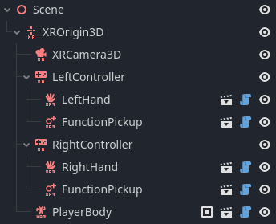
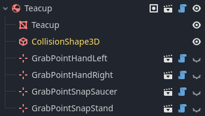
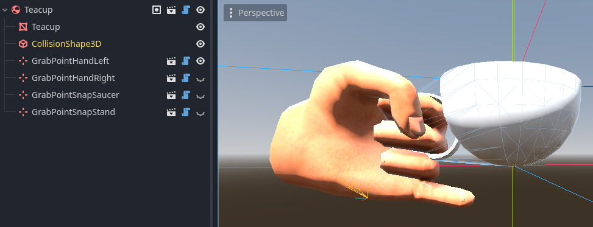
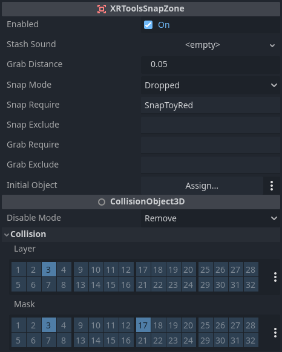
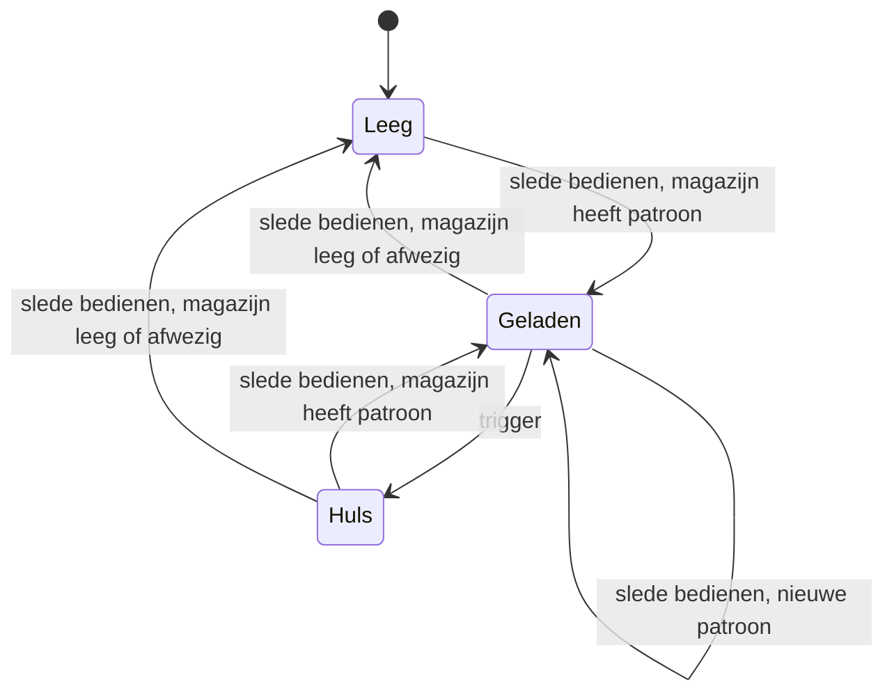

# Objecten vastnemen en bedienen

## Inleiding

Stel dat je in VR een beker op tafel ziet staan. Je steekt je hand uit, neemt de beker vast en zet hem op een houder. Dat lijkt één eenvoudige handeling. Voor ons programma zijn het verschillende problemen. Hoe vinden we het voorwerp bij de hand? Hoe bepalen we waar de vingers terechtkomen? Wie bestuurt de beker wanneer hij in de houder staat?

We zullen die vragen één voor één oplossen met **Godot XR Tools**. Eerst maken we een voorwerp dat je kan vastnemen. Daarna voegen we vaste grijppunten, visuele feedback en houders toe. Ten slotte bouwen we het principe achter het interactieve voorwerp uit de video's: een magazijn, een kamer en een beweegbare slede. Gebruik eenvoudige blokken en cilinders. Je hebt geen gedetailleerd model nodig om de werking te begrijpen.

Deze les volgt [Godot XR Tools Parts 1–4 van Bastiaan Olij](links.md). De oorspronkelijke tutorialcode gebruikt Godot 3. Wij richten ons op **Godot 4.5 met XR Tools 4.5.1**, een release uit de 4.5-reeks die Godot 4.4 of nieuwer vereist. In Godot 4 heten de nodes onder meer `Node3D`, `RigidBody3D` en `XRController3D`. Een scène maak je aan met `instantiate()`; in C# met `Instantiate()`. Gebruik daarom de huidige addon-scènes en geen losse scripts uit het oude project.

We veronderstellen dat OpenXR al werkt. De headset en controllers worden gevolgd, de vloer heeft een collider en één Godot-eenheid stelt één meter voor. Raadpleeg zo nodig [Setting up XR](https://docs.godotengine.org/en/4.5/tutorials/xr/setting_up_xr.html). Voor C# gebruik je de .NET-uitgave. De voorbeelden zijn lescomponenten; ze zijn niet in Godot of met een headset uitgevoerd.

## De bibliotheek toevoegen

*Deel 1, repository vanaf 1:25 en voorbereiding vanaf 2:45.*

XR Tools neemt terugkerend werk over: het vinden van voorwerpen, vasthouden, loslaten en uitlijnen. Onze eigen code bepaalt wat een voorwerp doet. Een zaklamp kan bijvoorbeeld aan- en uitgaan zonder zelf een nieuw grijpsysteem te implementeren.

Download [release 4.5.1](https://github.com/GodotVR/godot-xr-tools/releases/tag/4.5.1), plaats `addons/godot-xr-tools` in je project en schakel de plugin in onder **Project → Project Settings → Plugins**. Controleer de versie; de ontwikkelbranch kan intussen andere API's bevatten. Gebruik bij een Asset Library-installatie dezelfde versieafspraak.

Voeg onder elke `XRController3D` een instantie van deze scène toe:

```text
res://addons/godot-xr-tools/functions/function_pickup.tscn
```

Je behoudt de spelersopbouw uit [beweging](../beweging/cursus.md). Voeg dus geen tweede origin, camera of bewegingscontroller toe. Het relevante deel wordt:

```text
XROrigin3D
├── XRCamera3D
├── LeftHand (XRController3D, tracker /user/hand/left)
│   └── FunctionPickup
└── RightHand (XRController3D, tracker /user/hand/right)
    └── FunctionPickup
```



*Deze documentatiescreenshot toont de plaats van de pickupfuncties. Sommige namen en Inspectorvelden in de documentatiebeelden zijn ouder; de tekst en broncode van versie 4.5.1 zijn hier bepalend. [Herkomst](afbeeldingen/BRONNEN.md).*

Een zichtbaar handmodel is nuttig om het resultaat te beoordelen, maar het model zelf verricht het grijpen niet. Dat doet `XRToolsFunctionPickup`. In 4.5.1 gebruikt die standaard de analoge actie **`grip`** voor vastnemen en **`trigger_click`** voor bedienen. Controleer in je OpenXR Action Map of die namen en bindings bestaan. Een knop die toevallig dezelfde fysieke plaats heeft, krijgt niet automatisch dezelfde actienaam.

Zet voor de eerste proef **Ranged Enable** uit. Zo weet je dat je werkelijk dichtbij genoeg moet komen. Later kan je grijpen op afstand apart onderzoeken. Achtergrond: [OpenXR-actions](../concepten/openxr-actions.md).

## Een eerste voorwerp

*Deel 2, vanaf 1:24 en 3:15.*

Maak een nieuwe overgeërfde scène van:

```text
res://addons/godot-xr-tools/objects/pickable.tscn
```

Bewaar die als `Block.tscn`. De root is een `RigidBody3D` met het script `XRToolsPickable`. Geef de bestaande `CollisionShape3D` een `BoxShape3D` en voeg een `MeshInstance3D` met een `BoxMesh` toe. Kies voor beide bijvoorbeeld 0,15 meter per zijde. Plaats het blok boven de vloer en laat **Freeze** uit voor dit gewone voorwerp.



*De beker heeft dezelfde verantwoordelijkheden als ons blok: de mesh tekent, de shape bepaalt het botsingsvolume en de root regelt physics en vastnemen.*

Start de scène. Het blok moet eerst op de vloer vallen en blijven liggen. Pas daarna probeer je het vast te nemen. Zo onderzoek je niet tegelijk een ontbrekende vloerbotsing en een verkeerde gripbinding.

Met **Press To Hold** ingeschakeld laat je los zodra je de grip ontspant. Uitgeschakeld werkt de grip als een schakelaar. **Release Mode = Original** herstelt de freeze-toestand van vóór het grijpen. Bij een normaal dynamisch blok gaat de physics dus weer verder. De pickupfunctie schat bij loslaten ook een snelheid uit de handbeweging. Als je het blok werpt, hoef je daar geen tweede werpsnelheid bovenop te tellen.

Denk bij vastnemen aan een tijdelijke overdracht van besturing. Normaal beweegt physics het blok. Tijdens het grijpen bestuurt de addon zijn pose. Schrijf dus niet daarnaast elke frame een eigen `global_position` voor hetzelfde blok. Lees verder bij [Vasthouden en physics](../concepten/vasthouden-en-physics.md).

## Eerst de physicslagen goed zetten

*Deel 3, vanaf 0:25.*

Een zichtbaar blok is nog geen vindbaar blok. Physics gebruikt lagen en maskers. Een **layer** vertelt op welke lagen een object staat. Een **mask** bepaalt welke lagen een query of botsingscontrole onderzoekt. Je kan de aanbevolen namen instellen via **Project → Tools → XR Tools → Set Physics Layers**. Noteer bestaande projectafspraken voordat je laagnamen verandert.

Voor onze eenvoudige opstelling gebruiken we de volgende afspraken. Dit is een bewuste lesconfiguratie, geen lijst van alle standaardwaarden:

| Onderdeel | Layer | Mask of instelling |
| --- | --- | --- |
| Vloer en tafel | 1, Static World | Passend bij de voorwerpen die erop botsen. |
| Los blok of magazijn | 3, Pickable Objects | Wereldlagen 1 en 2, en laag 3. |
| Vastgehouden voorwerp | `Picked Up Layer`: 17, Held Objects | Controleer ook de overblijvende collision mask. |
| Pickupfunctie | Detectie via `Grab Collision Mask` | 3; voeg 19 toe als je afzonderlijke handles gebruikt. |
| Snapzone | 3 | 3 én 17, zodat losse en vastgehouden voorwerpen worden opgemerkt. |
| Spelerlichaam | 20 | Wereld en gewenste losse objecten; geen botsingspaar met laag 17. |

Het laagnummertje 17 is niet de integerwaarde 17. In een bitmasker is alleen die laag `1 << 16`, dus 65536. In de Inspector vink je gewoon vakje 17 aan.

Waarom krijgt een vastgehouden voorwerp een andere laag? Als het voorwerp tegen het spelerslichaam duwt terwijl de hand het blijft volgen, kan een ongewenste terugkoppeling ontstaan. De speler schuift weg en neemt het voorwerp mee. Controleer beide kanten van de botsingsconfiguratie: alleen één masker aanpassen bewijst nog niet dat alle ongewenste botsingen weg zijn.

Zet **Picked Up Layer** voor deze les niet leeg. Een snapzone die op laag 17 zoekt, kan een vastgehouden voorwerp zonder layer niet opmerken. De algemene documentatie bespreekt ook configuraties zonder held-layer; die passen niet bij onze snapzoneproef. Meer uitleg: [Lagen, maskers en groepen](../concepten/lagen-maskers-en-groepen.md).

## Zien wat je kan vastnemen

*Deel 2, vanaf 3:50; deel 3, herbruikbare highlight vanaf 3:15.*

Je hand bevindt zich dicht bij een beker. Is de beker al geselecteerd, of moet je nog wat dichterbij? Een highlight beantwoordt die vraag voordat je een knop indrukt.

Voeg rechtstreeks onder de pickable-root een `Node3D` toe met het addon-script:

```text
res://addons/godot-xr-tools/objects/highlight/highlight_visible.gd
```

Plaats daaronder een eenvoudige extra mesh die de selectie aangeeft, bijvoorbeeld een iets groter draadmodel of een transparante omhulling. Geef die mesh geen collider. Het script luistert naar `highlight_updated(pickable, enable)` van zijn parent en schakelt zijn eigen zichtbaarheid. Op die manier blijft de gewone mesh altijd zichtbaar en verschijnt alleen de extra aanwijzing tijdens selectie.

Een highlight is feedback over een kandidaat. Het is geen bewijs dat het object al wordt vastgehouden. Gebruik voor spelgedrag de pickup- en drop-signalen. Wil je in plaats daarvan een materiaal veranderen, onderzoek dan `highlight_material.gd` en let op [gedeelde materiaalresources](../concepten/resources-en-local-to-scene.md).

## Waar komt de hand terecht?

*Deel 2, vanaf 4:40.*

Bij een blok is een willekeurige greep aanvaardbaar. Een beker wil je bij het oor vastnemen. Voeg als directe kinderen van de pickable-root instanties toe van:

```text
objects/grab_points/grab_point_hand_left.tscn
objects/grab_points/grab_point_hand_right.tscn
```

Deze paden zijn relatief aan `res://addons/godot-xr-tools/`. Plaats de grijppunten bij het oor en draai ze tot de voorbeeldhand logisch aansluit. Je wijzigt hier de **lokale transform van het grijppunt**. Je verplaatst de fysieke controller niet.



*De editorpreview helpt bij positie en oriëntatie. Ze bewijst nog niet dat jouw runtimehandmodel dezelfde pose toont.*

**Hand** selecteert links of rechts. **Hand Pose** beschrijft de vingers; **Snap Hand** bepaalt of het handmodel naar het grijppunt aansluit. Voor zichtbare aangepaste poses heb je een passend XR Tools-handmodel en pose-instelling nodig. Alleen een marker toevoegen vervormt een willekeurig meshmodel niet.

Begin met één hand per voorwerp. Onderzoek pas daarna **Second Hand Grab** en de gewichten voor positie, hoek en aim. Een tweede hand maakt de berekening niet automatisch fysisch correct. De conceptpagina [Grijppunten en uitlijning](../concepten/grijppunten-en-uitlijning.md) toont welke transforms bij elkaar horen.

## Een vastgehouden voorwerp bedienen

Een lamp is een kleine oefening waarmee we het verschil tussen grijpen en gebruiken kunnen testen. Maak een nieuwe pickable met deze kinderen:

```text
Lamp (RigidBody3D, XRToolsPickable blijft hier)
├── CollisionShape3D
├── MeshInstance3D
├── OmniLight3D
└── Behavior (Node, lamp.gd OF Lamp.cs)
```

Sleep de lichtnode naar het geëxporteerde veld `light` of `Light` op `Behavior`. Het addon-signaal `action_pressed` levert één argument: het pickable voorwerp. De handler moet dat argument ook ontvangen, zelfs als we het niet gebruiken.

GDScript:

```gdscript
extends Node
@export var light: OmniLight3D

func _ready() -> void:
    var pickable := get_parent() as XRToolsPickable
    pickable.action_pressed.connect(_on_action_pressed)

func _on_action_pressed(_pickable: Node3D) -> void:
    light.visible = not light.visible
```

C# gebruikt dezelfde nodeopbouw:

```csharp
public override void _Ready()
{
    GetParent().Connect("action_pressed",
        Callable.From<Node3D>(OnActionPressed));
}

private void OnActionPressed(Node3D pickable)
{
    Light.Visible = !Light.Visible;
}
```

De volledige bestanden staan bij [lamp.gd](code/gdscript/lamp.gd) en [Lamp.cs](code/csharp/Lamp.cs). In C# bestaat de GDScriptklasse `XRToolsPickable` niet als gewone C#-basisklasse. Daarom houden we het addon-script op de root en voegen we gedrag toe met een kindnode. GDScript kan de addonklasse wel rechtstreeks benoemen, maar volgt hier bewust dezelfde opbouw.

De pickupfunctie roept in 4.5.1 zowel de gewone actie van het voorwerp als de controllergerichte actie aan. Die laatste kan een actie op het actieve grijppunt doorgeven. Verbind dus niet dezelfde spelactie tegelijk met het root-signaal en het grijppuntsignaal: dan kan één triggerdruk tweemaal gedrag uitvoeren. Zie [Signalen en scriptcompositie](../concepten/signalen-en-scriptcompositie.md).

**Probeer zelf:** neem de lamp vast en druk de trigger in. Laat daarna los. Waarom zou de lamp op tafel niet meer reageren op die trigger?

## Een voorwerp in een houder plaatsen

*Deel 3, snapzone vanaf 4:10, houder vanaf 7:30.*

Een **snapzone** is een vaste plek waar een voorwerp kan aansluiten. Een gereedschapsrek, bekerhouder en magazijnschacht gebruiken hetzelfde principe. De zone neemt het voorwerp over van de hand en lijnt het uit.

Maak een overgeërfde scène van `objects/snap_zone.tscn`. De root is een `Area3D` met `XRToolsSnapZone`; de bestaande collision shape begrenst het detectiegebied. Plaats de root waar het voorwerp moet aansluiten. Controleer de layers uit de tabel: de zone staat op 3 en haar masker bevat 3 en 17.



*Een groepfilter bepaalt welk soort voorwerp welkom is. Het physicsmasker bepaalt of de zone het voorwerp überhaupt kan opmerken.*

Kies eerst **Snap Mode = Dropped**. De speler brengt het voorwerp in de zone en laat los. In **Range** kan de zone het al bij binnenkomst overnemen. Dat verschil is merkbaar: voor een holster wil je vaak bewust loslaten, terwijl een andere puzzel een onmiddellijke aansluiting kan vragen.

Voeg op de pickable-root bijvoorbeeld de groep `tool` toe en zet **Snap Require** op de zone op `tool`. Een blok zonder die groep wordt geweigerd. **Snap Exclude** sluit een groep uit. **Grab Require** en **Grab Exclude** beperken wie het voorwerp uit de zone kan nemen; ze filteren de grijpende node, niet het binnenkomende voorwerp.

Voeg aan het voorwerp ook `objects/grab_points/grab_point_snap.tscn` toe. Dit grijppunt bepaalt de aansluiting in de houder. Geef bijvoorbeeld de houderroot de groep `tool_rack` en zet **Require Group** op het snapgrijppunt op `tool_rack`. Nu bestaan er twee controles: de zone accepteert het juiste voorwerp en het voorwerp kiest een grijppunt voor de juiste soort zone.

De zone meldt `has_picked_up(what)` wanneer zij iets opneemt. **`has_dropped` heeft geen argument.** Lees het bezette voorwerp via `picked_up_object` en gebruik `has_snapped_object()` wanneer je alleen bezetting wil weten. `drop_object()` geeft het vrij. Een pickable kan ook door een zone worden vastgehouden: `is_picked_up()` betekent dus niet uitsluitend “in een menselijke hand”.

**Probeer zelf:** bied twee blokken aan waarvan slechts één in groep `tool` zit. Verander daarna het masker zodat laag 17 ontbreekt. Verklaar waarom een vastgehouden blok zich nu anders kan gedragen dan een los vallend blok.

## Van houder naar magazijn

*Deel 3, vanaf 8:25 en 9:55; deel 4, vanaf 0:20 en 2:20.*

Het video-voorbeeld bouwt een interactief wapen. Voor onze oefening gebruiken we een eenvoudig demonstratiemodel met trage projectielen. De interessante programmeervraag is hoe meerdere onderdelen één betrouwbaar geheel vormen.

Maak een pickable `Magazine.tscn`, zet de root in groep `magazine` en voeg een kind `Magazine` van type `Node` toe. Daar komt [magazine.gd](code/gdscript/magazine.gd) of [Magazine.cs](code/csharp/Magazine.cs) op. De node start met drie patronen. Een methode neemt er precies één weg en geeft aan of dat lukte:

```gdscript
func take_round() -> bool:
    if rounds <= 0:
        return false
    rounds -= 1
    return true
```

```csharp
public bool TakeRound()
{
    if (Rounds <= 0) return false;
    Rounds--;
    return true;
}
```

Voeg aan het demonstratiemodel een snapzone `MagazineZone` toe met **Snap Require = magazine** en een bijpassend snapgrijppunt op het magazijn. Maak de detectieruimte klein genoeg dat een magazijn naast het model niet al wordt ingevoegd.

Een magazijn met patronen betekent niet dat de **kamer** geladen is. De kamer heeft drie mogelijke toestanden: leeg, een ongebruikte patroon, of een afgevuurde huls. Bij het bedienen van de slede wordt de huidige inhoud uitgeworpen en wordt, indien mogelijk, één patroon uit het magazijn genomen. Bij afvuren wordt alleen een geladen patroon een huls. De magazijnteller daalt dan niet nog eens.



De tekst beschrijft dezelfde overgangen als het diagram. Een triggerdruk in de lege of huls-toestand geeft alleen een klik. Een geladen patroon blijft in de kamer wanneer je het magazijn verwijdert. De conceptpagina [Toestanden en voorraad](../concepten/toestanden-en-voorraad.md) werkt dit verschil verder uit.

## De demonstratiescène samenstellen

Gebruik voor beide talen dezelfde boom. De opgegeven scripts vervangen elkaar per taal:

```text
Demo (RigidBody3D, XRToolsPickable)
├── CollisionShape3D
├── MeshInstance3D
├── MagazineZone (instantie snap_zone.tscn)
├── Muzzle (Marker3D, -Z wijst naar voren)
├── Chamber (Node, chamber.gd / Chamber.cs)
├── SlidePivot (Node3D, lokale +Z wijst naar achteren)
│   ├── SlideVisual (MeshInstance3D)
│   └── SlideHandle (instantie pickable.tscn, kleine collider)
└── Slide (Node, slide.gd / Slide.cs)
```

Vul op `Chamber` de referenties naar `MagazineZone`, `Muzzle` en de projectielscène in. Vul op `Slide` de referenties naar pivot, visual, handle en chamber in. Gebruik een neutrale schaal `(1, 1, 1)` op de pivot. De visual en handle zijn directe kinderen van de pivot, zodat hun rustposities dezelfde lokale ruimte gebruiken.

Maak `Projectile.tscn` met een `RigidBody3D`-root, kleine mesh en shape. Zet **Gravity Scale** voor deze eenvoudige richtingsproef op 0. Zet het projectiel op een eigen vrije physicslaag, bijvoorbeeld 6. Laat projectielen alleen de wereld op laag 1 raken, en zorg dat de maskers van het demonstratiemodel en zijn onderdelen laag 6 niet meenemen. Plaats `Muzzle` vóór de buitenkant van het model. Zo begint een projectiel niet overlappend met zijn afzender. Kies bij snelle, kleine projectielen passende continue botsingsdetectie en test op tunneling; de lage testsnelheid is geen algemene garantie.

Het volledige gedrag staat in [chamber.gd](code/gdscript/chamber.gd) en [Chamber.cs](code/csharp/Chamber.cs). Het script zoekt de kindnode `Magazine` in het voorwerp dat de snapzone momenteel bezit. Het bewaart geen verouderde magazijnreferentie na het uitnemen. De methode `cycle()` of `Cycle()` leegt de kamer en probeert één nieuwe patroon te nemen.

Bij een geldige triggerdruk wordt een scène geïnstantieerd. We voegen die aan de wereldscène toe en stellen pas daarna de globale transform in:

```gdscript
get_tree().current_scene.add_child(projectile)
projectile.global_transform = muzzle.global_transform
projectile.linear_velocity = -muzzle.global_basis.z.normalized() * speed
```

```csharp
GetTree().CurrentScene.AddChild(projectile);
projectile.GlobalTransform = Muzzle.GlobalTransform;
projectile.LinearVelocity = -Muzzle.GlobalBasis.Z.Normalized() * Speed;
```

Het projectiel wordt geen kind van de hand of het model. Anders zou een latere beweging van de speler ook het projectiel kunnen meenemen. De vector gebruikt bewust **-Z** als voorwaartse as; het oorspronkelijke model uit de video's heeft andere modelassen. Controleer dus altijd je marker. Een genormaliseerde richting maal snelheid levert meter per seconde. Vermenigvuldig hier niet nog eens met `delta`.

Voeg [projectile.gd](code/gdscript/projectile.gd) of [Projectile.cs](code/csharp/Projectile.cs) aan de projectielroot toe. Die verwijdert de instantie na drie seconden. Dat voorkomt dat iedere proef onbeperkt extra nodes achterlaat. Zie [Instanties en levensduur](../concepten/instanties-en-levensduur.md).

## De slede langs één as bewegen

*Deel 4, vanaf 4:30.*

Een hand beweegt in drie dimensies, een slede slechts langs één as. We nemen daarom niet de volledige handpositie over. Het `SlideHandle` is een afzonderlijk grijpbaar hulpvoorwerp. De visual blijft beperkt tot de lokale Z-as van `SlidePivot`.

Zet voor de handle **Freeze** aan, **Release Mode = Frozen**, **Press To Hold** aan en grijpen op afstand uit. Geef haar alleen de detectielaag die je pickup onderzoekt en voor deze hulpconstructie geen botsingen met de rest van het model. Een bevroren losgelaten handle kan zo naar haar rusttransform worden teruggezet zonder te gaan vallen. Houd het demonstratiemodel zelf met de andere hand vast. Deze eenvoudige versie laat de handle ook bedienen wanneer het model op tafel ligt.

De scripts [slide.gd](code/gdscript/slide.gd) en [Slide.cs](code/csharp/Slide.cs) zetten de wereldpositie om naar pivotruimte, trekken de rustpositie af en begrenzen de Z-afstand tot 7,5 centimeter. Bij 95% van die afstand wordt één keer de kamer bediend:

```gdscript
var local := pivot.to_local(handle.global_position)
var rest := pivot.to_local((handle.get_parent() as Node3D).to_global(handle_rest.origin))
var pull := clampf(local.z - rest.z, 0.0, travel)
visual.position = visual_rest + Vector3(0.0, 0.0, pull)
if pull >= travel * 0.95 and not latched:
    latched = true
    chamber.cycle()
```

```csharp
var local = Pivot.ToLocal(Handle.GlobalPosition);
var rest = Pivot.ToLocal(((Node3D)Handle.GetParent()).ToGlobal(_handleRest.Origin));
float pull = Mathf.Clamp(local.Z - rest.Z, 0.0f, Travel);
Visual.Position = _visualRest + new Vector3(0, 0, pull);
if (pull >= Travel * 0.95f && !_latched)
{
    _latched = true;
    Chamber.Cycle();
}
```

Waarom houden we `latched` bij? Zonder die vlag zou elke physicsstap bij het achterste punt een patroon verbruiken. Loslaten herstelt de rustpose en maakt een nieuwe cyclus mogelijk. Deze vereenvoudiging doet één cyclus per greep; voor herhaald heen-en-weer bewegen zonder loslaten voeg je een tweede, lagere resetdrempel toe. Dat is [hysterese bij begrensde interactie](../concepten/een-as-en-drempels.md).

De onzichtbare handle mag de hand volgen terwijl de zichtbare slede op haar rail blijft. Het is dus een meetconstructie, geen volledig fysische schuifverbinding. Gebruik voor een andere simulatie-eis een passende joint of constraint en onderzoek de gevolgen apart.

## Animaties, hulzen en effecten toevoegen

*Deel 3, vanaf 9:55; deel 4, vanaf 9:00 en 15:35–22:05.*

De video's voegen mechanische animaties, uitgeworpen hulzen en een mondingsflits toe. Houd daarbij speltoestand en presentatie uit elkaar. Een flits kan niet bewijzen dat er werkelijk een patroon beschikbaar was.

Onze kleine codeversie verwerkt afvuren meteen in de actiehandler en herladen meteen bij de slededrempel. Voor een geanimeerde uitbreiding kan je een `AnimationPlayer` toevoegen en de handler alleen een passende animatie laten starten. Een method call track roept op het gekozen frame de daadwerkelijke afvuurmethode aan. Controleer daar opnieuw of de kamer geladen is. Verwijder dan de onmiddellijke afvuuraanroep uit de actiehandler, anders ontstaat hetzelfde projectiel tweemaal.

Blokkeer nieuwe acties zolang de mechanische handeling bezig is en herstel die blokkering bij afloop én onderbreking. In C# kies je in de method track de werkelijke C#-methodenaam; addon-methoden die je via `Call` aanroept behouden hun GDScriptnaam. Laat een animatie niet tegelijk met het sledescript dezelfde `position` schrijven. Bepaal per fase welk onderdeel de transform bestuurt.

Een huls is een afzonderlijke scène met `RigidBody3D`, mesh, collider en korte levensduur. Bewaar bij de slededrempel eerst de oude kamertoestand. Was die `LIVE`, dan werp je een ongebruikte patroon uit; was die `SPENT`, dan een huls; was die `EMPTY`, dan niets. Plaats de instantie aan een `EjectionPoint`, geef haar een bescheiden zijwaartse snelheid en gebruik dezelfde wereldruimte- en opruimafspraken als voor het projectiel. Daarna laad je pas de volgende patroon. Een mondingsflits is een kort zichtbaar effect op het model en hoeft geen botsende body te zijn.

De concrete lesbestanden bevatten geen modellen, geluiden, hulzen of volledige animatiereeks uit de video's. Die uitbreidingen vragen eigen assets en timing. We hebben wel de onderliggende toestand, snapzonekoppeling, sledeberekening en projectiellevensduur in beide talen uitgewerkt. Meer uitleg: [Animatiegebeurtenissen](../concepten/animatiegebeurtenissen.md).

## Onderzoeken of het geheel klopt

Test eerst grijpen, dan een houder en pas daarna de samengestelde demonstratie. Gebruik de [spectator view](../debugging/cursus.md) om hand, collider en snapzone van buitenaf te volgen.

| Proef | Verwacht resultaat |
| --- | --- |
| Los blok laten vallen | Het blijft op de vloer liggen. |
| Blok vasthouden naast het lichaam | De speler schiet niet weg. |
| Verkeerd voorwerp in de snapzone | Het wordt niet opgenomen. |
| Magazijn met drie patronen plaatsen | De kamer blijft leeg tot de slede wordt bediend. |
| Slede volledig terugtrekken en vasthouden | Voorraad daalt één keer naar twee; kamer wordt geladen. |
| Trigger eenmaal indrukken | Eén projectiel; kamer bevat daarna een huls. |
| Trigger opnieuw indrukken | Alleen een klik; geen extra projectiel. |
| Magazijn uitnemen na laden | De al geladen patroon blijft beschikbaar. |
| Model draaien en dan slede bedienen | De slede volgt de lokale rail, niet de wereld-Z-as. |
| Drie seconden wachten na afvuren | De projectielinstantie verdwijnt uit de Remote Scene Tree. |

Als grijpen niet werkt, controleer achtereenvolgens actienaam, afstand, enabled-instelling en detectiemasker. Als aansluiten niet werkt, controleer ook laag 17, groepen, snapmodus en het snapgrijppunt. Verander telkens één instelling en voorspel eerst welk verschil ze zou moeten maken.

## Bronnen en verdere uitleg

De [videolijst](links.md) bevat de vier afleveringen en tijdstippen. De technische controle gebruikt de [XR Tools-documentatie](https://godotvr.github.io/godot-xr-tools/), de [vastgezette addonbroncode 4.5.1](https://github.com/GodotVR/godot-xr-tools/tree/4.5.1) en de officiële Godot 4.5-documentatie voor [RigidBody3D](https://docs.godotengine.org/en/4.5/classes/class_rigidbody3d.html), [Area3D](https://docs.godotengine.org/en/4.5/classes/class_area3d.html), [Node3D](https://docs.godotengine.org/en/4.5/classes/class_node3d.html), [PackedScene](https://docs.godotengine.org/en/4.5/classes/class_packedscene.html), [C# en GDScript samen](https://docs.godotengine.org/en/4.5/tutorials/scripting/cross_language_scripting.html) en [AnimationPlayer](https://docs.godotengine.org/en/4.5/classes/class_animationplayer.html).
