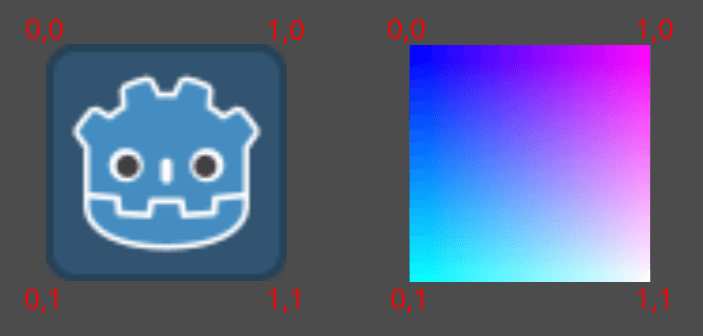

# Een eerste kennismaking met 2D-shaders

## Inleiding

Tot nu toe hebben we vooral beschreven wat objecten doen: bewegen, draaien en botsen. Maar hoe bepaalt Godot eigenlijk wat je op het scherm ziet? Waarom krijgt een stukje van een sprite een bepaalde kleur? En kunnen we het beeld vervormen zonder de node zelf te verplaatsen?

Daarvoor kunnen we shaders gebruiken. Een shader is een klein programma dat op de grafische processor, de GPU, wordt uitgevoerd. We geven voor veel hoekpunten of beeldfragmenten dezelfde berekening op, telkens met andere invoerwaarden. Zo kunnen we het uiterlijk van een object veranderen.

We beperken ons in deze les tot **drie eenvoudige 2D-voorbeelden**: een egale kleur, een kleurfilter en een bredere sprite. Het doel is dat je begrijpt waar een vertexfunctie en een fragmentfunctie voor dienen. We gebruiken Godot **4.5**.

Deze inleiding sluit aan bij [Your first 2D shader](https://docs.godotengine.org/en/4.5/tutorials/shaders/your_first_shader/your_first_2d_shader.html) en bij de basisonderwerpen uit Clear Codes video [The ultimate introduction to shaders in Godot](https://www.youtube.com/watch?v=J9qx8MxuJYM). Vooral de onderdelen over theorie (1:20), fragmenten (5:00), kleuren (27:14), textures (39:35), vertices (55:45) en variabelen (1:08:27) zijn relevant. De video gaat daarna veel verder dan wat je voor deze les nodig hebt.

## Hoekpunten en fragmenten

Een gewone sprite wordt als een rechthoek getekend, opgebouwd uit driehoeken. Die vorm heeft hoekpunten, of **vertices**. Eerst bepaalt Godot waar die hoekpunten terechtkomen. Daarna bepaalt het welke stukjes van het beeld door de driehoeken worden bedekt en welke kleur die krijgen.

We kunnen op twee plaatsen tussenkomen:

| Functie | Wordt uitgevoerd voor | Wat passen we hier aan? |
| --- | --- | --- |
| `vertex()` | Elk hoekpunt van de getekende geometrie | De positie van dat hoekpunt. |
| `fragment()` | Elk te verwerken fragment van die geometrie | De kleur en doorzichtigheid. |

Voor deze eerste oefeningen mag je een fragment zien als een kandidaat voor een pixelkleur. Het is niet noodzakelijk hetzelfde als één uiteindelijke schermpixel: er kunnen bijvoorbeeld meerdere objecten over elkaar worden getekend.

Een vertexfunctie draait dus niet één keer per pixel. Een grote, gewone onverdeelde sprite heeft weinig hoekpunten, ook wanneer ze veel pixels bedekt. Een fragmentfunctie krijgt juist veel werk wanneer het object groot in beeld staat.

Je hoeft ook niet beide functies te schrijven. Laat je `vertex()` weg, dan verwerkt Godot de posities op de gewone manier. Laat je `fragment()` weg, dan blijft de gewone kleur- en textureverwerking behouden.

## De scène klaarzetten

Maak een kleine 2D-scène met een `Node2D` als root en een `Sprite2D` als kind. Geef de sprite een texture. Je kan hiervoor het `icon.svg` uit een nieuw Godot-project gebruiken, of een andere afbeelding met wat verschillende kleuren en doorzichtige delen.

Selecteer de sprite en ga in de Inspector naar **CanvasItem → Material**. Maak een **ShaderMaterial** aan. Open die resource en maak bij **Shader** een shader met type **CanvasItem**. Bewaar het bestand met extensie `.gdshader`.

De koppeling ziet er zo uit:

```text
Sprite2D
└── Material: ShaderMaterial
    └── Shader: jouw_bestand.gdshader
```

Een shader is de programmacode. Het materiaal koppelt die code en haar instelbare waarden aan de sprite. Het materiaal is dus niet hetzelfde als het shaderbestand.

Voor elk voorbeeld kan je het shaderbestand op hetzelfde materiaal vervangen. Test ze eerst apart. Je vindt de drie complete bestanden in [code/](code/).

## Voorbeeld 1: alles één kleur geven

*Sluit aan bij de videoonderdelen Fragment basics en Fragment colors.*

We beginnen met de eenvoudigste vraag: kunnen we de volledige rechthoek van onze sprite blauw maken?

Open [01_egale_kleur.gdshader](code/01_egale_kleur.gdshader) of schrijf zelf het volgende:

```glsl
shader_type canvas_item;
render_mode unshaded;

void fragment() {
    COLOR = vec4(0.4, 0.6, 0.9, 1.0);
}
```

`shader_type canvas_item` zegt dat deze shader bedoeld is voor 2D-objecten. Een shader voor een 3D-mesh gebruikt een ander type. Met `render_mode unshaded` laten we de 2D-verlichting buiten deze oefeningen, zodat we alleen het resultaat van onze eigen berekening bekijken.

`void fragment()` is de functie die de fragmentkleur berekent. Ze geeft geen waarde terug met `return`; we schrijven het resultaat naar de ingebouwde variabele `COLOR`.

Een kleur bestaat hier uit vier getallen: rood, groen, blauw en alpha. Alpha bepaalt de doorzichtigheid. `vec4` bundelt die vier waarden. We gebruiken waarden van 0 tot 1: 0 betekent geen bijdrage van die component, 1 de volle bijdrage. Met alpha 1 is de kleur volledig dekkend.


*Dit is ook wat onze eerste shader doet: de oorspronkelijke afbeelding wordt vervangen door een egale kleur.*

Merk op dat ook de doorzichtige delen van de oorspronkelijke afbeelding verdwijnen. We lezen die afbeelding immers nergens uit en schrijven overal alpha 1. De rechthoek van de sprite blijft bestaan, maar de vorm die eerder door de texture en haar transparantie zichtbaar was, niet.

Probeer de eerste drie getallen te wijzigen. Maak daarna de alpha 0,5 en zet een andere sprite achter dit vlak. Je moet die dan gedeeltelijk door het vlak heen zien. Voorspel telkens eerst wat je verwacht en pas dan de code aan.

## Voorbeeld 2: de afbeelding behouden en kleuren

*Sluit aan bij Textures en Variables uit de video.*

Een egaal vlak is een goede eerste test, maar meestal willen we de afbeelding behouden. Daarvoor moeten we weten waar de kleur van die afbeelding vandaan komt.

Een **texture** is een afbeelding waaruit de shader kleuren kan opvragen. De ingebouwde variabele `TEXTURE` verwijst bij onze `Sprite2D` naar haar texture. Met **UV-coördinaten** geven we aan welke plaats in die texture we bedoelen.

Bij onze gewone sprite loopt U van 0 links tot 1 rechts en V van 0 boven tot 1 onder. Het zijn dus verhoudingen, geen pixelnummers. Het midden is `(0.5, 0.5)`, ongeacht de resolutie van de afbeelding.



*Links staat de afbeelding, rechts een kleurweergave van dezelfde UV-ruimte. De hoekcoördinaten tonen dat een texturepositie van de afbeeldingsresolutie losstaat.*

De bewerking `texture(TEXTURE, UV)` vraagt de kleur op de huidige texturepositie op. In Godot 4.5 is dat voor onze volgende shader niet eens nodig: de invoerwaarde van `COLOR` in `fragment()` bevat de texturekleur al, vermenigvuldigd met de modulatiekleur van de node (d.w.z. de kleur die in het algemeen op de node is toegepast).

We kunnen die bestaande kleur dus gewoon met een kleurfilter vermenigvuldigen:

```glsl
shader_type canvas_item;
render_mode unshaded;

uniform vec4 tint : source_color = vec4(0.6, 0.8, 1.0, 1.0);

void fragment() {
    // COLOR bevat hier al de texturekleur en de modulatiekleur van de node.
    COLOR *= tint;
}
```

Dit bestand staat klaar als [02_kleurfilter.gdshader](code/02_kleurfilter.gdshader).

`COLOR *= tint` is een korte schrijfwijze voor `COLOR = COLOR * tint`. De vermenigvuldiging gebeurt per component. We behouden 60 procent van het rood, 80 procent van het groen en al het blauw. Daardoor oogt het resultaat blauwer. Alpha wordt met 1 vermenigvuldigd, zodat de oorspronkelijke doorzichtigheid behouden blijft.

Zo'n filter voegt geen kleur toe die er niet was. Een volledig zwart stukje blijft zwart. Dat is een gevolg van vermenigvuldigen: nul maal eender welke factor blijft nul.

### Een waarde instelbaar maken met een uniform

`uniform` betekent dat we een waarde van buiten de shader kunnen instellen. Alle aanroepen die dit materiaal op dat moment tekenen, gebruiken die ingestelde waarde. Het is geen apart veranderlijk geheugen per pixel.

De hint `source_color` vertelt Godot dat `tint` een kleur is, met de bijbehorende kleurverwerking. In de Inspector van het **ShaderMaterial** verschijnt de parameter onder **Shader Parameters** met een kleurkiezer. Verander daar de tint. Je hoeft de shadercode dus niet telkens aan te passen om een andere filterkleur te kiezen.

Shadercode gebruikt Godots eigen shading language. Die lijkt op GLSL en is dezelfde in een GDScript- en een C#-project. Je schrijft dus geen C#-versie van `fragment()`.

Je kan de uniform wel vanuit beide talen instellen. Deze optionele scripts horen op dezelfde `Sprite2D` als het materiaal:

```gdscript
extends Sprite2D

func _ready() -> void:
    var shader_material := material as ShaderMaterial
    if shader_material:
        shader_material.set_shader_parameter("tint", Color(1.0, 0.7, 0.7, 1.0))
```

```csharp
using Godot;

public partial class KleurfilterInstellen : Sprite2D
{
    public override void _Ready()
    {
        if (Material is ShaderMaterial shaderMaterial)
            shaderMaterial.SetShaderParameter("tint", new Color(1.0f, 0.7f, 0.7f, 1.0f));
    }
}
```

De volledige bestanden zijn [kleurfilter_instellen.gd](code/gdscript/kleurfilter_instellen.gd) en [KleurfilterInstellen.cs](code/csharp/KleurfilterInstellen.cs). Kies er één. De naam `tint` moet exact overeenkomen met de uniformnaam in de shader.

Gebruiken meerdere sprites hetzelfde materiaal, dan delen ze ook deze instelling. Maak het materiaal uniek als elke sprite een eigen tint moet krijgen. Alleen hetzelfde shaderbestand delen is geen probleem: verschillende materialen kunnen dezelfde code met verschillende uniformwaarden gebruiken.

Let ook op een veelgemaakte fout: vermenigvuldig de bestaande `COLOR` hier niet nog eens met `texture(TEXTURE, UV)`. De texture zit al in die kleur. Je zou de texturekleur dan tweemaal vermenigvuldigen en het resultaat onbedoeld donkerder maken.

## Voorbeeld 3: de sprite breder tekenen

*Sluit aan bij Vertex basics uit de video.*

Tot nu toe veranderden we kleuren. Nu laten we de kleuren met rust en passen we de geometrie aan. We willen de sprite anderhalve keer zo breed tekenen, zonder haar hoogte te veranderen.

Gebruik [03_breder.gdshader](code/03_breder.gdshader):

```glsl
shader_type canvas_item;
render_mode unshaded;

uniform float breedte : hint_range(0.5, 2.0, 0.05) = 1.5;

void vertex() {
    VERTEX.x *= breedte;
}
```

`VERTEX` is in deze vertexfunctie een `vec2`: een positie met een X- en een Y-component. Die positie staat standaard in de **lokale ruimte van de sprite**, in lokale pixeleenheden. Het is dus niet de schermpositie van een pixel.

Een standaard `Sprite2D` is gecentreerd rond haar lokale oorsprong. Stel dat de linkerhoek op `x = -50` staat en de rechterhoek op `x = 50`. Met breedte 1,5 worden dat -75 en 75. De afstand tussen de zijkanten wordt 150 in plaats van 100. Omdat we Y niet aanpassen, blijft de hoogte gelijk.

De UV-coördinaten blijven ook gelijk. Dezelfde texture wordt nu over een bredere rechthoek verdeeld en lijkt dus horizontaal uitgerekt.

Onze uniform is deze keer een `float`, één kommagetal. De `hint_range` geeft de Inspector een bereik van 0,5 tot 2 met stapjes van 0,05. Dat is een hulp bij het instellen, geen algemene beveiliging tegen waarden die andere code aan de shader doorgeeft.

We hebben geen `fragment()` geschreven. Godot gebruikt voor de gewijzigde geometrie gewoon de bestaande texture- en kleurverwerking. Dat laat mooi zien dat de twee functies verschillende taken hebben.

### Wat is er niet mee veranderd?

De shader verandert de getekende hoekpunten. De `position` en `scale` van de node blijven hetzelfde. Ook een eventuele collision shape wordt niet breder. Een muisinteractie of botsing past zich dus niet vanzelf aan de vervormde afbeelding aan.

Voor een gewone permanente schaalverandering is de `scale`-property van de node eenvoudiger. We gebruiken dit voorbeeld om te begrijpen wat `vertex()` kan doen, niet omdat een shader noodzakelijk de beste manier is om een sprite te schalen.

Een vertexshader maakt ook niet automatisch nieuwe hoekpunten. De vier hoeken van een gewone sprite geven weinig ruimte voor een gedetailleerde vervorming. Voor deze eenvoudige verbreding is dat voldoende.

## Even controleren of het idee duidelijk is

Je hebt nu drie programma's gezien, maar eigenlijk maar twee soorten ingrepen: posities aanpassen met `VERTEX` en kleuren aanpassen met `COLOR`. De uniformwaarden laten ons de sterkte van die ingrepen veranderen zonder de berekening zelf te herschrijven.

Probeer nog deze kleine wijzigingen. Gebruik daarvoor dezelfde drie voorbeelden; je hoeft geen nieuw effect te bouwen.

1. Maak de egale kleur groen en halfdoorzichtig. Welke vier waarden heb je nodig?
2. Zet `tint` op wit. Waarom krijg je dan de oorspronkelijke afbeelding terug? Wat gebeurt er met een zwarte tint?
3. Zet `breedte` op 0,5 en daarna op 1. Voorspel telkens de linker- en rechterhoek van een sprite van 100 pixels breed.
4. Wil je het kleurfilter en de verbreding combineren? Voeg de bestaande `vertex()` toe aan de kleurfiltershader en neem ook haar uniform over. Zet `shader_type` en `render_mode` maar één keer bovenaan. Beide functies blijven hun eigen taak uitvoeren.

Krijg je een foutmelding, controleer dan eerst het shadertype, de puntkomma's en de hoofdletters van `COLOR`, `VERTEX`, `UV` en `TEXTURE`. Zie je helemaal geen sprite, controleer dan ook de texture, de alfawaarde en of het materiaal werkelijk aan de juiste node gekoppeld is.

## Bronnen

| Bron | Gebruikt voor |
| --- | --- |
| [Clear Code — The ultimate introduction to shaders in Godot](https://www.youtube.com/watch?v=J9qx8MxuJYM) | Selectie en opbouw van de basisonderwerpen: fragmenten, kleuren, textures, vertices en variabelen. |
| [Your first 2D shader](https://docs.godotengine.org/en/4.5/tutorials/shaders/your_first_shader/your_first_2d_shader.html) | Materiaal koppelen, eerste fragmentfunctie, texturecoördinaten en vertexposities. |
| [Introduction to shaders](https://docs.godotengine.org/en/4.5/tutorials/shaders/introduction_to_shaders.html) | GPU-verwerking en het onderscheid tussen de shaderfasen. |
| [CanvasItem shaders](https://docs.godotengine.org/en/4.5/tutorials/shaders/shader_reference/canvas_item_shader.html) | Precieze betekenis van `COLOR`, `VERTEX`, `UV` en `unshaded` in Godot 4.5. |
| [Shading language](https://docs.godotengine.org/en/4.5/tutorials/shaders/shader_reference/shading_language.html) | Types, uniforms, kleurhints en Inspectorhints. |

De afbeeldingen zijn afkomstig uit de officiële documentatie onder CC BY 3.0. Zie [afbeeldingen/BRONNEN.md](afbeeldingen/BRONNEN.md). De voorbeelden zijn niet in Godot uitgevoerd.
